# ExamPilot · Motion videos (live design, frame-perfect)

Every animation in the **v1 · Clear Glass** design, recorded straight from the live prototypes. Use these clips as the reference while building the React Native version.

**How the clips were made**
- Each clip is rendered **frame by frame at 30 fps** on a virtual clock, so no frames are dropped and timings are exact.
- Resolution is 780 × 1688 (2× of a 390 pt phone). The two wide boards are 2× their own size.
- A grey circle shows where a finger taps.
- The prototype replays the whole-page blur after every tap. That's a quirk of the prototype runtime, not part of the design, so it was removed from the clips. Each change animates only what actually changed.

**What's here**

| File | What it is | Who it's for |
|---|---|---|
| `NN-name.mp4` | the clip (H.264, plays everywhere) | you |
| `index.html` | open in a browser: a gallery where each clip opens in a **modal** with 0.25× / 0.5× / 1× speed and a clickable step list | you |
| `frames/NN-name.png` | key-frame contact sheet with timestamps | **Claude Code / any AI model** (models can't watch video, but they can read this image) |
| `timeline/NN-name.json` | every animation measured from the live page: element, property, from → to, duration, delay, easing, loops | Claude Code, for exact numbers |
| `steps/NN-name.md` | the same timeline as a readable table, with the matching React Native piece | both |

**How to use it with Claude Code** (one animation at a time):
> Open `/design/motion-videos/frames/06-today.png` and `/design/motion-videos/timeline/06-today.json`, and read the "06 · Today" section of `/design/motion-videos/MOTION-VIDEOS.md`. Make our Today screen animate exactly like that, using the `@/ui` kit. Then list any timing that doesn't match the table.

**Reading a timeline row:** `0.00s | page | pagein | opacity:0; translateY(10px); blur(10px) → opacity:1; none; blur(0) | 360 | 0 | bezier(0.2,0.8,0.2,1)` means that at load, the page fades from 0 to 1, rises 10 pt and sharpens from 10 px blur, over 360 ms with that curve. In React Native that's `<Screen>` + `<BlurIn>`.

**Prototype vs app:**
- Press feedback in the clips is web-style: a 1 pt hover lift, then scale .96 with a 0.6 px blur. On a phone, use the kit's `PressableScale` (scale .96 + haptic).
- Everything else (durations, delays, easings, distances) should match exactly.

---

## 01 · Splash

First-launch splash on a white page. Everything arrives in one ~1.9 s sequence, then it waits for “Let’s begin”. The clip plays it twice (Replay).

<video src="01-splash.mp4" poster="posters/01-splash.jpg" controls muted loop playsinline width="300"></video>

▶ **Video:** [`01-splash.mp4`](01-splash.mp4) · **Key frames (for AI):** [`frames/01-splash.png`](frames/01-splash.png) · **Raw timeline:** [`timeline/01-splash.json`](timeline/01-splash.json)

### Step by step

1. **0.00s** — Blue circle (130) blooms from scale .6 → 1 with a soft overshoot, 900 ms `bezier(.2,.9,.25,1.08)`. Violet (118) follows at **140 ms**, green (96) at **280 ms**.
2. **0.30s** — Glossy black logo tile (80, radius 28) pops in over the circles.
3. **0.40s** — Thin load bar fills left → right, 1500 ms `bezier(.4,0,.2,1)`, flat #151517 on #E8EBF0.
4. **0.50s** — The paper-plane stroke draws itself: `strokeDashoffset` 57 → 0 in 700 ms `bezier(.6,0,.2,1)`.
5. **0.70s** — Letters of **ExamPilot** rise 22 pt and sharpen from blur 12 px → 0, one every **45 ms** (600 ms each, decelerate).
6. **1.20s** — Tagline “Study calm. Exam ready.” blurs in (8 px → 0, rise 10).
7. **1.70s** — The clay **Let’s begin** button (64 pt, glossy arrow chip) blurs in. A small glossy dot keeps orbiting (14 s loop).
8. **3.40s** — Tap **Replay**: the button squeezes (.96) and the whole sequence restarts from zero.

### Build it in React Native

- Drop in `<SplashIntro onBegin={…} />` — it already uses these exact timings (`splashTimeline` in `motion.ts`).
- Hide the native splash (`expo-splash-screen`) as it mounts so the two never overlap.
- Show it only on first launch (store a flag).

### Key frames

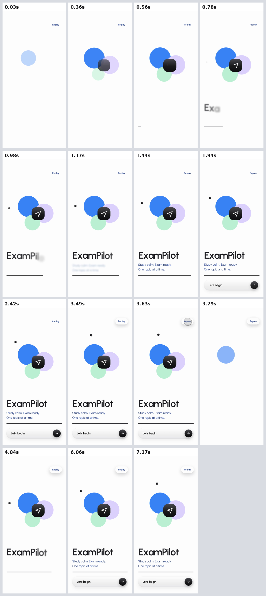

Exact spec from the live design (every animation, timing and easing)

| time | trigger / element | animation | from → to | dur ms | delay ms | easing | loops | React Native |
|---|---|---|---|---|---|---|---|---|
| 0.00s | shape 274×274 | `ring` | opacity:0; transform:scale(0.85) → opacity:1; transform:scale(1) | 1100 | 0 | `bezier(0.2, 0.8, 0.2, 1)` |  | motion.bloom() |
| 0.00s | shape 189×189 | `ring` | opacity:0; transform:scale(0.85) → opacity:1; transform:scale(1) | 1100 | 120 | `bezier(0.2, 0.8, 0.2, 1)` |  | motion.bloom() |
| 0.00s | block 320×320 | `orbit` | transform:none → transform:rotate(360deg) | 14000 | 0 | `linear` | ∞ | withRepeat(withTiming(360deg), -1) |
| 0.00s | shape 13×13 | `bloom` | opacity:0; transform:scale(0.6) → opacity:1; transform:scale(1) | 900 | 700 | `bezier(0.2, 0.9, 0.25, 1.08)` |  | motion.bloom() |
| 0.00s | shape 9×9 | `bloom` | opacity:0; transform:scale(0.6) → opacity:1; transform:scale(1) | 900 | 820 | `bezier(0.2, 0.9, 0.25, 1.08)` |  | motion.bloom() |
| 0.00s | shape 78×78 | `bloom` | opacity:0; transform:scale(0.6) → opacity:1; transform:scale(1) | 900 | 0 | `bezier(0.2, 0.9, 0.25, 1.08)` |  | motion.bloom() |
| 0.00s | shape 71×71 | `bloom` | opacity:0; transform:scale(0.6) → opacity:1; transform:scale(1) | 900 | 140 | `bezier(0.2, 0.9, 0.25, 1.08)` |  | motion.bloom() |
| 0.00s | shape 58×58 | `bloom` | opacity:0; transform:scale(0.6) → opacity:1; transform:scale(1) | 900 | 280 | `bezier(0.2, 0.9, 0.25, 1.08)` |  | motion.bloom() |
| 0.00s | shape 56×56 | `bloom` | opacity:0; transform:scale(0.7) → opacity:1; transform:scale(1) | 500 | 300 | `bezier(0.2, 0.9, 0.25, 1.1)` |  | motion.bloom() |
| 0.00s | SVG stroke 21×21 | `draw` | strokeDashoffset:60px → strokeDashoffset:0px | 700 | 500 | `bezier(0.6, 0, 0.2, 1)` |  | strokeDashoffset via useAnimatedProps |
| 0.00s | “E” | `letter` | opacity:0; transform:translateY(22px); filter:blur(12px) → opacity:1; transform:none; filter:blur(0px) | 600 | 700 | `bezier(0.05, 0.7, 0.1, 1)` |  | SplashIntro letters (BlurIn delay) |
| 0.00s | “x” | `letter` | opacity:0; transform:translateY(22px); filter:blur(12px) → opacity:1; transform:none; filter:blur(0px) | 600 | 745 | `bezier(0.05, 0.7, 0.1, 1)` |  | SplashIntro letters (BlurIn delay) |
| 0.00s | “a” | `letter` | opacity:0; transform:translateY(22px); filter:blur(12px) → opacity:1; transform:none; filter:blur(0px) | 600 | 790 | `bezier(0.05, 0.7, 0.1, 1)` |  | SplashIntro letters (BlurIn delay) |
| 0.00s | “m” | `letter` | opacity:0; transform:translateY(22px); filter:blur(12px) → opacity:1; transform:none; filter:blur(0px) | 600 | 835 | `bezier(0.05, 0.7, 0.1, 1)` |  | SplashIntro letters (BlurIn delay) |
| 0.00s | “P” | `letter` | opacity:0; transform:translateY(22px); filter:blur(12px) → opacity:1; transform:none; filter:blur(0px) | 600 | 880 | `bezier(0.05, 0.7, 0.1, 1)` |  | SplashIntro letters (BlurIn delay) |
| 0.00s | “i” | `letter` | opacity:0; transform:translateY(22px); filter:blur(12px) → opacity:1; transform:none; filter:blur(0px) | 600 | 925 | `bezier(0.05, 0.7, 0.1, 1)` |  | SplashIntro letters (BlurIn delay) |
| 0.00s | “l” | `letter` | opacity:0; transform:translateY(22px); filter:blur(12px) → opacity:1; transform:none; filter:blur(0px) | 600 | 970 | `bezier(0.05, 0.7, 0.1, 1)` |  | SplashIntro letters (BlurIn delay) |
| 0.00s | “o” | `letter` | opacity:0; transform:translateY(22px); filter:blur(12px) → opacity:1; transform:none; filter:blur(0px) | 600 | 1015 | `bezier(0.05, 0.7, 0.1, 1)` |  | SplashIntro letters (BlurIn delay) |
| 0.00s | “t” | `letter` | opacity:0; transform:translateY(22px); filter:blur(12px) → opacity:1; transform:none; filter:blur(0px) | 600 | 1060 | `bezier(0.05, 0.7, 0.1, 1)` |  | SplashIntro letters (BlurIn delay) |
| 0.00s | “Study calm. Exam ready. One topic…” | `fade` | opacity:0; transform:translateY(10px); filter:blur(8px) → opacity:1; transform:none; filter:blur(0px) | 600 | 1200 | `bezier(0.05, 0.7, 0.1, 1)` |  | BlurIn |
| 0.00s | shape 0×4 | `bar` | transform:scaleX(0) → transform:scaleX(1) | 1500 | 400 | `bezier(0.4, 0, 0.2, 1)` |  | scale 0→1, transformOrigin left/bottom |
| 0.00s | “Let's begin” | `fade` | opacity:0; transform:translateY(10px); filter:blur(8px) → opacity:1; transform:none; filter:blur(0px) | 600 | 1700 | `bezier(0.05, 0.7, 0.1, 1)` |  | BlurIn |
| **3.40s** | 👆 **tap text=Replay** | | | | | | | |
| 3.40s | “Replay” | `box-shadow` | boxShadow:none → boxShadow:rgba(27, 27, 31, 0.22) 0px 10px 24px 0px | 220 | 0 | `ease` |  | Surface kind swap |
| 3.55s | “Replay” | `filter` | filter:none → filter:blur(0.6px) | 220 | 0 | `ease` |  | (press blur → haptic in RN) |
| 3.55s | “Replay” | `transform` | transform:translateY(-0.97px) → transform:scale(0.96) | 180 | 0 | `bezier(0.2, 0, 0, 1)` |  | PressableScale / withSpring |
| 3.70s | “Replay” | `box-shadow` | boxShadow:none → boxShadow:rgba(27, 27, 31, 0.22) 0px 10px 24px 0px | 220 | 0 | `ease` |  | Surface kind swap |
| 3.70s | block 320×320 | `orbit` | transform:none → transform:rotate(360deg) | 14000 | 0 | `linear` | ∞ | withRepeat(withTiming(360deg), -1) |

---

## 02 · Login

Login screen arrives with a staggered blur-in; the Sign in / Create account switch slides a glossy black pill; the email field gets a crisp ink focus ring.

<video src="02-login.mp4" poster="posters/02-login.jpg" controls muted loop playsinline width="300"></video>

▶ **Video:** [`02-login.mp4`](02-login.mp4) · **Key frames (for AI):** [`frames/02-login.png`](frames/02-login.png) · **Raw timeline:** [`timeline/02-login.json`](timeline/02-login.json)

### Step by step

1. **0.00s** — Page blurs in: blur 10 → 0 px and rises 10 pt in 360 ms `bezier(.2,.8,.2,1)`. Logo, title, switch and fields follow 60 ms apart.
2. **1.30s** — Tap **Create account**: the glossy black slider springs to the right (400/34); labels swap colour (white on ink).
3. **1.50s** — Title text changes to “Let’s get you set up” and the form blurs back in; the primary button reads **Create account**.
4. **2.67s** — Tap **Sign in**: slider springs back; the page content blurs in again.
5. **3.83s** — Tap the email field: background goes #F4F6FA → white with a 2 pt ink ring (180 ms). Typed text appears normally.

### Build it in React Native

- `<SegmentedControl>` for the switch (glossy slider, spring 400/34).
- Wrap logo / title / switch / each field in `<BlurIn index={0…5}>`; key the title block by mode so it re-blurs on switch.
- Fields: §6.3 of the guide (focus = white + 2 pt ink border).

### Key frames

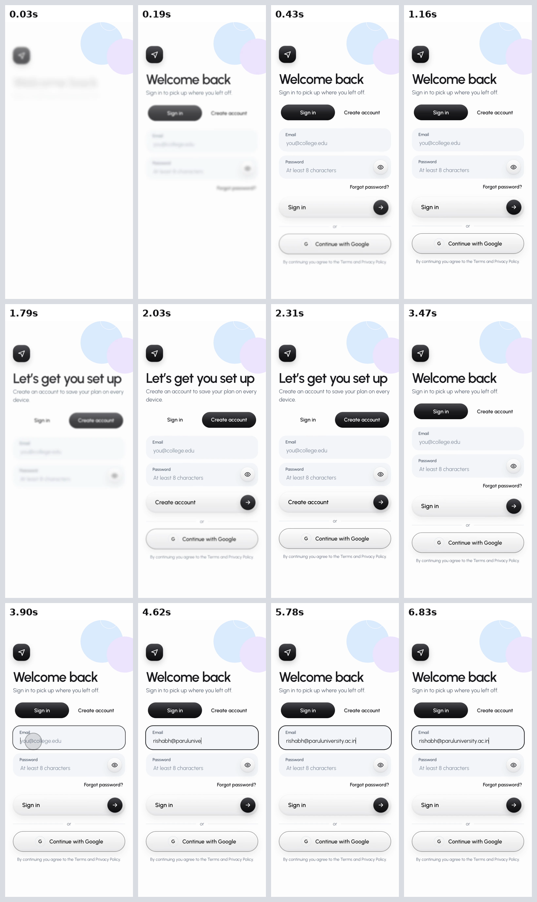

Exact spec from the live design (every animation, timing and easing)

| time | trigger / element | animation | from → to | dur ms | delay ms | easing | loops | React Native |
|---|---|---|---|---|---|---|---|---|
| 0.00s | shape 52×52 | `rise` | opacity:0; transform:translateY(12px); filter:blur(10px) → opacity:1; transform:none; filter:blur(0px) | 480 | 0 | `bezier(0.05, 0.7, 0.1, 1)` |  | BlurIn index={n} |
| 0.00s | “Welcome back Sign in to pick up w…” | `rise` | opacity:0; transform:translateY(12px); filter:blur(10px) → opacity:1; transform:none; filter:blur(0px) | 480 | 60 | `bezier(0.05, 0.7, 0.1, 1)` |  | BlurIn index={n} |
| 0.00s | “Account” (div) | `rise` | opacity:0; transform:translateY(12px); filter:blur(10px) → opacity:1; transform:none; filter:blur(0px) | 480 | 120 | `bezier(0.05, 0.7, 0.1, 1)` |  | BlurIn index={n} |
| 0.00s | “Email Password Forgot password?” | `rise` | opacity:0; transform:translateY(12px); filter:blur(10px) → opacity:1; transform:none; filter:blur(0px) | 480 | 180 | `bezier(0.05, 0.7, 0.1, 1)` |  | BlurIn index={n} |
| 0.00s | “Sign in” | `rise` | opacity:0; transform:translateY(12px); filter:blur(10px) → opacity:1; transform:none; filter:blur(0px) | 480 | 240 | `bezier(0.05, 0.7, 0.1, 1)` |  | BlurIn index={n} |
| 0.00s | “or G Continue with Google By cont…” | `rise` | opacity:0; transform:translateY(12px); filter:blur(10px) → opacity:1; transform:none; filter:blur(0px) | 480 | 300 | `bezier(0.05, 0.7, 0.1, 1)` |  | BlurIn index={n} |
| **1.30s** | 👆 **tap text=Create account >> nth=0** | | | | | | | |
| 1.60s | shape 52×52 | `rise` | opacity:0; transform:translateY(12px); filter:blur(10px) → opacity:1; transform:none; filter:blur(0px) | 480 | 0 | `bezier(0.05, 0.7, 0.1, 1)` |  | BlurIn index={n} |
| 1.60s | “Let’s get you set up Create an ac…” | `rise` | opacity:0; transform:translateY(12px); filter:blur(10px) → opacity:1; transform:none; filter:blur(0px) | 480 | 60 | `bezier(0.05, 0.7, 0.1, 1)` |  | BlurIn index={n} |
| 1.60s | “Account” (div) | `rise` | opacity:0; transform:translateY(12px); filter:blur(10px) → opacity:1; transform:none; filter:blur(0px) | 480 | 120 | `bezier(0.05, 0.7, 0.1, 1)` |  | BlurIn index={n} |
| 1.60s | “Email Password” | `rise` | opacity:0; transform:translateY(12px); filter:blur(10px) → opacity:1; transform:none; filter:blur(0px) | 480 | 180 | `bezier(0.05, 0.7, 0.1, 1)` |  | BlurIn index={n} |
| 1.60s | “Create account” | `rise` | opacity:0; transform:translateY(12px); filter:blur(10px) → opacity:1; transform:none; filter:blur(0px) | 480 | 240 | `bezier(0.05, 0.7, 0.1, 1)` |  | BlurIn index={n} |
| 1.60s | “or G Continue with Google By cont…” | `rise` | opacity:0; transform:translateY(12px); filter:blur(10px) → opacity:1; transform:none; filter:blur(0px) | 480 | 300 | `bezier(0.05, 0.7, 0.1, 1)` |  | BlurIn index={n} |
| **2.67s** | 👆 **tap text=Sign in >> nth=0** | | | | | | | |
| **3.83s** | 👆 **type "rishabh@paruluniversity.ac.in" into input[type=email]** | | | | | | | |
| 3.85s | “Email” | `box-shadow` | boxShadow:none → boxShadow:rgb(27, 27, 31) 0px 0px 0px 2px | 180 | 0 | `ease` |  | Surface kind swap |
| 3.95s | block 53×53 | `opacity` | opacity:0.85 → opacity:0 | 153 | 0 | `ease` |  | withTiming opacity |
| 3.95s | block 53×53 | `transform` | transform:scale(1.05) → transform:scale(1.4) | 153 | 0 | `ease` |  | PressableScale / withSpring |

---

## 03 · Your details

Profile step: the progress segment fills, fields blur-rise in sequence, typing updates the avatar initials, and the selected semester chip turns glossy black.

<video src="03-your-details.mp4" poster="posters/03-your-details.jpg" controls muted loop playsinline width="300"></video>

▶ **Video:** [`03-your-details.mp4`](03-your-details.mp4) · **Key frames (for AI):** [`frames/03-your-details.png`](frames/03-your-details.png) · **Raw timeline:** [`timeline/03-your-details.json`](timeline/03-your-details.json)

### Step by step

1. **0.00s** — Fields rise 12 pt and sharpen (blur 10 → 0) over 480 ms, 60 ms apart.
2. **0.20s** — Step 2 of 3 segment fills `scaleX` 0 → 1 from the left, 600 ms.
3. **1.30s** — Typing the first name updates the avatar initials; the avatar pops .85 → 1 (320 ms).
4. **2.53s** — Tap a semester chip: it turns glossy ink with white text; the previous one goes back to the outline style.
5. **3.60s** — Another chip: the same swap, with a small pop on the new one.

### Build it in React Native

- Step bar: `Animated.View` with `transformOrigin: 'left'` and `scaleX` withTiming 600 ms.
- Avatar: `popIn()` keyed by the initials.
- Semester chips: `SoftButton variant={selected ? 'ink' : 'outline'}`.

### Key frames

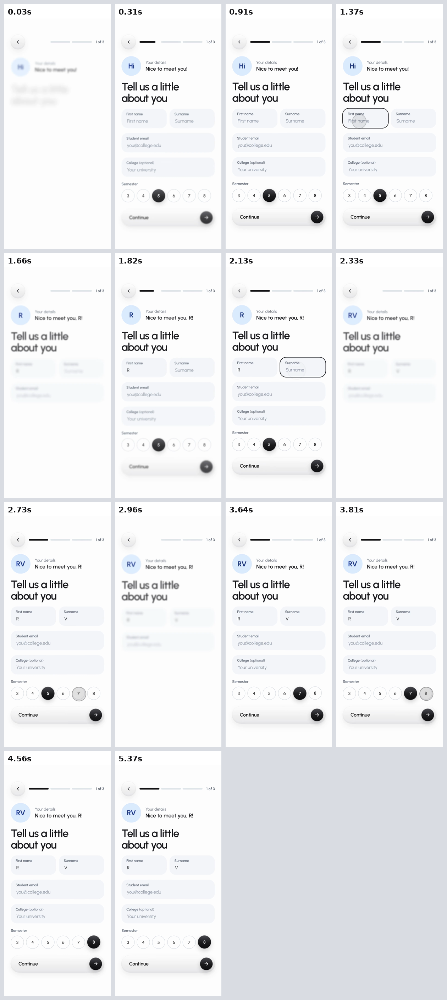

Exact spec from the live design (every animation, timing and easing)

| time | trigger / element | animation | from → to | dur ms | delay ms | easing | loops | React Native |
|---|---|---|---|---|---|---|---|---|
| 0.00s | shape 8×6 | `grow` | transform:scaleX(0) → transform:scaleX(1) | 600 | 200 | `bezier(0.2, 0.8, 0.2, 1)` |  | scaleX 0→1, transformOrigin left |
| 0.00s | “Hi Your details Nice to meet you!” | `rise` | opacity:0; transform:translateY(12px); filter:blur(10px) → opacity:1; transform:none; filter:blur(0px) | 480 | 0 | `bezier(0.05, 0.7, 0.1, 1)` |  | BlurIn index={n} |
| 0.00s | “Hi” | `pop` | transform:scale(0.85) → transform:scale(1) | 320 | 0 | `bezier(0.2, 0.9, 0.25, 1.2)` |  | withSequence scale .9→1.12→1 (AnimatedCheckbox / popIn) |
| 0.00s | “Tell us a little about you” | `rise` | opacity:0; transform:translateY(12px); filter:blur(10px) → opacity:1; transform:none; filter:blur(0px) | 480 | 60 | `bezier(0.05, 0.7, 0.1, 1)` |  | BlurIn index={n} |
| 0.00s | “First name Surname” | `rise` | opacity:0; transform:translateY(12px); filter:blur(10px) → opacity:1; transform:none; filter:blur(0px) | 480 | 120 | `bezier(0.05, 0.7, 0.1, 1)` |  | BlurIn index={n} |
| 0.00s | “Student email” | `rise` | opacity:0; transform:translateY(12px); filter:blur(10px) → opacity:1; transform:none; filter:blur(0px) | 480 | 120 | `bezier(0.05, 0.7, 0.1, 1)` |  | BlurIn index={n} |
| 0.00s | “College (optional)” | `rise` | opacity:0; transform:translateY(12px); filter:blur(10px) → opacity:1; transform:none; filter:blur(0px) | 480 | 180 | `bezier(0.05, 0.7, 0.1, 1)` |  | BlurIn index={n} |
| 0.00s | “Semester” (div) | `rise` | opacity:0; transform:translateY(12px); filter:blur(10px) → opacity:1; transform:none; filter:blur(0px) | 480 | 180 | `bezier(0.05, 0.7, 0.1, 1)` |  | BlurIn index={n} |
| 0.00s | “5” | `pop` | transform:scale(0.85) → transform:scale(1) | 320 | 0 | `bezier(0.2, 0.9, 0.25, 1.2)` |  | withSequence scale .9→1.12→1 (AnimatedCheckbox / popIn) |
| 0.00s | “Continue” | `rise` | opacity:0; transform:translateY(12px); filter:blur(10px) → opacity:1; transform:none; filter:blur(0px) | 480 | 240 | `bezier(0.05, 0.7, 0.1, 1)` |  | BlurIn index={n} |
| **1.30s** | 👆 **type "Rishabh" into input[autocomplete=given-name]** | | | | | | | |
| 1.30s | “First name” | `box-shadow` | boxShadow:none → boxShadow:rgb(27, 27, 31) 0px 0px 0px 2px | 180 | 0 | `ease` |  | Surface kind swap |
| 1.40s | block 47×47 | `opacity` | opacity:0.85 → opacity:0 | 153 | 0 | `ease` |  | withTiming opacity |
| 1.55s | shape 0×6 | `grow` | transform:scaleX(0) → transform:scaleX(1) | 600 | 200 | `bezier(0.2, 0.8, 0.2, 1)` |  | scaleX 0→1, transformOrigin left |
| 1.55s | “R Your details Nice to meet you, …” | `rise` | opacity:0; transform:translateY(12px); filter:blur(10px) → opacity:1; transform:none; filter:blur(0px) | 480 | 0 | `bezier(0.05, 0.7, 0.1, 1)` |  | BlurIn index={n} |
| 1.55s | “R” | `pop` | transform:scale(0.85) → transform:scale(1) | 320 | 0 | `bezier(0.2, 0.9, 0.25, 1.2)` |  | withSequence scale .9→1.12→1 (AnimatedCheckbox / popIn) |
| 1.55s | “Semester” (div) | `rise` | opacity:0; transform:translateY(12px); filter:blur(10px) → opacity:1; transform:none; filter:blur(0px) | 480 | 180 | `bezier(0.05, 0.7, 0.1, 1)` |  | BlurIn index={n} |
| 1.95s | “Surname” | `box-shadow` | boxShadow:none → boxShadow:rgb(27, 27, 31) 0px 0px 0px 2px | 180 | 0 | `ease` |  | Surface kind swap |
| **1.97s** | 👆 **type "Vyas" into input[autocomplete=family-name]** | | | | | | | |
| 2.05s | block 53×53 | `opacity` | opacity:0.85 → opacity:0 | 153 | 0 | `ease` |  | withTiming opacity |
| 2.05s | block 53×53 | `transform` | transform:scale(1.05) → transform:scale(1.4) | 153 | 0 | `ease` |  | PressableScale / withSpring |
| 2.20s | “RV Your details Nice to meet you,…” | `rise` | opacity:0; transform:translateY(12px); filter:blur(10px) → opacity:1; transform:none; filter:blur(0px) | 480 | 0 | `bezier(0.05, 0.7, 0.1, 1)` |  | BlurIn index={n} |
| 2.20s | “RV” | `pop` | transform:scale(0.85) → transform:scale(1) | 320 | 0 | `bezier(0.2, 0.9, 0.25, 1.2)` |  | withSequence scale .9→1.12→1 (AnimatedCheckbox / popIn) |
| **2.53s** | 👆 **tap [aria-label="Semester"] button >> nth=4** | | | | | | | |
| 2.65s | “7” | `filter` | filter:none → filter:blur(0.6px) | 220 | 0 | `ease` |  | (press blur → haptic in RN) |
| 2.65s | “7” | `transform` | transform:translateY(-0.97px) → transform:scale(0.96) | 180 | 0 | `bezier(0.2, 0, 0, 1)` |  | PressableScale / withSpring |
| 2.85s | “RV Your details Nice to meet you,…” | `rise` | opacity:0; transform:translateY(12px); filter:blur(10px) → opacity:1; transform:none; filter:blur(0px) | 480 | 0 | `bezier(0.05, 0.7, 0.1, 1)` |  | BlurIn index={n} |
| 2.85s | “7” | `pop` | transform:scale(0.85) → transform:scale(1) | 320 | 0 | `bezier(0.2, 0.9, 0.25, 1.2)` |  | withSequence scale .9→1.12→1 (AnimatedCheckbox / popIn) |
| **3.60s** | 👆 **tap [aria-label="Semester"] button >> nth=5** | | | | | | | |
| 3.75s | “8” | `filter` | filter:none → filter:blur(0.6px) | 220 | 0 | `ease` |  | (press blur → haptic in RN) |
| 3.75s | “8” | `transform` | transform:translateY(-0.97px) → transform:scale(0.96) | 180 | 0 | `bezier(0.2, 0, 0, 1)` |  | PressableScale / withSpring |
| 3.90s | “RV” | `pop` | transform:scale(0.85) → transform:scale(1) | 320 | 0 | `bezier(0.2, 0.9, 0.25, 1.2)` |  | withSequence scale .9→1.12→1 (AnimatedCheckbox / popIn) |
| 3.90s | “8” | `pop` | transform:scale(0.85) → transform:scale(1) | 320 | 0 | `bezier(0.2, 0.9, 0.25, 1.2)` |  | withSequence scale .9→1.12→1 (AnimatedCheckbox / popIn) |

---

## 04 · Admit card

Upload state → scanning state → results. The upload badge bobs gently; scanning shows a moving line with a blue glow; results rows blur in one after another.

<video src="04-admit-card.mp4" poster="posters/04-admit-card.jpg" controls muted loop playsinline width="300"></video>

▶ **Video:** [`04-admit-card.mp4`](04-admit-card.mp4) · **Key frames (for AI):** [`frames/04-admit-card.png`](frames/04-admit-card.png) · **Raw timeline:** [`timeline/04-admit-card.json`](timeline/04-admit-card.json)

### Step by step

1. **0.00s** — Cards fade up (420 ms); the upload badge bobs ±6 pt on a 2.4 s loop.
2. **1.30s** — Tap **Try a sample** → the “One moment…” state blurs in.
3. **1.60s** — Scan line (#151517 with a `0 0 18px 6px rgba(59,130,246,.55)` glow) sweeps top → bottom every 1.6 s; skeleton rows pulse; the three dots blink.
4. **2.00s** — The step bar segment grows (600 ms, 200 ms delay).
5. **2.30s** — “We found 3 exams”: SE / DAA / DDS rows fade up one after another, then the dashed “Add an exam we missed” and the primary button.
6. **5.97s** — Scroll down to the primary **Looks right — build my plan**.

### Build it in React Native

- Badge bob + scan line: `withRepeat(withTiming(...), -1, true)` on `translateY`.
- Results: `<BlurIn soft delay={i * 120}>` per row.
- Turn loops off with `useReducedMotion()`.

### Key frames

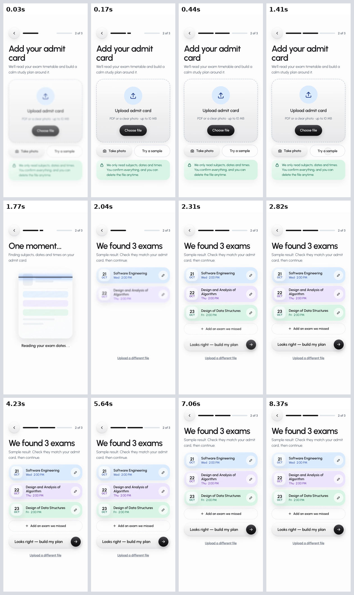

Exact spec from the live design (every animation, timing and easing)

| time | trigger / element | animation | from → to | dur ms | delay ms | easing | loops | React Native |
|---|---|---|---|---|---|---|---|---|
| 0.00s | shape 16×6 | `grow` | transform:scaleX(0) → transform:scaleX(1) | 600 | 200 | `bezier(0.2, 0.8, 0.2, 1)` |  | scaleX 0→1, transformOrigin left |
| 0.00s | “Upload admit card PDF or a clear …” | `fadeup` | opacity:0; transform:translateY(8px); filter:blur(8px) → opacity:1; transform:none; filter:blur(0px) | 420 | 0 | `bezier(0.05, 0.7, 0.1, 1)` |  | BlurIn soft |
| 0.00s | shape 84×84 | `bob` | transform:translateY(0px) → transform:translateY(0px) | 2400 | 0 | `ease-in-out` | ∞ | withRepeat translateY ± |
| **1.30s** | 👆 **tap text=Try a sample** | | | | | | | |
| 1.45s | “Try a sample” | `filter` | filter:none → filter:blur(0.6px) | 220 | 0 | `ease` |  | (press blur → haptic in RN) |
| 1.45s | “Try a sample” | `transform` | transform:translateY(-0.97px) → transform:scale(0.96) | 180 | 0 | `bezier(0.2, 0, 0, 1)` |  | PressableScale / withSpring |
| 1.60s | shape 0×6 | `grow` | transform:scaleX(0) → transform:scaleX(1) | 600 | 200 | `bezier(0.2, 0.8, 0.2, 1)` |  | scaleX 0→1, transformOrigin left |
| 1.60s | “Reading your exam dates . . .” | `fadeup` | opacity:0; transform:translateY(8px); filter:blur(8px) → opacity:1; transform:none; filter:blur(0px) | 420 | 0 | `bezier(0.05, 0.7, 0.1, 1)` |  | BlurIn soft |
| 1.60s | 7 elements: shape 122×9, shape 147×9, shape 210×30… | `shine` | opacity:0.55 → opacity:0.55 | 1400 | 0 | `ease-in-out` | ∞ | withRepeat opacity |
| 1.60s | shape 250×3 | `scan` | top:8% → top:88% | 1600 | 0 | `bezier(0.45, 0, 0.55, 1)` | ∞ | withRepeat translateY |
| 1.60s | “.” | `dot` | opacity:0.25 → opacity:0.25 | 1200 | 0 | `ease-in-out` | ∞ | withRepeat opacity (staggered) |
| 1.60s | “.” | `dot` | opacity:0.25 → opacity:0.25 | 1200 | 150 | `ease-in-out` | ∞ | withRepeat opacity (staggered) |
| 1.60s | “.” | `dot` | opacity:0.25 → opacity:0.25 | 1200 | 300 | `ease-in-out` | ∞ | withRepeat opacity (staggered) |
| 1.90s | shape 48×6 | `grow` | transform:scaleX(0) → transform:scaleX(1) | 600 | 200 | `bezier(0.2, 0.8, 0.2, 1)` |  | scaleX 0→1, transformOrigin left |
| 1.90s | “21 OCT Software Engineering Wed ·…” | `fadeup` | opacity:0; transform:translateY(8px); filter:blur(8px) → opacity:1; transform:none; filter:blur(0px) | 420 | 0 | `bezier(0.05, 0.7, 0.1, 1)` |  | BlurIn soft |
| 1.90s | “22 OCT Design and Analysis of Alg…” | `fadeup` | opacity:0; transform:translateY(8px); filter:blur(8px) → opacity:1; transform:none; filter:blur(0px) | 420 | 120 | `bezier(0.05, 0.7, 0.1, 1)` |  | BlurIn soft |
| 1.90s | “23 OCT Design of Data Structures …” | `fadeup` | opacity:0; transform:translateY(8px); filter:blur(8px) → opacity:1; transform:none; filter:blur(0px) | 420 | 240 | `bezier(0.05, 0.7, 0.1, 1)` |  | BlurIn soft |
| 1.90s | “Add an exam we missed” | `fadeup` | opacity:0; transform:translateY(8px); filter:blur(8px) → opacity:1; transform:none; filter:blur(0px) | 420 | 320 | `bezier(0.05, 0.7, 0.1, 1)` |  | BlurIn soft |
| 1.90s | “Looks right — build my plan” | `fadeup` | opacity:0; transform:translateY(8px); filter:blur(8px) → opacity:1; transform:none; filter:blur(0px) | 420 | 320 | `bezier(0.05, 0.7, 0.1, 1)` |  | BlurIn soft |
| **5.97s** | 👆 **scroll to y=400** | | | | | | | |

---

## 05 · Plan ready

Celebration screen: the black success badge pops, its tick draws, 14 coloured dots burst outward, then stat tiles and the plan list rise in.

<video src="05-plan-ready.mp4" poster="posters/05-plan-ready.jpg" controls muted loop playsinline width="300"></video>

▶ **Video:** [`05-plan-ready.mp4`](05-plan-ready.mp4) · **Key frames (for AI):** [`frames/05-plan-ready.png`](frames/05-plan-ready.png) · **Raw timeline:** [`timeline/05-plan-ready.json`](timeline/05-plan-ready.json)

### Step by step

1. **0.00s** — Success badge (104, glossy black) pops scale .6 → 1 in 700 ms.
2. **0.15s** — 14 dots (blue / violet / green / ink) fly out from the badge centre and fade, 1100 ms.
3. **0.30s** — Stat tiles and the day list fade up (460 ms).
4. **0.38s** — White tick draws in 420 ms.
5. **3.20s** — Scroll to the plan list and the two buttons.

### Build it in React Native

- Badge: `popIn()`; tick: `strokeDashoffset` via `useAnimatedProps`.
- Burst: 14 absolutely-placed dots, each with an `entering` Keyframe to its own x/y + fade; also call `celebrate.current?.fire()`.

### Key frames

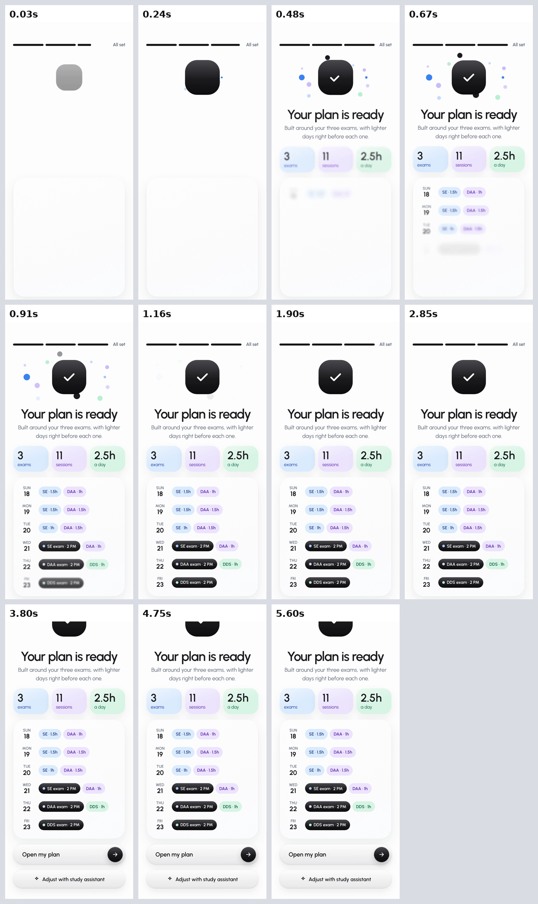

Exact spec from the live design (every animation, timing and easing)

| time | trigger / element | animation | from → to | dur ms | delay ms | easing | loops | React Native |
|---|---|---|---|---|---|---|---|---|
| 0.00s | shape 0×6 | `grow` | transform:scaleX(0) → transform:scaleX(1) | 600 | 0 | `bezier(0.2, 0.8, 0.2, 1)` |  | scaleX 0→1, transformOrigin left |
| 0.00s | 3 elements: shape 12×12, shape 16×16, shape 8×8 | `burst` | opacity:1; transform:translate(-50%, -50%) scale(0.4) → opacity:0; transform:translate(calc(-50% + 110px), -50%) scale(1) | 1100 | 150 | `bezier(0.15, 0.8, 0.3, 1)` |  | Keyframe out from centre (+ CelebrateLayer) |
| 0.00s | 3 elements: shape 12×12, shape 16×16, shape 20×20 | `burst` | opacity:1; transform:translate(-50%, -50%) scale(0.4) → opacity:0; transform:translate(calc(-50% + 119px), calc(-50% + 31px)) … | 1100 | 190 | `bezier(0.15, 0.8, 0.3, 1)` |  | Keyframe out from centre (+ CelebrateLayer) |
| 0.00s | 3 elements: shape 16×16, shape 20×20, shape 8×8 | `burst` | opacity:1; transform:translate(-50%, -50%) scale(0.4) → opacity:0; transform:translate(calc(-50% + 96px), calc(-50% + 66px)) s… | 1100 | 230 | `bezier(0.15, 0.8, 0.3, 1)` |  | Keyframe out from centre (+ CelebrateLayer) |
| 0.00s | 3 elements: shape 12×12, shape 20×20, shape 8×8 | `burst` | opacity:1; transform:translate(-50%, -50%) scale(0.4) → opacity:0; transform:translate(calc(-50% + 24px), calc(-50% + 59px)) s… | 1100 | 270 | `bezier(0.15, 0.8, 0.3, 1)` |  | Keyframe out from centre (+ CelebrateLayer) |
| 0.00s | 2 elements: shape 12×12, shape 8×8 | `burst` | opacity:1; transform:translate(-50%, -50%) scale(0.4) → opacity:0; transform:translate(calc(-50% - 29px), calc(-50% + 71px)) s… | 1100 | 310 | `bezier(0.15, 0.8, 0.3, 1)` |  | Keyframe out from centre (+ CelebrateLayer) |
| 0.00s | shape 62×62 | `badge` | opacity:0; transform:scale(0.6) → opacity:1; transform:scale(1) | 700 | 0 | `bezier(0.2, 0.9, 0.25, 1.25)` |  | popIn() |
| 0.00s | SVG stroke 19×13 | `draw` | strokeDashoffset:30px → strokeDashoffset:0px | 420 | 380 | `ease-out` |  | strokeDashoffset via useAnimatedProps |
| 0.00s | “Your plan is ready Built around y…” | `fadeup` | opacity:0; transform:translateY(8px); filter:blur(8px) → opacity:1; transform:none; filter:blur(0px) | 460 | 300 | `bezier(0.05, 0.7, 0.1, 1)` |  | BlurIn soft |
| 0.00s | “3 exams 11 sessions 2.5h a day” | `fadeup` | opacity:0; transform:translateY(8px); filter:blur(8px) → opacity:1; transform:none; filter:blur(0px) | 460 | 420 | `bezier(0.05, 0.7, 0.1, 1)` |  | BlurIn soft |
| 0.00s | “SUN 18 SE · 1.5h DAA · 1h” | `fadeup` | opacity:0; transform:translateY(8px); filter:blur(8px) → opacity:1; transform:none; filter:blur(0px) | 460 | 520 | `bezier(0.05, 0.7, 0.1, 1)` |  | BlurIn soft |
| 0.00s | “MON 19 SE · 1.5h DAA · 1.5h” | `fadeup` | opacity:0; transform:translateY(8px); filter:blur(8px) → opacity:1; transform:none; filter:blur(0px) | 460 | 590 | `bezier(0.05, 0.7, 0.1, 1)` |  | BlurIn soft |
| 0.00s | “TUE 20 SE · 1h DAA · 1.5h” | `fadeup` | opacity:0; transform:translateY(8px); filter:blur(8px) → opacity:1; transform:none; filter:blur(0px) | 460 | 660 | `bezier(0.05, 0.7, 0.1, 1)` |  | BlurIn soft |
| 0.00s | “WED 21 SE exam · 2 PM DAA · 1h” | `fadeup` | opacity:0; transform:translateY(8px); filter:blur(8px) → opacity:1; transform:none; filter:blur(0px) | 460 | 730 | `bezier(0.05, 0.7, 0.1, 1)` |  | BlurIn soft |
| 0.00s | “THU 22 DAA exam · 2 PM DDS · 1h” | `fadeup` | opacity:0; transform:translateY(8px); filter:blur(8px) → opacity:1; transform:none; filter:blur(0px) | 460 | 800 | `bezier(0.05, 0.7, 0.1, 1)` |  | BlurIn soft |
| 0.00s | “FRI 23 DDS exam · 2 PM” | `fadeup` | opacity:0; transform:translateY(8px); filter:blur(8px) → opacity:1; transform:none; filter:blur(0px) | 460 | 870 | `bezier(0.05, 0.7, 0.1, 1)` |  | BlurIn soft |
| 0.00s | “Open my plan” | `fadeup` | opacity:0; transform:translateY(8px); filter:blur(8px) → opacity:1; transform:none; filter:blur(0px) | 460 | 900 | `bezier(0.05, 0.7, 0.1, 1)` |  | BlurIn soft |
| 0.00s | “Adjust with study assistant” | `fadeup` | opacity:0; transform:translateY(8px); filter:blur(8px) → opacity:1; transform:none; filter:blur(0px) | 460 | 980 | `bezier(0.05, 0.7, 0.1, 1)` |  | BlurIn soft |
| **3.20s** | 👆 **scroll to y=260** | | | | | | | |

---

## 06 · Today

Main screen. The page arrives blurred and sharpens; ticking a revision task pops the glossy checkbox, draws the tick, strikes the title, and fills a progress segment. Finishing all four shows the “Nice work” card.

<video src="06-today.mp4" poster="posters/06-today.jpg" controls muted loop playsinline width="300"></video>

▶ **Video:** [`06-today.mp4`](06-today.mp4) · **Key frames (for AI):** [`frames/06-today.png`](frames/06-today.png) · **Raw timeline:** [`timeline/06-today.json`](timeline/06-today.json)

### Step by step

1. **0.00s** — Whole page blurs in: blur 10 → 0, rise 10 pt, 360 ms `bezier(.2,.8,.2,1)`.
2. **0.00s** — Active tab grows 56 → full width (520 ms `bezier(.2,.9,.25,1.04)`); its label slides in 6 pt from the left after 180 ms (320 ms).
3. **3.20s** — Tap **Master theorem**: the row squeezes to .96.
4. **3.50s** — Checkbox turns glossy black and pops .9 → 1.12 → 1 (260 ms); the white tick draws after 60 ms (220 ms ease-out); title fades to #6B7385 with a strike line; the next segment fills.
5. **4.87s** — Tap **AVL rotations** → same tick; now 4/4 done.
6. **4.92s** — “Nice work, you finished today’s revision!” card fades up from 8 pt with blur 8 → 0 (260 ms).

### Build it in React Native

- `<Screen>` + `<BlurIn index>` per block; see `native/examples/TodayScreen.example.tsx`.
- Rows: `<AnimatedCheckbox>` (same pop / tick / strike timings).
- Completion: `<BlurIn soft>` + `celebrate.current?.fire()` once.

### Key frames

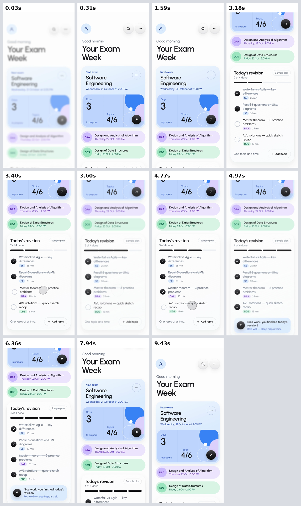

Exact spec from the live design (every animation, timing and easing)

| time | trigger / element | animation | from → to | dur ms | delay ms | easing | loops | React Native |
|---|---|---|---|---|---|---|---|---|
| 0.00s | “Good morning Your Exam Week Next …” | `pagein` | opacity:0; transform:translateY(10px); filter:blur(10px) → opacity:1; transform:none; filter:blur(0px) | 360 | 0 | `bezier(0.2, 0.8, 0.2, 1)` |  | Screen + BlurIn (replays on focus) |
| 0.00s | 4 elements: shape 31×31, shape 74×8 | `pop` | transform:scale(0.9) → transform:scale(1) | 260 | 0 | `bezier(0.2, 0, 0, 1)` |  | withSequence scale .9→1.12→1 (AnimatedCheckbox / popIn) |
| 0.00s | 2× SVG stroke 10×7 | `draw` | strokeDashoffset:24px → strokeDashoffset:0px | 220 | 60 | `ease-out` |  | strokeDashoffset via useAnimatedProps |
| 0.00s | “Today” | `tabin` | maxWidth:56px → maxWidth:320px | 520 | 0 | `bezier(0.2, 0.9, 0.25, 1.04)` |  | TabBar tabGrow (520ms) |
| 0.00s | “Today” | `tablabel` | opacity:0; transform:translateX(-6px) → opacity:1; transform:none | 320 | 180 | `bezier(0.05, 0.7, 0.1, 1)` |  | TabBar label (180ms delay, 320ms) |
| **1.80s** | 👆 **scroll to y=520** | | | | | | | |
| **3.20s** | 👆 **tap text=Master theorem** | | | | | | | |
| 3.35s | “Master theorem — 3 practice probl…” | `filter` | filter:none → filter:blur(0.6px) | 220 | 0 | `ease` |  | (press blur → haptic in RN) |
| 3.35s | “Master theorem — 3 practice probl…” | `transform` | transform:translateY(-0.97px) → transform:scale(0.96) | 180 | 0 | `bezier(0.2, 0, 0, 1)` |  | PressableScale / withSpring |
| 3.50s | 6 elements: shape 27×27, shape 66×7 | `pop` | transform:scale(0.9) → transform:scale(1) | 260 | 0 | `bezier(0.2, 0, 0, 1)` |  | withSequence scale .9→1.12→1 (AnimatedCheckbox / popIn) |
| 3.50s | 3× SVG stroke 10×7 | `draw` | strokeDashoffset:24px → strokeDashoffset:0px | 220 | 60 | `ease-out` |  | strokeDashoffset via useAnimatedProps |
| **4.57s** | 👆 **tap text=AVL rotations** | | | | | | | |
| 4.70s | “AVL rotations — quick sketch reca…” | `filter` | filter:none → filter:blur(0.6px) | 220 | 0 | `ease` |  | (press blur → haptic in RN) |
| 4.70s | “AVL rotations — quick sketch reca…” | `transform` | transform:translateY(-0.97px) → transform:scale(0.96) | 180 | 0 | `bezier(0.2, 0, 0, 1)` |  | PressableScale / withSpring |
| 4.85s | 2 elements: shape 27×27, shape 66×7 | `pop` | transform:scale(0.9) → transform:scale(1) | 260 | 0 | `bezier(0.2, 0, 0, 1)` |  | withSequence scale .9→1.12→1 (AnimatedCheckbox / popIn) |
| 4.85s | SVG stroke 10×7 | `draw` | strokeDashoffset:24px → strokeDashoffset:0px | 220 | 60 | `ease-out` |  | strokeDashoffset via useAnimatedProps |
| 4.85s | “Nice work, you finished today's r…” | `fadeup` | opacity:0; transform:translateY(8px); filter:blur(8px) → opacity:1; transform:none; filter:blur(0px) | 260 | 0 | `bezier(0.05, 0.7, 0.1, 1)` |  | BlurIn soft |
| **7.73s** | 👆 **scroll to y=0** | | | | | | | |

---

## 07 · Calendar

Selecting a day turns it into a glossy black circle and swaps the day list below with a soft blur-up; changing month blurs the whole month card in again.

<video src="07-calendar.mp4" poster="posters/07-calendar.jpg" controls muted loop playsinline width="300"></video>

▶ **Video:** [`07-calendar.mp4`](07-calendar.mp4) · **Key frames (for AI):** [`frames/07-calendar.png`](frames/07-calendar.png) · **Raw timeline:** [`timeline/07-calendar.json`](timeline/07-calendar.json)

### Step by step

1. **0.00s** — Page blurs in (360 ms); event rows fade up (260 ms).
2. **1.40s** — Tap **21**: the day becomes an ink circle; the list below swaps to “Wed, 21 Oct” — rows fade up 8 pt (260 ms).
3. **3.07s** — Tap **23** → list swaps to the DDS exam.
4. **4.73s** — Next month: the month card blurs in again with November.
5. **6.00s** — Previous month: back to October, same blur-in.
6. **7.27s** — Scroll: the floating tab bar stays put.

### Build it in React Native

- Key the day list by date and wrap rows in `<BlurIn soft index={i}>`.
- Key the month grid by month and wrap it in `<BlurIn rise={10}>`.
- Selected day: `Surface kind="ink"` 38 pt circle.

### Key frames

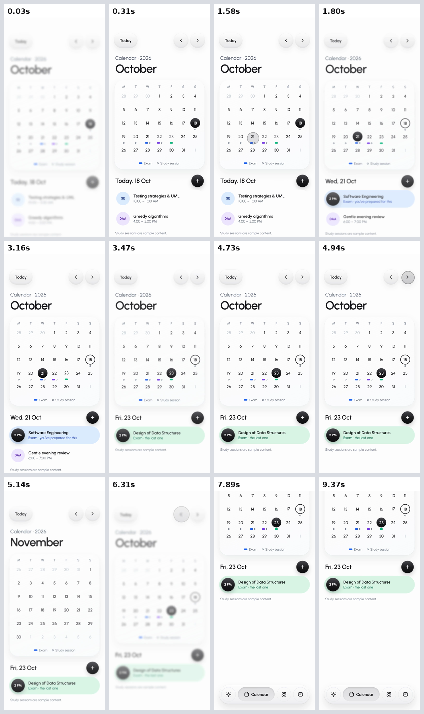

Exact spec from the live design (every animation, timing and easing)

| time | trigger / element | animation | from → to | dur ms | delay ms | easing | loops | React Native |
|---|---|---|---|---|---|---|---|---|
| 0.00s | “Today Calendar · 2026 October M T…” | `pagein` | opacity:0; transform:translateY(10px); filter:blur(10px) → opacity:1; transform:none; filter:blur(0px) | 360 | 0 | `bezier(0.2, 0.8, 0.2, 1)` |  | Screen + BlurIn (replays on focus) |
| 0.00s | “Selected day” (section) | `fadeup` | opacity:0; transform:translateY(8px); filter:blur(8px) → opacity:1; transform:none; filter:blur(0px) | 260 | 0 | `bezier(0.05, 0.7, 0.1, 1)` |  | BlurIn soft |
| 0.00s | “Calendar” | `tabin` | maxWidth:56px → maxWidth:320px | 520 | 0 | `bezier(0.2, 0.9, 0.25, 1.04)` |  | TabBar tabGrow (520ms) |
| 0.00s | “Calendar” | `tablabel` | opacity:0; transform:translateX(-6px) → opacity:1; transform:none | 320 | 180 | `bezier(0.05, 0.7, 0.1, 1)` |  | TabBar label (180ms delay, 320ms) |
| **1.40s** | 👆 **tap [aria-label^="Wednesday 21 October"]** | | | | | | | |
| 1.55s | “Wednesday 21 October, exam” (button) | `filter` | filter:none → filter:blur(0.6px) | 220 | 0 | `ease` |  | (press blur → haptic in RN) |
| 1.55s | “Wednesday 21 October, exam” (button) | `transform` | transform:translateY(-0.97px) → transform:scale(0.96) | 180 | 0 | `bezier(0.2, 0, 0, 1)` |  | PressableScale / withSpring |
| 1.70s | “Selected day” (section) | `fadeup` | opacity:0; transform:translateY(8px); filter:blur(8px) → opacity:1; transform:none; filter:blur(0px) | 260 | 0 | `bezier(0.05, 0.7, 0.1, 1)` |  | BlurIn soft |
| **3.07s** | 👆 **tap [aria-label^="Friday 23 October"]** | | | | | | | |
| 3.20s | “Friday 23 October, exam” (button) | `filter` | filter:none → filter:blur(0.6px) | 220 | 0 | `ease` |  | (press blur → haptic in RN) |
| 3.20s | “Friday 23 October, exam” (button) | `transform` | transform:translateY(-0.97px) → transform:scale(0.96) | 180 | 0 | `bezier(0.2, 0, 0, 1)` |  | PressableScale / withSpring |
| 3.35s | “Selected day” (section) | `fadeup` | opacity:0; transform:translateY(8px); filter:blur(8px) → opacity:1; transform:none; filter:blur(0px) | 260 | 0 | `bezier(0.05, 0.7, 0.1, 1)` |  | BlurIn soft |
| **4.73s** | 👆 **tap [aria-label="Next month"]** | | | | | | | |
| 4.85s | “Next month” (button) | `filter` | filter:none → filter:blur(0.6px) | 220 | 0 | `ease` |  | (press blur → haptic in RN) |
| 4.85s | “Next month” (button) | `transform` | transform:translateY(-0.97px) → transform:scale(0.96) | 180 | 0 | `bezier(0.2, 0, 0, 1)` |  | PressableScale / withSpring |
| 5.05s | “Selected day” (section) | `fadeup` | opacity:0; transform:translateY(8px); filter:blur(8px) → opacity:1; transform:none; filter:blur(0px) | 260 | 0 | `bezier(0.05, 0.7, 0.1, 1)` |  | BlurIn soft |
| **6.00s** | 👆 **tap [aria-label="Previous month"]** | | | | | | | |
| **7.27s** | 👆 **scroll to y=360** | | | | | | | |

---

## 08 · Subjects

Switching SE → DAA → DDS swaps the tinted hero card and the topic list; the selected filter chip turns glossy black.

<video src="08-subjects.mp4" poster="posters/08-subjects.jpg" controls muted loop playsinline width="300"></video>

▶ **Video:** [`08-subjects.mp4`](08-subjects.mp4) · **Key frames (for AI):** [`frames/08-subjects.png`](frames/08-subjects.png) · **Raw timeline:** [`timeline/08-subjects.json`](timeline/08-subjects.json)

### Step by step

1. **0.00s** — Page blurs in; topic segments pop; ticks draw.
2. **1.40s** — Tap **DAA**: chip turns ink; the hero changes to violet and the content fades up (280 ms) with ticks redrawn.
3. **3.27s** — Tap **DDS**: same, green.
4. **5.13s** — Scroll to the topics and Notes & PDFs cards.

### Build it in React Native

- `<FilterChips>` for the row.
- Wrap the subject section in `<BlurIn key={subject} amount={blur.swap} ms={520} rise={0}>`.

### Key frames

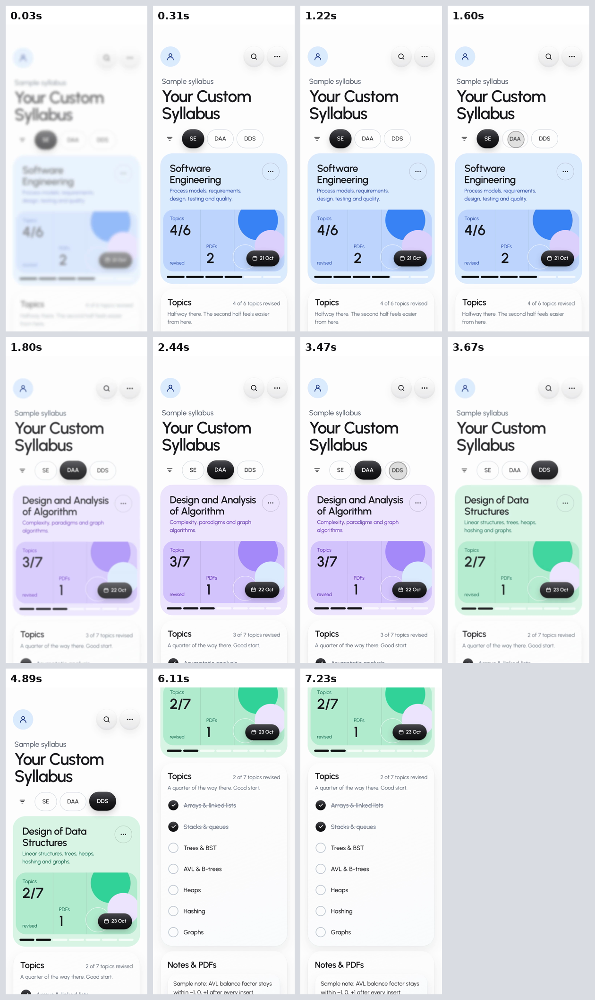

Exact spec from the live design (every animation, timing and easing)

| time | trigger / element | animation | from → to | dur ms | delay ms | easing | loops | React Native |
|---|---|---|---|---|---|---|---|---|
| 0.00s | “Sample syllabus Your Custom Sylla…” | `pagein` | opacity:0; transform:translateY(10px); filter:blur(10px) → opacity:1; transform:none; filter:blur(0px) | 360 | 0 | `bezier(0.2, 0.8, 0.2, 1)` |  | Screen + BlurIn (replays on focus) |
| 0.00s | “Software Engineering” (section) | `fadeup` | opacity:0; transform:translateY(8px); filter:blur(8px) → opacity:1; transform:none; filter:blur(0px) | 280 | 0 | `bezier(0.05, 0.7, 0.1, 1)` |  | BlurIn soft |
| 0.00s | 4× shape 31×31 | `pop` | transform:scale(0.9) → transform:scale(1) | 260 | 0 | `bezier(0.2, 0, 0, 1)` |  | withSequence scale .9→1.12→1 (AnimatedCheckbox / popIn) |
| 0.00s | 4× SVG stroke 10×6 | `draw` | strokeDashoffset:24px → strokeDashoffset:0px | 220 | 60 | `ease-out` |  | strokeDashoffset via useAnimatedProps |
| 0.00s | “Subjects” | `tabin` | maxWidth:56px → maxWidth:320px | 520 | 0 | `bezier(0.2, 0.9, 0.25, 1.04)` |  | TabBar tabGrow (520ms) |
| 0.00s | “Subjects” | `tablabel` | opacity:0; transform:translateX(-6px) → opacity:1; transform:none | 320 | 180 | `bezier(0.05, 0.7, 0.1, 1)` |  | TabBar label (180ms delay, 320ms) |
| **1.40s** | 👆 **tap button:has-text("DAA") >> nth=0** | | | | | | | |
| 1.55s | “DAA” | `filter` | filter:none → filter:blur(0.6px) | 220 | 0 | `ease` |  | (press blur → haptic in RN) |
| 1.55s | “DAA” | `transform` | transform:translateY(-0.97px) → transform:scale(0.96) | 180 | 0 | `bezier(0.2, 0, 0, 1)` |  | PressableScale / withSpring |
| 1.70s | “Design and Analysis of Algorithm” (section) | `fadeup` | opacity:0; transform:translateY(8px); filter:blur(8px) → opacity:1; transform:none; filter:blur(0px) | 280 | 0 | `bezier(0.05, 0.7, 0.1, 1)` |  | BlurIn soft |
| 1.70s | 3× shape 28×28 | `pop` | transform:scale(0.9) → transform:scale(1) | 260 | 0 | `bezier(0.2, 0, 0, 1)` |  | withSequence scale .9→1.12→1 (AnimatedCheckbox / popIn) |
| 1.70s | 3× SVG stroke 10×6 | `draw` | strokeDashoffset:24px → strokeDashoffset:0px | 220 | 60 | `ease-out` |  | strokeDashoffset via useAnimatedProps |
| **3.27s** | 👆 **tap button:has-text("DDS") >> nth=0** | | | | | | | |
| 3.40s | “DDS” | `filter` | filter:none → filter:blur(0.6px) | 220 | 0 | `ease` |  | (press blur → haptic in RN) |
| 3.40s | “DDS” | `transform` | transform:translateY(-0.97px) → transform:scale(0.96) | 180 | 0 | `bezier(0.2, 0, 0, 1)` |  | PressableScale / withSpring |
| 3.55s | SVG stroke 9×6 | `draw` | strokeDashoffset:24px → strokeDashoffset:0px | 220 | 60 | `ease-out` |  | strokeDashoffset via useAnimatedProps |
| **5.13s** | 👆 **scroll to y=520** | | | | | | | |

---

## 09 · Questions

Question cards open like an accordion — the answer blurs in under the question and the chevron button turns ink. Filtering by subject swaps the list.

<video src="09-questions.mp4" poster="posters/09-questions.jpg" controls muted loop playsinline width="300"></video>

▶ **Video:** [`09-questions.mp4`](09-questions.mp4) · **Key frames (for AI):** [`frames/09-questions.png`](frames/09-questions.png) · **Raw timeline:** [`timeline/09-questions.json`](timeline/09-questions.json)

### Step by step

1. **0.00s** — Page blurs in; cards fade up 6 pt.
2. **1.87s** — Tap a question: the card grows, the answer box (#F6F7F9) blurs in, chevron rotates and turns glossy black.
3. **3.53s** — Open another question: same.
4. **5.90s** — Tap **DDS** filter: list swaps to DDS questions with a soft fade-up.

### Build it in React Native

- Card: `Animated.View layout={layout}`; answer inside `<BlurIn soft rise={0}>` rendered only when open.
- Chevron: `withSpring` rotate 0 → 180°, `Surface` clay → ink.

### Key frames

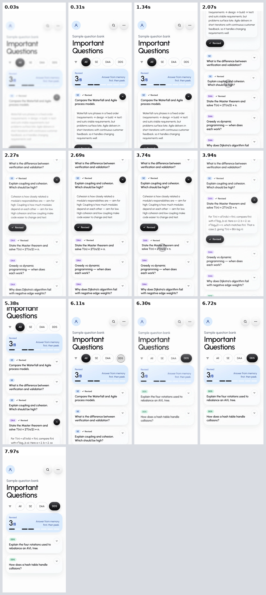

Exact spec from the live design (every animation, timing and easing)

| time | trigger / element | animation | from → to | dur ms | delay ms | easing | loops | React Native |
|---|---|---|---|---|---|---|---|---|
| 0.00s | “Sample question bank Important Qu…” | `pagein` | opacity:0; transform:translateY(10px); filter:blur(10px) → opacity:1; transform:none; filter:blur(0px) | 360 | 0 | `bezier(0.2, 0.8, 0.2, 1)` |  | Screen + BlurIn (replays on focus) |
| 0.00s | 3× shape 33×6 | `pop` | transform:scale(0.9) → transform:scale(1) | 260 | 0 | `bezier(0.2, 0, 0, 1)` |  | withSequence scale .9→1.12→1 (AnimatedCheckbox / popIn) |
| 0.00s | “SE Revised Compare the Waterfall …” | `fadeup` | opacity:0; transform:translateY(8px); filter:blur(8px) → opacity:1; transform:none; filter:blur(0px) | 260 | 0 | `bezier(0.05, 0.7, 0.1, 1)` |  | BlurIn soft |
| 0.00s | 3× “Revised” | `pop` | transform:scale(0.9) → transform:scale(1) | 260 | 0 | `bezier(0.2, 0, 0, 1)` |  | withSequence scale .9→1.12→1 (AnimatedCheckbox / popIn) |
| 0.00s | “Waterfall runs phases in a fixed …” | `fadeup` | opacity:0; transform:translateY(8px); filter:blur(8px) → opacity:1; transform:none; filter:blur(0px) | 260 | 0 | `bezier(0.05, 0.7, 0.1, 1)` |  | BlurIn soft |
| 0.00s | “SE What is the difference between…” | `fadeup` | opacity:0; transform:translateY(8px); filter:blur(8px) → opacity:1; transform:none; filter:blur(0px) | 260 | 0 | `bezier(0.05, 0.7, 0.1, 1)` |  | BlurIn soft |
| 0.00s | “SE Revised Explain coupling and c…” | `fadeup` | opacity:0; transform:translateY(8px); filter:blur(8px) → opacity:1; transform:none; filter:blur(0px) | 260 | 0 | `bezier(0.05, 0.7, 0.1, 1)` |  | BlurIn soft |
| 0.00s | “DAA Revised State the Master theo…” | `fadeup` | opacity:0; transform:translateY(8px); filter:blur(8px) → opacity:1; transform:none; filter:blur(0px) | 260 | 0 | `bezier(0.05, 0.7, 0.1, 1)` |  | BlurIn soft |
| 0.00s | “DAA Greedy vs dynamic programming…” | `fadeup` | opacity:0; transform:translateY(8px); filter:blur(8px) → opacity:1; transform:none; filter:blur(0px) | 260 | 0 | `bezier(0.05, 0.7, 0.1, 1)` |  | BlurIn soft |
| 0.00s | “DAA Why does Dijkstra’s algorithm…” | `fadeup` | opacity:0; transform:translateY(8px); filter:blur(8px) → opacity:1; transform:none; filter:blur(0px) | 260 | 0 | `bezier(0.05, 0.7, 0.1, 1)` |  | BlurIn soft |
| 0.00s | “DDS Explain the four rotations us…” | `fadeup` | opacity:0; transform:translateY(8px); filter:blur(8px) → opacity:1; transform:none; filter:blur(0px) | 260 | 0 | `bezier(0.05, 0.7, 0.1, 1)` |  | BlurIn soft |
| 0.00s | “DDS How does a hash table handle …” | `fadeup` | opacity:0; transform:translateY(8px); filter:blur(8px) → opacity:1; transform:none; filter:blur(0px) | 260 | 0 | `bezier(0.05, 0.7, 0.1, 1)` |  | BlurIn soft |
| 0.00s | “Questions” | `tabin` | maxWidth:56px → maxWidth:320px | 520 | 0 | `bezier(0.2, 0.9, 0.25, 1.04)` |  | TabBar tabGrow (520ms) |
| 0.00s | “Questions” | `tablabel` | opacity:0; transform:translateX(-6px) → opacity:1; transform:none | 320 | 180 | `bezier(0.05, 0.7, 0.1, 1)` |  | TabBar label (180ms delay, 320ms) |
| **1.87s** | 👆 **tap text=Explain coupling and cohesion** | | | | | | | |
| 2.00s | “SE Revised Explain coupling and c…” | `filter` | filter:none → filter:blur(0.6px) | 220 | 0 | `ease` |  | (press blur → haptic in RN) |
| 2.00s | “SE Revised Explain coupling and c…” | `transform` | transform:translateY(-0.97px) → transform:scale(0.96) | 180 | 0 | `bezier(0.2, 0, 0, 1)` |  | PressableScale / withSpring |
| 2.15s | 3× shape 32×5 | `pop` | transform:scale(0.9) → transform:scale(1) | 260 | 0 | `bezier(0.2, 0, 0, 1)` |  | withSequence scale .9→1.12→1 (AnimatedCheckbox / popIn) |
| 2.15s | “SE Revised Compare the Waterfall …” | `fadeup` | opacity:0; transform:translateY(8px); filter:blur(8px) → opacity:1; transform:none; filter:blur(0px) | 260 | 0 | `bezier(0.05, 0.7, 0.1, 1)` |  | BlurIn soft |
| 2.15s | 3× “Revised” | `pop` | transform:scale(0.9) → transform:scale(1) | 260 | 0 | `bezier(0.2, 0, 0, 1)` |  | withSequence scale .9→1.12→1 (AnimatedCheckbox / popIn) |
| 2.15s | “SE What is the difference between…” | `fadeup` | opacity:0; transform:translateY(8px); filter:blur(8px) → opacity:1; transform:none; filter:blur(0px) | 260 | 0 | `bezier(0.05, 0.7, 0.1, 1)` |  | BlurIn soft |
| 2.15s | “SE Revised Explain coupling and c…” | `fadeup` | opacity:0; transform:translateY(8px); filter:blur(8px) → opacity:1; transform:none; filter:blur(0px) | 260 | 0 | `bezier(0.05, 0.7, 0.1, 1)` |  | BlurIn soft |
| 2.15s | “Cohesion is how closely related a…” | `fadeup` | opacity:0; transform:translateY(8px); filter:blur(8px) → opacity:1; transform:none; filter:blur(0px) | 260 | 0 | `bezier(0.05, 0.7, 0.1, 1)` |  | BlurIn soft |
| 2.15s | “DAA Revised State the Master theo…” | `fadeup` | opacity:0; transform:translateY(8px); filter:blur(8px) → opacity:1; transform:none; filter:blur(0px) | 260 | 0 | `bezier(0.05, 0.7, 0.1, 1)` |  | BlurIn soft |
| 2.15s | “DAA Greedy vs dynamic programming…” | `fadeup` | opacity:0; transform:translateY(8px); filter:blur(8px) → opacity:1; transform:none; filter:blur(0px) | 260 | 0 | `bezier(0.05, 0.7, 0.1, 1)` |  | BlurIn soft |
| 2.15s | “DAA Why does Dijkstra’s algorithm…” | `fadeup` | opacity:0; transform:translateY(8px); filter:blur(8px) → opacity:1; transform:none; filter:blur(0px) | 260 | 0 | `bezier(0.05, 0.7, 0.1, 1)` |  | BlurIn soft |
| 2.15s | “DDS Explain the four rotations us…” | `fadeup` | opacity:0; transform:translateY(8px); filter:blur(8px) → opacity:1; transform:none; filter:blur(0px) | 260 | 0 | `bezier(0.05, 0.7, 0.1, 1)` |  | BlurIn soft |
| 2.15s | “DDS How does a hash table handle …” | `fadeup` | opacity:0; transform:translateY(8px); filter:blur(8px) → opacity:1; transform:none; filter:blur(0px) | 260 | 0 | `bezier(0.05, 0.7, 0.1, 1)` |  | BlurIn soft |
| **3.53s** | 👆 **tap text=State the Master theorem** | | | | | | | |
| 3.65s | “DAA Revised State the Master theo…” | `filter` | filter:none → filter:blur(0.6px) | 220 | 0 | `ease` |  | (press blur → haptic in RN) |
| 3.65s | “DAA Revised State the Master theo…” | `transform` | transform:translateY(-0.97px) → transform:scale(0.96) | 180 | 0 | `bezier(0.2, 0, 0, 1)` |  | PressableScale / withSpring |
| 3.85s | 2× “Revised” | `pop` | transform:scale(0.9) → transform:scale(1) | 260 | 0 | `bezier(0.2, 0, 0, 1)` |  | withSequence scale .9→1.12→1 (AnimatedCheckbox / popIn) |
| 3.85s | “SE What is the difference between…” | `fadeup` | opacity:0; transform:translateY(8px); filter:blur(8px) → opacity:1; transform:none; filter:blur(0px) | 260 | 0 | `bezier(0.05, 0.7, 0.1, 1)` |  | BlurIn soft |
| 3.85s | “SE Revised Explain coupling and c…” | `fadeup` | opacity:0; transform:translateY(8px); filter:blur(8px) → opacity:1; transform:none; filter:blur(0px) | 260 | 0 | `bezier(0.05, 0.7, 0.1, 1)` |  | BlurIn soft |
| 3.85s | “DAA Revised State the Master theo…” | `fadeup` | opacity:0; transform:translateY(8px); filter:blur(8px) → opacity:1; transform:none; filter:blur(0px) | 260 | 0 | `bezier(0.05, 0.7, 0.1, 1)` |  | BlurIn soft |
| 3.85s | “For T(n) = aT(n/b) + f(n), compar…” | `fadeup` | opacity:0; transform:translateY(8px); filter:blur(8px) → opacity:1; transform:none; filter:blur(0px) | 260 | 0 | `bezier(0.05, 0.7, 0.1, 1)` |  | BlurIn soft |
| 3.85s | “DAA Greedy vs dynamic programming…” | `fadeup` | opacity:0; transform:translateY(8px); filter:blur(8px) → opacity:1; transform:none; filter:blur(0px) | 260 | 0 | `bezier(0.05, 0.7, 0.1, 1)` |  | BlurIn soft |
| 3.85s | “DAA Why does Dijkstra’s algorithm…” | `fadeup` | opacity:0; transform:translateY(8px); filter:blur(8px) → opacity:1; transform:none; filter:blur(0px) | 260 | 0 | `bezier(0.05, 0.7, 0.1, 1)` |  | BlurIn soft |
| 3.85s | “DDS Explain the four rotations us…” | `fadeup` | opacity:0; transform:translateY(8px); filter:blur(8px) → opacity:1; transform:none; filter:blur(0px) | 260 | 0 | `bezier(0.05, 0.7, 0.1, 1)` |  | BlurIn soft |
| 3.85s | “DDS How does a hash table handle …” | `fadeup` | opacity:0; transform:translateY(8px); filter:blur(8px) → opacity:1; transform:none; filter:blur(0px) | 260 | 0 | `bezier(0.05, 0.7, 0.1, 1)` |  | BlurIn soft |
| **5.20s** | 👆 **scroll to y=0** | | | | | | | |
| **5.90s** | 👆 **tap button[aria-pressed]:has-text("DDS")** | | | | | | | |
| 6.05s | “DDS” | `filter` | filter:none → filter:blur(0.6px) | 220 | 0 | `ease` |  | (press blur → haptic in RN) |
| 6.05s | “DDS” | `transform` | transform:translateY(-0.97px) → transform:scale(0.96) | 180 | 0 | `bezier(0.2, 0, 0, 1)` |  | PressableScale / withSpring |
| 6.20s | “DDS Explain the four rotations us…” | `fadeup` | opacity:0; transform:translateY(8px); filter:blur(8px) → opacity:1; transform:none; filter:blur(0px) | 260 | 0 | `bezier(0.05, 0.7, 0.1, 1)` |  | BlurIn soft |
| 6.20s | “DDS How does a hash table handle …” | `fadeup` | opacity:0; transform:translateY(8px); filter:blur(8px) → opacity:1; transform:none; filter:blur(0px) | 260 | 0 | `bezier(0.05, 0.7, 0.1, 1)` |  | BlurIn soft |

---

## 10 · Study materials

Materials list with a breathing glossy “Add material” button; tapping it slides up a white sheet over a dimmed scrim.

<video src="10-study-materials.mp4" poster="posters/10-study-materials.jpg" controls muted loop playsinline width="300"></video>

▶ **Video:** [`10-study-materials.mp4`](10-study-materials.mp4) · **Key frames (for AI):** [`frames/10-study-materials.png`](frames/10-study-materials.png) · **Raw timeline:** [`timeline/10-study-materials.json`](timeline/10-study-materials.json)

### Step by step

1. **0.00s** — Rows fade up (380 ms). The ink FAB’s shadow breathes on a 2.8 s loop.
2. **1.87s** — Tap **Add material**: scrim fades in (260 ms) and the sheet slides up from 100% (420 ms).
3. **3.83s** — Tap close: the sheet slides back down and the scrim fades out.

### Build it in React Native

- Sheet: `spring.sheet` (380/36) on `translateY`; scrim `fadeIn(260)`; or `@gorhom/bottom-sheet`.
- FAB breathe: `withRepeat` on `scale` 1 ↔ 1.02 (cheaper than animating a shadow on Android).

### Key frames

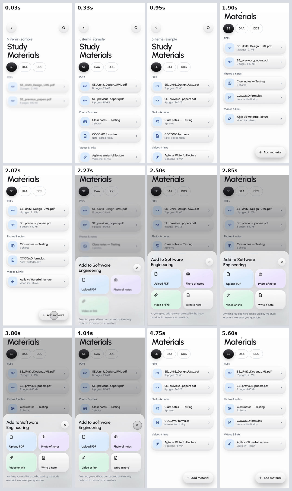

Exact spec from the live design (every animation, timing and easing)

| time | trigger / element | animation | from → to | dur ms | delay ms | easing | loops | React Native |
|---|---|---|---|---|---|---|---|---|
| 0.00s | “PDFs PDF SE_Unit3_Design_UML.pdf …” | `fadeup` | opacity:0; transform:translateY(8px); filter:blur(8px) → opacity:1; transform:none; filter:blur(0px) | 380 | 0 | `bezier(0.05, 0.7, 0.1, 1)` |  | BlurIn soft |
| 0.00s | “Photos & notes Class notes — Test…” | `fadeup` | opacity:0; transform:translateY(8px); filter:blur(8px) → opacity:1; transform:none; filter:blur(0px) | 380 | 90 | `bezier(0.05, 0.7, 0.1, 1)` |  | BlurIn soft |
| 0.00s | “Videos & links Agile vs Waterfall…” | `fadeup` | opacity:0; transform:translateY(8px); filter:blur(8px) → opacity:1; transform:none; filter:blur(0px) | 380 | 180 | `bezier(0.05, 0.7, 0.1, 1)` |  | BlurIn soft |
| 0.00s | “Add material” | `fab` | boxShadow:rgba(27, 27, 31, 0.25) 0px 10px 26px 0px → boxShadow:rgba(27, 27, 31, 0.25) 0px 10px 26px 0px | 2800 | 0 | `ease-in-out` | ∞ | withRepeat boxShadow/scale |
| **1.87s** | 👆 **tap text=Add material >> nth=0** | | | | | | | |
| 2.00s | “Add material” | `filter` | filter:none → filter:blur(0.6px) | 220 | 0 | `ease` |  | (press blur → haptic in RN) |
| 2.00s | “Add material” | `transform` | transform:translateY(-1px) → transform:scale(0.96) | 180 | 0 | `bezier(0.2, 0, 0, 1)` |  | PressableScale / withSpring |
| 2.15s | “PDFs PDF SE_Unit3_Design_UML.pdf …” | `fadeup` | opacity:0; transform:translateY(8px); filter:blur(8px) → opacity:1; transform:none; filter:blur(0px) | 380 | 0 | `bezier(0.05, 0.7, 0.1, 1)` |  | BlurIn soft |
| 2.15s | “Photos & notes Class notes — Test…” | `fadeup` | opacity:0; transform:translateY(8px); filter:blur(8px) → opacity:1; transform:none; filter:blur(0px) | 380 | 90 | `bezier(0.05, 0.7, 0.1, 1)` |  | BlurIn soft |
| 2.15s | “Videos & links Agile vs Waterfall…” | `fadeup` | opacity:0; transform:translateY(8px); filter:blur(8px) → opacity:1; transform:none; filter:blur(0px) | 380 | 180 | `bezier(0.05, 0.7, 0.1, 1)` |  | BlurIn soft |
| 2.15s | “Add material” | `fab` | boxShadow:rgba(27, 27, 31, 0.25) 0px 10px 26px 0px → boxShadow:rgba(27, 27, 31, 0.25) 0px 10px 26px 0px | 2800 | 0 | `ease-in-out` | ∞ | withRepeat boxShadow/scale |
| 2.15s | block 390×1060 | `scrim` | opacity:0 → opacity:1 | 260 | 0 | `ease` |  | fadeIn(260) |
| 2.15s | “Add material” (div) | `sheet` | transform:translateY(100%) → transform:none | 420 | 0 | `bezier(0.2, 0.9, 0.25, 1.02)` |  | spring.sheet translateY 100%→0 |
| 2.15s | “Upload PDF” | `fadeup` | opacity:0; transform:translateY(8px); filter:blur(8px) → opacity:1; transform:none; filter:blur(0px) | 380 | 0 | `bezier(0.05, 0.7, 0.1, 1)` |  | BlurIn soft |
| 2.15s | “Photo of notes” | `fadeup` | opacity:0; transform:translateY(8px); filter:blur(8px) → opacity:1; transform:none; filter:blur(0px) | 380 | 60 | `bezier(0.05, 0.7, 0.1, 1)` |  | BlurIn soft |
| 2.15s | “Video or link” | `fadeup` | opacity:0; transform:translateY(8px); filter:blur(8px) → opacity:1; transform:none; filter:blur(0px) | 380 | 120 | `bezier(0.05, 0.7, 0.1, 1)` |  | BlurIn soft |
| 2.15s | “Write a note” | `fadeup` | opacity:0; transform:translateY(8px); filter:blur(8px) → opacity:1; transform:none; filter:blur(0px) | 380 | 180 | `bezier(0.05, 0.7, 0.1, 1)` |  | BlurIn soft |
| **3.83s** | 👆 **tap [aria-label="Close"]** | | | | | | | |
| 3.95s | “Close” (button) | `filter` | filter:none → filter:blur(0.6px) | 220 | 0 | `ease` |  | (press blur → haptic in RN) |
| 3.95s | “Close” (button) | `transform` | transform:translateY(-0.97px) → transform:scale(0.96) | 180 | 0 | `bezier(0.2, 0, 0, 1)` |  | PressableScale / withSpring |
| 4.15s | “Add material” | `fab` | boxShadow:rgba(27, 27, 31, 0.25) 0px 10px 26px 0px → boxShadow:rgba(27, 27, 31, 0.25) 0px 10px 26px 0px | 2800 | 0 | `ease-in-out` | ∞ | withRepeat boxShadow/scale |

---

## 11 · Study assistant

Chat with Study buddy. Tapping a suggestion sends it; a typing indicator bounces, then the reply bubble rises in.

<video src="11-study-assistant.mp4" poster="posters/11-study-assistant.jpg" controls muted loop playsinline width="300"></video>

▶ **Video:** [`11-study-assistant.mp4`](11-study-assistant.mp4) · **Key frames (for AI):** [`frames/11-study-assistant.png`](frames/11-study-assistant.png) · **Raw timeline:** [`timeline/11-study-assistant.json`](timeline/11-study-assistant.json)

### Step by step

1. **0.00s** — Messages and the chart are already on screen; bars grew from 0 on load.
2. **2.70s** — Tap **Quiz me on AVL trees**: your ink bubble rises 10 pt with scale .98 → 1 (msg, 360 ms).
3. **3.10s** — Three typing dots bounce (1 s loop, staggered).
4. **4.10s** — Study buddy’s glass reply bubble rises in the same way.

### Build it in React Native

- Bubbles: `entering={messageIn}`.
- Typing dots: three `withRepeat(withSequence(...))` translateY loops offset by 160 ms.
- Chart: `react-native-gifted-charts` `BarChart isAnimated animationDuration={800}`.

### Key frames

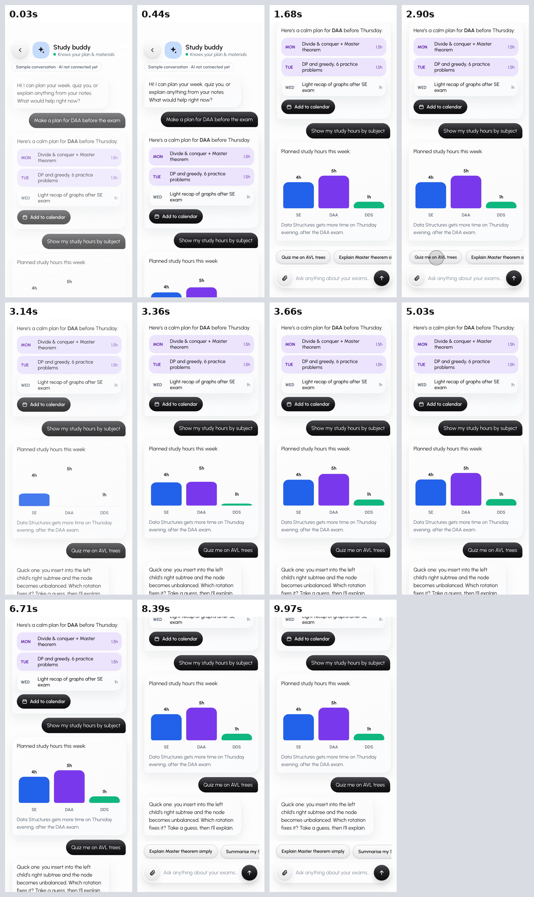

Exact spec from the live design (every animation, timing and easing)

| time | trigger / element | animation | from → to | dur ms | delay ms | easing | loops | React Native |
|---|---|---|---|---|---|---|---|---|
| 0.00s | shape 52×52 | `glow` | transform:rotate(0deg) scale(1) → transform:rotate(0deg) scale(1) | 3000 | 0 | `ease-in-out` | ∞ | withRepeat rotate+scale |
| 0.00s | “Hi! I can plan your week, quiz yo…” | `msg` | opacity:0; transform:translateY(10px) scale(0.98) → opacity:1; transform:none | 360 | 0 | `bezier(0.2, 0.9, 0.25, 1.05)` |  | messageIn |
| 0.00s | “Make a plan for DAA before the ex…” | `msg` | opacity:0; transform:translateY(10px) scale(0.98) → opacity:1; transform:none | 360 | 0 | `bezier(0.2, 0.9, 0.25, 1.05)` |  | messageIn |
| 0.00s | “Here’s a calm plan for DAA before…” | `msg` | opacity:0; transform:translateY(10px) scale(0.98) → opacity:1; transform:none | 360 | 0 | `bezier(0.2, 0.9, 0.25, 1.05)` |  | messageIn |
| 0.00s | “Show my study hours by subject” | `msg` | opacity:0; transform:translateY(10px) scale(0.98) → opacity:1; transform:none | 360 | 0 | `bezier(0.2, 0.9, 0.25, 1.05)` |  | messageIn |
| 0.00s | “Planned study hours this week: 4h…” | `msg` | opacity:0; transform:translateY(10px) scale(0.98) → opacity:1; transform:none | 360 | 0 | `bezier(0.2, 0.9, 0.25, 1.05)` |  | messageIn |
| 0.00s | shape 93×20 | `bar` | transform:scaleY(0) → transform:scaleY(1) | 800 | 0 | `bezier(0.2, 0.8, 0.2, 1)` |  | scale 0→1, transformOrigin left/bottom |
| 0.00s | shape 93×0 | `bar` | transform:scaleY(0) → transform:scaleY(1) | 800 | 120 | `bezier(0.2, 0.8, 0.2, 1)` |  | scale 0→1, transformOrigin left/bottom |
| 0.00s | shape 93×0 | `bar` | transform:scaleY(0) → transform:scaleY(1) | 800 | 240 | `bezier(0.2, 0.8, 0.2, 1)` |  | scale 0→1, transformOrigin left/bottom |
| **1.40s** | 👆 **scroll to y=2000** | | | | | | | |
| **2.70s** | 👆 **tap text=Quiz me on AVL trees** | | | | | | | |
| 2.85s | “Quiz me on AVL trees” | `filter` | filter:none → filter:blur(0.6px) | 220 | 0 | `ease` |  | (press blur → haptic in RN) |
| 2.85s | “Quiz me on AVL trees” | `transform` | transform:translateY(-0.97px) → transform:scale(0.96) | 180 | 0 | `bezier(0.2, 0, 0, 1)` |  | PressableScale / withSpring |
| 3.00s | shape 52×52 | `glow` | transform:rotate(0deg) scale(1) → transform:rotate(0deg) scale(1) | 3000 | 0 | `ease-in-out` | ∞ | withRepeat rotate+scale |
| 3.00s | “Here’s a calm plan for DAA before…” | `msg` | opacity:0; transform:translateY(10px) scale(0.98) → opacity:1; transform:none | 360 | 0 | `bezier(0.2, 0.9, 0.25, 1.05)` |  | messageIn |
| 3.00s | “Show my study hours by subject” | `msg` | opacity:0; transform:translateY(10px) scale(0.98) → opacity:1; transform:none | 360 | 0 | `bezier(0.2, 0.9, 0.25, 1.05)` |  | messageIn |
| 3.00s | “Planned study hours this week: 4h…” | `msg` | opacity:0; transform:translateY(10px) scale(0.98) → opacity:1; transform:none | 360 | 0 | `bezier(0.2, 0.9, 0.25, 1.05)` |  | messageIn |
| 3.00s | shape 93×13 | `bar` | transform:scaleY(0) → transform:scaleY(1) | 800 | 0 | `bezier(0.2, 0.8, 0.2, 1)` |  | scale 0→1, transformOrigin left/bottom |
| 3.00s | “Quiz me on AVL trees” | `msg` | opacity:0; transform:translateY(10px) scale(0.98) → opacity:1; transform:none | 360 | 0 | `bezier(0.2, 0.9, 0.25, 1.05)` |  | messageIn |
| 3.00s | “Study buddy is typing” (div) | `msg` | opacity:0; transform:translateY(10px) scale(0.98) → opacity:1; transform:none | 360 | 0 | `bezier(0.2, 0.9, 0.25, 1.05)` |  | messageIn |
| 3.00s | shape 8×8 | `bounce` | opacity:0.4; transform:translateY(0px) → opacity:0.4; transform:translateY(0px) | 1000 | 0 | `ease-in-out` | ∞ | withRepeat translateY (typing dots) |
| 3.00s | shape 8×8 | `bounce` | opacity:0.4; transform:translateY(0px) → opacity:0.4; transform:translateY(0px) | 1000 | 150 | `ease-in-out` | ∞ | withRepeat translateY (typing dots) |
| 3.00s | shape 8×8 | `bounce` | opacity:0.4; transform:translateY(0px) → opacity:0.4; transform:translateY(0px) | 1000 | 300 | `ease-in-out` | ∞ | withRepeat translateY (typing dots) |
| 3.10s | shape 59×59 | `glow` | transform:rotate(0deg) scale(1) → transform:rotate(0deg) scale(1) | 3000 | 0 | `ease-in-out` | ∞ | withRepeat rotate+scale |
| 3.10s | “Hi! I can plan your week, quiz yo…” | `msg` | opacity:0; transform:translateY(10px) scale(0.98) → opacity:1; transform:none | 360 | 0 | `bezier(0.2, 0.9, 0.25, 1.05)` |  | messageIn |
| 3.10s | “Make a plan for DAA before the ex…” | `msg` | opacity:0; transform:translateY(10px) scale(0.98) → opacity:1; transform:none | 360 | 0 | `bezier(0.2, 0.9, 0.25, 1.05)` |  | messageIn |
| 3.10s | shape 94×80 | `bar` | transform:scaleY(0) → transform:scaleY(1) | 800 | 0 | `bezier(0.2, 0.8, 0.2, 1)` |  | scale 0→1, transformOrigin left/bottom |
| 3.10s | shape 94×99 | `bar` | transform:scaleY(0) → transform:scaleY(1) | 800 | 120 | `bezier(0.2, 0.8, 0.2, 1)` |  | scale 0→1, transformOrigin left/bottom |
| 3.10s | shape 94×19 | `bar` | transform:scaleY(0) → transform:scaleY(1) | 800 | 240 | `bezier(0.2, 0.8, 0.2, 1)` |  | scale 0→1, transformOrigin left/bottom |
| 3.10s | “Quiz me on AVL trees” | `msg` | opacity:0; transform:translateY(10px) scale(0.98) → opacity:1; transform:none | 360 | 0 | `bezier(0.2, 0.9, 0.25, 1.05)` |  | messageIn |
| 3.10s | “Quick one: you insert into the le…” | `msg` | opacity:0; transform:translateY(10px) scale(0.98) → opacity:1; transform:none | 360 | 0 | `bezier(0.2, 0.9, 0.25, 1.05)` |  | messageIn |
| **6.87s** | 👆 **scroll to y=2400** | | | | | | | |

---

## 12 · PDF reader

Reader with a highlighter toggle and page turns that slide 40 pt with a 2° tilt. Jumping to the last page shows the “You finished this PDF!” card with sparks.

<video src="12-pdf-reader.mp4" poster="posters/12-pdf-reader.jpg" controls muted loop playsinline width="300"></video>

▶ **Video:** [`12-pdf-reader.mp4`](12-pdf-reader.mp4) · **Key frames (for AI):** [`frames/12-pdf-reader.png`](frames/12-pdf-reader.png) · **Raw timeline:** [`timeline/12-pdf-reader.json`](timeline/12-pdf-reader.json)

### Step by step

1. **0.00s** — Page sheet slides in from the right (turnR: 40 pt, rotate 2° → 0, 420 ms).
2. **1.20s** — Tap the highlighter: the button sits in the pressed-in groove and the key line gets the #E3EEFF highlight.
3. **3.03s** — Next page: content slides in from the right (420 ms); the rocket on the progress bar glides forward.
4. **4.30s** — Next page again.
5. **5.57s** — Previous page: content slides in from the left (turnL).
6. **6.83s** — Jump to page 6: “You finished this PDF!” card pops .8 → 1 (600 ms) with sparks flying out (900 ms, 200 ms delay).

### Build it in React Native

- Page content: key by page and use an `entering` Keyframe (translateX ±40, rotate ±2°, 420 ms smooth) inside `<BlurIn>`.
- Finished card: `popIn()` + `celebrate`.

### Key frames

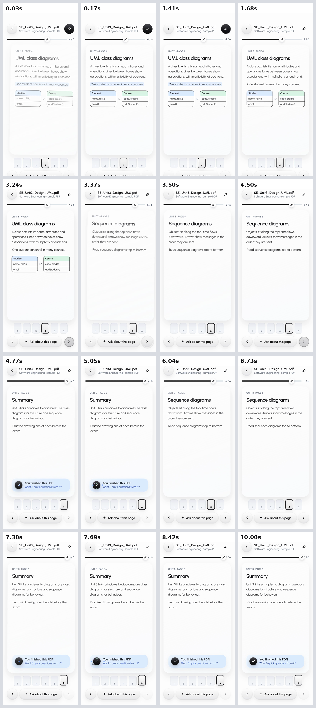

Exact spec from the live design (every animation, timing and easing)

| time | trigger / element | animation | from → to | dur ms | delay ms | easing | loops | React Native |
|---|---|---|---|---|---|---|---|---|
| 0.00s | “Page 4: UML class diagrams” (article) | `turnR` | opacity:0; transform:translateX(40px) rotate(2deg) → opacity:1; transform:none | 420 | 0 | `bezier(0.2, 0.8, 0.2, 1)` |  | BlurIn + translateX 40 / rotate 2° |
| **1.20s** | 👆 **tap [aria-label="Highlight key line"]** | | | | | | | |
| 1.35s | “Highlight key line” (button) | `filter` | filter:none → filter:blur(0.6px) | 220 | 0 | `ease` |  | (press blur → haptic in RN) |
| 1.35s | “Highlight key line” (button) | `transform` | transform:translateY(-0.97px) → transform:scale(0.96) | 180 | 0 | `bezier(0.2, 0, 0, 1)` |  | PressableScale / withSpring |
| **3.03s** | 👆 **tap [aria-label="Next page"]** | | | | | | | |
| 3.15s | “Next page” (button) | `filter` | filter:none → filter:blur(0.6px) | 220 | 0 | `ease` |  | (press blur → haptic in RN) |
| 3.15s | “Next page” (button) | `transform` | transform:translateY(-0.97px) → transform:scale(0.96) | 180 | 0 | `bezier(0.2, 0, 0, 1)` |  | PressableScale / withSpring |
| 3.35s | “Page 5: Sequence diagrams” (article) | `turnR` | opacity:0; transform:translateX(40px) rotate(2deg) → opacity:1; transform:none | 420 | 0 | `bezier(0.2, 0.8, 0.2, 1)` |  | BlurIn + translateX 40 / rotate 2° |
| **4.30s** | 👆 **tap [aria-label="Next page"]** | | | | | | | |
| 4.45s | “Next page” (button) | `filter` | filter:none → filter:blur(0.6px) | 220 | 0 | `ease` |  | (press blur → haptic in RN) |
| 4.45s | “Next page” (button) | `transform` | transform:translateY(-1px) → transform:scale(0.96) | 180 | 0 | `bezier(0.2, 0, 0, 1)` |  | PressableScale / withSpring |
| 4.60s | “Page 6: Summary” (article) | `turnR` | opacity:0; transform:translateX(40px) rotate(2deg) → opacity:1; transform:none | 420 | 0 | `bezier(0.2, 0.8, 0.2, 1)` |  | BlurIn + translateX 40 / rotate 2° |
| 4.60s | “You finished this PDF! Want 5 qui…” | `cheer` | opacity:0; transform:scale(0.8) → opacity:1; transform:none | 600 | 0 | `bezier(0.2, 0.9, 0.25, 1.3)` |  | popIn() |
| 4.60s | shape 9×9 | `spark` | opacity:1; transform:translate(0px) scale(0.5) → opacity:0; transform:translate(60px) scale(1) | 900 | 200 | `ease-out` |  | Keyframe out from centre |
| **5.57s** | 👆 **tap [aria-label="Previous page"]** | | | | | | | |
| 5.85s | “Page 5: Sequence diagrams” (article) | `turnL` | opacity:0; transform:translateX(-40px) rotate(-2deg) → opacity:1; transform:none | 420 | 0 | `bezier(0.2, 0.8, 0.2, 1)` |  | BlurIn + translateX -40 / rotate -2° |
| **6.83s** | 👆 **tap [aria-label^="Page 6"]** | | | | | | | |
| 7.15s | “Page 6: Summary” (article) | `turnR` | opacity:0; transform:translateX(40px) rotate(2deg) → opacity:1; transform:none | 420 | 0 | `bezier(0.2, 0.8, 0.2, 1)` |  | BlurIn + translateX 40 / rotate 2° |
| 7.15s | shape 10×10 | `spark` | opacity:1; transform:translate(0px) scale(0.5) → opacity:0; transform:translate(60px) scale(1) | 900 | 200 | `ease-out` |  | Keyframe out from centre |
| 7.15s | shape 9×9 | `spark` | opacity:1; transform:translate(0px) scale(0.5) → opacity:0; transform:translate(42px, 28px) scale(1) | 900 | 230 | `ease-out` |  | Keyframe out from centre |
| 7.15s | shape 9×9 | `spark` | opacity:1; transform:translate(0px) scale(0.5) → opacity:0; transform:translate(0px, 40px) scale(1) | 900 | 260 | `ease-out` |  | Keyframe out from centre |
| 7.15s | shape 9×9 | `spark` | opacity:1; transform:translate(0px) scale(0.5) → opacity:0; transform:translate(-42px, 28px) scale(1) | 900 | 290 | `ease-out` |  | Keyframe out from centre |
| 7.15s | shape 9×9 | `spark` | opacity:1; transform:translate(0px) scale(0.5) → opacity:0; transform:translate(-60px) scale(1) | 900 | 320 | `ease-out` |  | Keyframe out from centre |
| 7.15s | shape 9×9 | `spark` | opacity:1; transform:translate(0px) scale(0.5) → opacity:0; transform:translate(-42px, -28px) scale(1) | 900 | 350 | `ease-out` |  | Keyframe out from centre |
| 7.15s | shape 9×9 | `spark` | opacity:1; transform:translate(0px) scale(0.5) → opacity:0; transform:translate(0px, -40px) scale(1) | 900 | 380 | `ease-out` |  | Keyframe out from centre |
| 7.15s | shape 8×8 | `spark` | opacity:1; transform:translate(0px) scale(0.5) → opacity:0; transform:translate(42px, -28px) scale(1) | 900 | 410 | `ease-out` |  | Keyframe out from centre |

---

## M1 · Email code pill

One pill that morphs: Enter code → 6 cells → Verifying → Verified. A wrong code shakes and resets.

<video src="M1-email-code-pill.mp4" poster="posters/M1-email-code-pill.jpg" controls muted loop playsinline width="300"></video>

▶ **Video:** [`M1-email-code-pill.mp4`](M1-email-code-pill.mp4) · **Key frames (for AI):** [`frames/M1-email-code-pill.png`](frames/M1-email-code-pill.png) · **Raw timeline:** [`timeline/M1-email-code-pill.json`](timeline/M1-email-code-pill.json)

### Step by step

1. **0.90s** — Tap **Enter code**: the pill morphs (blur 6 → 0, scale .96 → 1, 260 ms) into six cells; the caret blinks (1 s).
2. **2.47s** — Demo **Wrong code**: digits pop in one by one (scale .6 → 1, blur 4 → 0, 220 ms).
3. **2.97s** — Spinner + shimmer (“Verifying…”), then the pill shakes left-right (420 ms) and clears.
4. **6.03s** — Reset.
5. **8.47s** — Demo **Correct code**: digits pop, then the pill turns green “✓ Verified”: tick draws (300 ms), a light sheen sweeps across, and **Continue** rises in.

### Build it in React Native

- `<CodePill verify={…}>` — same morph, digit, caret and shake timings (`SHAKE_STEPS`).

### Key frames

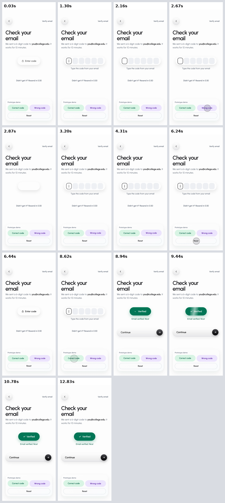

Exact spec from the live design (every animation, timing and easing)

| time | trigger / element | animation | from → to | dur ms | delay ms | easing | loops | React Native |
|---|---|---|---|---|---|---|---|---|
| 0.00s | “Enter code” | `morph` | opacity:0; transform:scale(0.96); filter:blur(6px) → opacity:1; transform:none; filter:blur(0px) | 260 | 0 | `bezier(0.2, 0.8, 0.2, 1)` |  | layout + FadeIn (CodePill) |
| **0.90s** | 👆 **tap text=Enter code** | | | | | | | |
| 1.20s | block 280×45 | `morph` | opacity:0; transform:scale(0.96); filter:blur(6px) → opacity:1; transform:none; filter:blur(0px) | 260 | 0 | `bezier(0.2, 0.8, 0.2, 1)` |  | layout + FadeIn (CodePill) |
| 1.20s | shape 2×20 | `caret` | opacity:1 → opacity:0 | 1000 | 0 | `steps(1)` | ∞ | Caret withRepeat opacity |
| **2.47s** | 👆 **tap text=Wrong code** | | | | | | | |
| 2.60s | “Wrong code” | `filter` | filter:none → filter:blur(0.6px) | 220 | 0 | `ease` |  | (press blur → haptic in RN) |
| 2.60s | “Wrong code” | `transform` | transform:translateY(-0.97px) → transform:scale(0.96) | 180 | 0 | `bezier(0.2, 0, 0, 1)` |  | PressableScale / withSpring |
| 2.75s | block 283×46 | `morph` | opacity:0; transform:scale(0.96); filter:blur(6px) → opacity:1; transform:none; filter:blur(0px) | 260 | 0 | `bezier(0.2, 0.8, 0.2, 1)` |  | layout + FadeIn (CodePill) |
| 2.75s | shape 2×20 | `caret` | opacity:1 → opacity:0 | 1000 | 0 | `steps(1)` | ∞ | Caret withRepeat opacity |
| 2.80s | “2” | `morph` | opacity:0; transform:scale(0.96); filter:blur(6px) → opacity:1; transform:none; filter:blur(0px) | 260 | 0 | `bezier(0.2, 0.8, 0.2, 1)` |  | layout + FadeIn (CodePill) |
| 2.80s | “2” | `digit` | opacity:0; transform:scale(0.6) translateY(4px); filter:blur(4px) → opacity:1; transform:none; filter:blur(0px) | 220 | 0 | `bezier(0.2, 0.9, 0.25, 1.2)` |  | digitIn |
| 2.80s | shape 2×20 | `caret` | opacity:1 → opacity:0 | 1000 | 0 | `steps(1)` | ∞ | Caret withRepeat opacity |
| 2.85s | “2 1 3” | `morph` | opacity:0; transform:scale(0.96); filter:blur(6px) → opacity:1; transform:none; filter:blur(0px) | 260 | 0 | `bezier(0.2, 0.8, 0.2, 1)` |  | layout + FadeIn (CodePill) |
| 2.85s | 2× “1” | `digit` | opacity:0; transform:scale(0.6) translateY(4px); filter:blur(4px) → opacity:1; transform:none; filter:blur(0px) | 220 | 0 | `bezier(0.2, 0.9, 0.25, 1.2)` |  | digitIn |
| 2.85s | “3” | `digit` | opacity:0; transform:scale(0.6) translateY(4px); filter:blur(4px) → opacity:1; transform:none; filter:blur(0px) | 220 | 0 | `bezier(0.2, 0.9, 0.25, 1.2)` |  | digitIn |
| 2.85s | 2× shape 2×20 | `caret` | opacity:1 → opacity:0 | 1000 | 0 | `steps(1)` | ∞ | Caret withRepeat opacity |
| 2.85s | “2 1 3 2 1” | `morph` | opacity:0; transform:scale(0.96); filter:blur(6px) → opacity:1; transform:none; filter:blur(0px) | 260 | 0 | `bezier(0.2, 0.8, 0.2, 1)` |  | layout + FadeIn (CodePill) |
| 2.85s | “2” | `digit` | opacity:0; transform:scale(0.6) translateY(4px); filter:blur(4px) → opacity:1; transform:none; filter:blur(0px) | 220 | 0 | `bezier(0.2, 0.9, 0.25, 1.2)` |  | digitIn |
| 2.90s | “2 1 3 2 1 2” | `morph` | opacity:0; transform:scale(0.96); filter:blur(6px) → opacity:1; transform:none; filter:blur(0px) | 260 | 0 | `bezier(0.2, 0.8, 0.2, 1)` |  | layout + FadeIn (CodePill) |
| 2.90s | “2” | `digit` | opacity:0; transform:scale(0.6) translateY(4px); filter:blur(4px) → opacity:1; transform:none; filter:blur(0px) | 220 | 0 | `bezier(0.2, 0.9, 0.25, 1.2)` |  | digitIn |
| 2.95s | “Verifying” | `morph` | opacity:0; transform:scale(0.96); filter:blur(6px) → opacity:1; transform:none; filter:blur(0px) | 260 | 0 | `bezier(0.2, 0.8, 0.2, 1)` |  | layout + FadeIn (CodePill) |
| 2.95s | shape 20×20 | `spin` | transform:none → transform:rotate(360deg) | 800 | 0 | `linear` | ∞ | withRepeat rotate / ActivityIndicator |
| 2.95s | “Verifying” | `shimmer` | backgroundPositionX:120%; backgroundPositionY:0px → backgroundPositionX:-120%; backgroundPositionY:0px | 1200 | 0 | `linear` | ∞ | — |
| 3.10s | “2 1 3 2 1 2 6-digit code” | `shake` | transform:none → transform:none | 420 | 0 | `bezier(0.36, 0.07, 0.19, 0.97)` |  | SHAKE_STEPS withSequence |
| 3.10s | “2 1 3 2 1 2” | `morph` | opacity:0; transform:scale(0.96); filter:blur(6px) → opacity:1; transform:none; filter:blur(0px) | 260 | 0 | `bezier(0.2, 0.8, 0.2, 1)` |  | layout + FadeIn (CodePill) |
| 3.15s | shape 2×20 | `caret` | opacity:1 → opacity:0 | 1000 | 0 | `steps(1)` | ∞ | Caret withRepeat opacity |
| **6.03s** | 👆 **tap text=Reset** | | | | | | | |
| 6.15s | “Reset” | `filter` | filter:none → filter:blur(0.6px) | 220 | 0 | `ease` |  | (press blur → haptic in RN) |
| 6.15s | “Reset” | `transform` | transform:translateY(-0.97px) → transform:scale(0.96) | 180 | 0 | `bezier(0.2, 0, 0, 1)` |  | PressableScale / withSpring |
| 6.35s | “Enter code” | `morph` | opacity:0; transform:scale(0.96); filter:blur(6px) → opacity:1; transform:none; filter:blur(0px) | 260 | 0 | `bezier(0.2, 0.8, 0.2, 1)` |  | layout + FadeIn (CodePill) |
| **7.20s** | 👆 **tap text=Enter code** | | | | | | | |
| 7.50s | shape 2×20 | `caret` | opacity:1 → opacity:0 | 1000 | 0 | `steps(1)` | ∞ | Caret withRepeat opacity |
| **8.47s** | 👆 **tap text=Correct code** | | | | | | | |
| 8.60s | “Correct code” | `filter` | filter:none → filter:blur(0.6px) | 220 | 0 | `ease` |  | (press blur → haptic in RN) |
| 8.60s | “Correct code” | `transform` | transform:translateY(-0.97px) → transform:scale(0.96) | 180 | 0 | `bezier(0.2, 0, 0, 1)` |  | PressableScale / withSpring |
| 8.75s | shape 2×20 | `caret` | opacity:1 → opacity:0 | 1000 | 0 | `steps(1)` | ∞ | Caret withRepeat opacity |
| 8.85s | “Verified” | `morph` | opacity:0; transform:scale(0.96); filter:blur(6px) → opacity:1; transform:none; filter:blur(0px) | 260 | 0 | `bezier(0.2, 0.8, 0.2, 1)` |  | layout + FadeIn (CodePill) |
| 8.85s | SVG stroke 11×7 | `draw` | strokeDashoffset:24px → strokeDashoffset:0px | 300 | 120 | `ease-out` |  | strokeDashoffset via useAnimatedProps |
| 8.85s | shape 60×60 | `shine` | left:-70px → left:110% | 900 | 250 | `ease-in-out` |  | withRepeat opacity |
| 8.85s | “Continue” | `rise` | opacity:0; transform:translateY(12px); filter:blur(10px) → opacity:1; transform:none; filter:blur(0px) | 420 | 0 | `bezier(0.05, 0.7, 0.1, 1)` |  | BlurIn index={n} |

---

## M2 · Study island

A black Dynamic-Island-style pill at the top of Today. A blob melts into it and it stretches to show each state.

<video src="M2-study-island.mp4" poster="posters/M2-study-island.jpg" controls muted loop playsinline width="300"></video>

▶ **Video:** [`M2-study-island.mp4`](M2-study-island.mp4) · **Key frames (for AI):** [`frames/M2-study-island.png`](frames/M2-study-island.png) · **Raw timeline:** [`timeline/M2-study-island.json`](timeline/M2-study-island.json)

### Step by step

1. **2.07s** — **Exam alert**: pill stretches (spring), content blurs in from the left (fadein: blur 6 → 0, x −6 → 0).
2. **4.13s** — **Next up**: content swaps with the same blur-in.
3. **6.20s** — **AI working**: spinner + pulsing text.
4. **10.07s** — **All done**: success state with a drawn tick.
5. **12.23s** — **Split**: the blob separates from the pill (goo).
6. **14.10s** — **Apart**: back to two shapes.

### Build it in React Native

- `<GooeyIsland state={…}>` (Skia goo: blur 7 + alpha threshold), spring 380/26.
- Drive `state` from your focus-timer store.

### Key frames

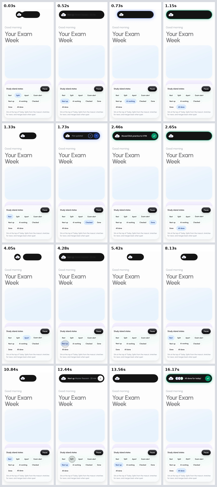

Exact spec from the live design (every animation, timing and easing)

| time | trigger / element | animation | from → to | dur ms | delay ms | easing | loops | React Native |
|---|---|---|---|---|---|---|---|---|
| 0.00s | g 9×5 | `blink` | transform:scaleY(1) → transform:scaleY(1) | 2600 | 0 | `ease-in-out` | ∞ | withRepeat scaleY |
| 0.05s | g 9×5 | `blink` | transform:scaleY(1) → transform:scaleY(1) | 2600 | 0 | `ease-in-out` | ∞ | withRepeat scaleY |
| 0.15s | g 9×5 | `blink` | transform:scaleY(1) → transform:scaleY(1) | 2600 | 0 | `ease-in-out` | ∞ | withRepeat scaleY |
| 0.25s | g 10×5 | `blink` | transform:scaleY(1) → transform:scaleY(1) | 2600 | 0 | `ease-in-out` | ∞ | withRepeat scaleY |
| 0.25s | “SE exam · Wed 2 PM 3 days to prep…” | `fadein` | opacity:0; transform:translateX(-6px); filter:blur(6px) → opacity:1; transform:none; filter:blur(0px) | 360 | 140 | `bezier(0.2, 0.8, 0.2, 1)` |  | FadeIn + translateX |
| 0.25s | shape 42×42 | `pulse` | opacity:0.55 → opacity:0.55 | 1600 | 0 | `ease-in-out` | ∞ | withRepeat opacity |
| 0.40s | g 10×5 | `blink` | transform:scaleY(1) → transform:scaleY(1) | 2600 | 0 | `ease-in-out` | ∞ | withRepeat scaleY |
| 0.40s | “Next up Master theorem · 25 min” | `fadein` | opacity:0; transform:translateX(-6px); filter:blur(6px) → opacity:1; transform:none; filter:blur(0px) | 360 | 140 | `bezier(0.2, 0.8, 0.2, 1)` |  | FadeIn + translateX |
| 0.40s | “Start” (button) | `pop` | opacity:0; transform:scale(0.5) → opacity:1; transform:scale(1) | 380 | 180 | `bezier(0.2, 0.9, 0.25, 1.3)` |  | withSequence scale .9→1.12→1 (AnimatedCheckbox / popIn) |
| 0.65s | g 9×5 | `blink` | transform:scaleY(1) → transform:scaleY(1) | 2600 | 0 | `ease-in-out` | ∞ | withRepeat scaleY |
| 0.65s | “Updating your plan” | `fadein` | opacity:0; transform:translateX(-6px); filter:blur(6px) → opacity:1; transform:none; filter:blur(0px) | 360 | 140 | `bezier(0.2, 0.8, 0.2, 1)` |  | FadeIn + translateX |
| 0.65s | shape 34×34 | `spin` | transform:none → transform:rotate(360deg) | 1000 | 0 | `linear` | ∞ | withRepeat rotate / ActivityIndicator |
| 0.85s | g 9×5 | `blink` | transform:scaleY(1) → transform:scaleY(1) | 2600 | 0 | `ease-in-out` | ∞ | withRepeat scaleY |
| 0.85s | “Plan updated” | `fadein` | opacity:0; transform:translateX(-6px); filter:blur(6px) → opacity:1; transform:none; filter:blur(0px) | 360 | 140 | `bezier(0.2, 0.8, 0.2, 1)` |  | FadeIn + translateX |
| 0.85s | shape 17×17 | `pop` | opacity:0; transform:scale(0.5) → opacity:1; transform:scale(1) | 380 | 180 | `bezier(0.2, 0.9, 0.25, 1.3)` |  | withSequence scale .9→1.12→1 (AnimatedCheckbox / popIn) |
| 0.85s | SVG stroke 5×3 | `draw` | strokeDashoffset:24px → strokeDashoffset:0px | 320 | 200 | `ease-out` |  | strokeDashoffset via useAnimatedProps |
| 1.00s | g 10×5 | `blink` | transform:scaleY(1) → transform:scaleY(1) | 2600 | 0 | `ease-in-out` | ∞ | withRepeat scaleY |
| 1.00s | “Moved DAA practice to 4 PM” | `fadein` | opacity:0; transform:translateX(-6px); filter:blur(6px) → opacity:1; transform:none; filter:blur(0px) | 360 | 140 | `bezier(0.2, 0.8, 0.2, 1)` |  | FadeIn + translateX |
| 1.00s | shape 21×21 | `pop` | opacity:0; transform:scale(0.5) → opacity:1; transform:scale(1) | 380 | 180 | `bezier(0.2, 0.9, 0.25, 1.3)` |  | withSequence scale .9→1.12→1 (AnimatedCheckbox / popIn) |
| 1.00s | SVG stroke 6×4 | `draw` | strokeDashoffset:24px → strokeDashoffset:0px | 320 | 200 | `ease-out` |  | strokeDashoffset via useAnimatedProps |
| 1.10s | g 10×5 | `blink` | transform:scaleY(1) → transform:scaleY(1) | 2600 | 0 | `ease-in-out` | ∞ | withRepeat scaleY |
| 1.10s | “All done for today!” | `fadein` | opacity:0; transform:translateX(-6px); filter:blur(6px) → opacity:1; transform:none; filter:blur(0px) | 360 | 140 | `bezier(0.2, 0.8, 0.2, 1)` |  | FadeIn + translateX |
| **1.20s** | 👆 **tap button:has-text("Pause")** | | | | | | | |
| 1.20s | g 9×5 | `blink` | transform:scaleY(1) → transform:scaleY(1) | 2600 | 0 | `ease-in-out` | ∞ | withRepeat scaleY |
| 1.25s | g 9×5 | `blink` | transform:scaleY(1) → transform:scaleY(1) | 2600 | 0 | `ease-in-out` | ∞ | withRepeat scaleY |
| 1.35s | “Pause” | `filter` | filter:none → filter:blur(0.6px) | 220 | 0 | `ease` |  | (press blur → haptic in RN) |
| 1.35s | “Pause” | `transform` | transform:translateY(-0.97px) → transform:scale(0.96) | 180 | 0 | `bezier(0.2, 0, 0, 1)` |  | PressableScale / withSpring |
| 1.35s | 2× g 9×5 | `blink` | transform:scaleY(1) → transform:scaleY(1) | 2600 | 0 | `ease-in-out` | ∞ | withRepeat scaleY |
| 1.40s | g 10×5 | `blink` | transform:scaleY(1) → transform:scaleY(1) | 2600 | 0 | `ease-in-out` | ∞ | withRepeat scaleY |
| 1.40s | “Start” (button) | `pop` | opacity:0; transform:scale(0.5) → opacity:1; transform:scale(1) | 380 | 180 | `bezier(0.2, 0.9, 0.25, 1.3)` |  | withSequence scale .9→1.12→1 (AnimatedCheckbox / popIn) |
| 1.45s | g 9×5 | `blink` | transform:scaleY(1) → transform:scaleY(1) | 2600 | 0 | `ease-in-out` | ∞ | withRepeat scaleY |
| 1.45s | “Updating your plan” | `fadein` | opacity:0; transform:translateX(-6px); filter:blur(6px) → opacity:1; transform:none; filter:blur(0px) | 360 | 140 | `bezier(0.2, 0.8, 0.2, 1)` |  | FadeIn + translateX |
| 1.45s | shape 48×48 | `spin` | transform:none → transform:rotate(360deg) | 1000 | 0 | `linear` | ∞ | withRepeat rotate / ActivityIndicator |
| 1.50s | “Pause” | `filter` | filter:blur(0.31px) → filter:none | 114 | 0 | `ease` |  | (press blur → haptic in RN) |
| 1.50s | g 9×5 | `blink` | transform:scaleY(1) → transform:scaleY(1) | 2600 | 0 | `ease-in-out` | ∞ | withRepeat scaleY |
| 1.50s | shape 17×17 | `pop` | opacity:0; transform:scale(0.5) → opacity:1; transform:scale(1) | 380 | 180 | `bezier(0.2, 0.9, 0.25, 1.3)` |  | withSequence scale .9→1.12→1 (AnimatedCheckbox / popIn) |
| 1.50s | SVG stroke 5×3 | `draw` | strokeDashoffset:24px → strokeDashoffset:0px | 320 | 200 | `ease-out` |  | strokeDashoffset via useAnimatedProps |
| 1.55s | g 10×5 | `blink` | transform:scaleY(1) → transform:scaleY(1) | 2600 | 0 | `ease-in-out` | ∞ | withRepeat scaleY |
| 1.55s | shape 21×21 | `pop` | opacity:0; transform:scale(0.5) → opacity:1; transform:scale(1) | 380 | 180 | `bezier(0.2, 0.9, 0.25, 1.3)` |  | withSequence scale .9→1.12→1 (AnimatedCheckbox / popIn) |
| 1.55s | SVG stroke 6×4 | `draw` | strokeDashoffset:24px → strokeDashoffset:0px | 320 | 200 | `ease-out` |  | strokeDashoffset via useAnimatedProps |
| 1.60s | g 10×5 | `blink` | transform:scaleY(1) → transform:scaleY(1) | 2600 | 0 | `ease-in-out` | ∞ | withRepeat scaleY |
| 1.65s | 2× g 9×5 | `blink` | transform:scaleY(1) → transform:scaleY(1) | 2600 | 0 | `ease-in-out` | ∞ | withRepeat scaleY |
| 1.70s | g 10×5 | `blink` | transform:scaleY(1) → transform:scaleY(1) | 2600 | 0 | `ease-in-out` | ∞ | withRepeat scaleY |
| 1.70s | shape 42×42 | `pulse` | opacity:0.55 → opacity:0.55 | 1600 | 0 | `ease-in-out` | ∞ | withRepeat opacity |
| 1.75s | g 9×5 | `blink` | transform:scaleY(1) → transform:scaleY(1) | 2600 | 0 | `ease-in-out` | ∞ | withRepeat scaleY |
| 1.80s | g 10×5 | `blink` | transform:scaleY(1) → transform:scaleY(1) | 2600 | 0 | `ease-in-out` | ∞ | withRepeat scaleY |
| 1.85s | g 9×5 | `blink` | transform:scaleY(1) → transform:scaleY(1) | 2600 | 0 | `ease-in-out` | ∞ | withRepeat scaleY |
| 1.90s | g 9×5 | `blink` | transform:scaleY(1) → transform:scaleY(1) | 2600 | 0 | `ease-in-out` | ∞ | withRepeat scaleY |
| 2.00s | g 9×5 | `blink` | transform:scaleY(1) → transform:scaleY(1) | 2600 | 0 | `ease-in-out` | ∞ | withRepeat scaleY |
| 2.05s | g 9×5 | `blink` | transform:scaleY(1) → transform:scaleY(1) | 2600 | 0 | `ease-in-out` | ∞ | withRepeat scaleY |
| **2.07s** | 👆 **tap button:has-text("Exam alert")** | | | | | | | |
| 2.15s | g 10×5 | `blink` | transform:scaleY(1) → transform:scaleY(1) | 2600 | 0 | `ease-in-out` | ∞ | withRepeat scaleY |
| 2.15s | shape 42×42 | `pulse` | opacity:0.55 → opacity:0.55 | 1600 | 0 | `ease-in-out` | ∞ | withRepeat opacity |
| 2.20s | “Exam alert” | `filter` | filter:none → filter:blur(0.6px) | 220 | 0 | `ease` |  | (press blur → haptic in RN) |
| 2.20s | “Exam alert” | `transform` | transform:translateY(-0.77px) → transform:scale(0.96) | 180 | 0 | `bezier(0.2, 0, 0, 1)` |  | PressableScale / withSpring |
| 2.35s | “Exam alert” | `filter` | filter:blur(0.6px) → filter:none | 220 | 0 | `ease` |  | (press blur → haptic in RN) |
| 2.35s | “Exam alert” | `transform` | transform:scale(0.96) → transform:translateY(-1px) | 180 | 0 | `bezier(0.2, 0, 0, 1)` |  | PressableScale / withSpring |
| 2.35s | g 10×5 | `blink` | transform:scaleY(1) → transform:scaleY(1) | 2600 | 0 | `ease-in-out` | ∞ | withRepeat scaleY |
| 2.35s | “Next up Master theorem · 25 min” | `fadein` | opacity:0; transform:translateX(-6px); filter:blur(6px) → opacity:1; transform:none; filter:blur(0px) | 360 | 140 | `bezier(0.2, 0.8, 0.2, 1)` |  | FadeIn + translateX |
| 2.40s | g 9×5 | `blink` | transform:scaleY(1) → transform:scaleY(1) | 2600 | 0 | `ease-in-out` | ∞ | withRepeat scaleY |
| 2.40s | shape 47×47 | `spin` | transform:none → transform:rotate(360deg) | 1000 | 0 | `linear` | ∞ | withRepeat rotate / ActivityIndicator |
| 2.45s | 2 elements: g 10×5, g 9×5 | `blink` | transform:scaleY(1) → transform:scaleY(1) | 2600 | 0 | `ease-in-out` | ∞ | withRepeat scaleY |
| 2.65s | g 10×5 | `blink` | transform:scaleY(1) → transform:scaleY(1) | 2600 | 0 | `ease-in-out` | ∞ | withRepeat scaleY |
| 2.85s | 2× g 9×5 | `blink` | transform:scaleY(1) → transform:scaleY(1) | 2600 | 0 | `ease-in-out` | ∞ | withRepeat scaleY |
| 2.90s | g 9×5 | `blink` | transform:scaleY(1) → transform:scaleY(1) | 2600 | 0 | `ease-in-out` | ∞ | withRepeat scaleY |
| 2.95s | g 9×5 | `blink` | transform:scaleY(1) → transform:scaleY(1) | 2600 | 0 | `ease-in-out` | ∞ | withRepeat scaleY |
| 3.05s | g 10×5 | `blink` | transform:scaleY(1) → transform:scaleY(1) | 2600 | 0 | `ease-in-out` | ∞ | withRepeat scaleY |
| 3.05s | shape 42×42 | `pulse` | opacity:0.55 → opacity:0.55 | 1600 | 0 | `ease-in-out` | ∞ | withRepeat opacity |
| 3.15s | g 10×5 | `blink` | transform:scaleY(1) → transform:scaleY(1) | 2600 | 0 | `ease-in-out` | ∞ | withRepeat scaleY |
| 3.25s | g 9×5 | `blink` | transform:scaleY(1) → transform:scaleY(1) | 2600 | 0 | `ease-in-out` | ∞ | withRepeat scaleY |
| 3.25s | shape 47×47 | `spin` | transform:none → transform:rotate(360deg) | 1000 | 0 | `linear` | ∞ | withRepeat rotate / ActivityIndicator |
| 3.35s | g 9×5 | `blink` | transform:scaleY(1) → transform:scaleY(1) | 2600 | 0 | `ease-in-out` | ∞ | withRepeat scaleY |
| 3.45s | g 10×5 | `blink` | transform:scaleY(1) → transform:scaleY(1) | 2600 | 0 | `ease-in-out` | ∞ | withRepeat scaleY |
| 3.45s | “Moved DAA practice to 4 PM” | `fadein` | opacity:0; transform:translateX(-6px); filter:blur(6px) → opacity:1; transform:none; filter:blur(0px) | 360 | 140 | `bezier(0.2, 0.8, 0.2, 1)` |  | FadeIn + translateX |
| 3.50s | g 10×5 | `blink` | transform:scaleY(1) → transform:scaleY(1) | 2600 | 0 | `ease-in-out` | ∞ | withRepeat scaleY |
| 3.65s | 2× g 9×5 | `blink` | transform:scaleY(1) → transform:scaleY(1) | 2600 | 0 | `ease-in-out` | ∞ | withRepeat scaleY |
| 3.70s | g 9×5 | `blink` | transform:scaleY(1) → transform:scaleY(1) | 2600 | 0 | `ease-in-out` | ∞ | withRepeat scaleY |
| 3.75s | 2 elements: g 10×5, g 9×5 | `blink` | transform:scaleY(1) → transform:scaleY(1) | 2600 | 0 | `ease-in-out` | ∞ | withRepeat scaleY |
| 3.75s | “SE exam · Wed 2 PM 3 days to prep…” | `fadein` | opacity:0; transform:translateX(-6px); filter:blur(6px) → opacity:1; transform:none; filter:blur(0px) | 360 | 140 | `bezier(0.2, 0.8, 0.2, 1)` |  | FadeIn + translateX |
| 3.75s | shape 42×42 | `pulse` | opacity:0.55 → opacity:0.55 | 1600 | 0 | `ease-in-out` | ∞ | withRepeat opacity |
| 3.80s | g 9×5 | `blink` | transform:scaleY(1) → transform:scaleY(1) | 2600 | 0 | `ease-in-out` | ∞ | withRepeat scaleY |
| 3.80s | “Plan updated” | `fadein` | opacity:0; transform:translateX(-6px); filter:blur(6px) → opacity:1; transform:none; filter:blur(0px) | 360 | 140 | `bezier(0.2, 0.8, 0.2, 1)` |  | FadeIn + translateX |
| 3.85s | 2× g 9×5 | `blink` | transform:scaleY(1) → transform:scaleY(1) | 2600 | 0 | `ease-in-out` | ∞ | withRepeat scaleY |
| 3.85s | shape 46×46 | `spin` | transform:none → transform:rotate(360deg) | 1000 | 0 | `linear` | ∞ | withRepeat rotate / ActivityIndicator |
| 3.90s | g 10×5 | `blink` | transform:scaleY(1) → transform:scaleY(1) | 2600 | 0 | `ease-in-out` | ∞ | withRepeat scaleY |
| 4.00s | g 10×5 | `blink` | transform:scaleY(1) → transform:scaleY(1) | 2600 | 0 | `ease-in-out` | ∞ | withRepeat scaleY |
| 4.00s | “All done for today!” | `fadein` | opacity:0; transform:translateX(-6px); filter:blur(6px) → opacity:1; transform:none; filter:blur(0px) | 360 | 140 | `bezier(0.2, 0.8, 0.2, 1)` |  | FadeIn + translateX |
| 4.05s | 2× g 9×5 | `blink` | transform:scaleY(1) → transform:scaleY(1) | 2600 | 0 | `ease-in-out` | ∞ | withRepeat scaleY |
| 4.10s | g 10×5 | `blink` | transform:scaleY(1) → transform:scaleY(1) | 2600 | 0 | `ease-in-out` | ∞ | withRepeat scaleY |
| 4.10s | shape 42×42 | `pulse` | opacity:0.55 → opacity:0.55 | 1600 | 0 | `ease-in-out` | ∞ | withRepeat opacity |
| **4.13s** | 👆 **tap button:has-text("Next up")** | | | | | | | |
| 4.15s | g 10×5 | `blink` | transform:scaleY(1) → transform:scaleY(1) | 2600 | 0 | `ease-in-out` | ∞ | withRepeat scaleY |
| 4.25s | “Next up” | `filter` | filter:none → filter:blur(0.6px) | 220 | 0 | `ease` |  | (press blur → haptic in RN) |
| 4.25s | “Next up” | `transform` | transform:translateY(-0.90px) → transform:scale(0.96) | 180 | 0 | `bezier(0.2, 0, 0, 1)` |  | PressableScale / withSpring |
| 4.35s | “Next up” | `filter` | filter:none → filter:blur(0.6px) | 220 | 0 | `ease` |  | (press blur → haptic in RN) |
| 4.35s | “Next up” | `transform` | transform:translateY(0px) → transform:scale(0.96) | 180 | 0 | `bezier(0.2, 0, 0, 1)` |  | PressableScale / withSpring |
| 4.35s | g 9×5 | `blink` | transform:scaleY(1) → transform:scaleY(1) | 2600 | 0 | `ease-in-out` | ∞ | withRepeat scaleY |
| 4.35s | shape 46×46 | `spin` | transform:none → transform:rotate(360deg) | 1000 | 0 | `linear` | ∞ | withRepeat rotate / ActivityIndicator |
| 4.45s | 2× g 10×5 | `blink` | transform:scaleY(1) → transform:scaleY(1) | 2600 | 0 | `ease-in-out` | ∞ | withRepeat scaleY |
| 4.60s | g 9×5 | `blink` | transform:scaleY(1) → transform:scaleY(1) | 2600 | 0 | `ease-in-out` | ∞ | withRepeat scaleY |
| 4.65s | g 9×5 | `blink` | transform:scaleY(1) → transform:scaleY(1) | 2600 | 0 | `ease-in-out` | ∞ | withRepeat scaleY |
| 4.70s | g 9×5 | `blink` | transform:scaleY(1) → transform:scaleY(1) | 2600 | 0 | `ease-in-out` | ∞ | withRepeat scaleY |
| 4.75s | g 9×5 | `blink` | transform:scaleY(1) → transform:scaleY(1) | 2600 | 0 | `ease-in-out` | ∞ | withRepeat scaleY |
| 4.80s | g 10×5 | `blink` | transform:scaleY(1) → transform:scaleY(1) | 2600 | 0 | `ease-in-out` | ∞ | withRepeat scaleY |
| 4.80s | shape 42×42 | `pulse` | opacity:0.55 → opacity:0.55 | 1600 | 0 | `ease-in-out` | ∞ | withRepeat opacity |
| 4.85s | g 10×5 | `blink` | transform:scaleY(1) → transform:scaleY(1) | 2600 | 0 | `ease-in-out` | ∞ | withRepeat scaleY |
| 4.90s | g 9×5 | `blink` | transform:scaleY(1) → transform:scaleY(1) | 2600 | 0 | `ease-in-out` | ∞ | withRepeat scaleY |
| 4.90s | shape 34×34 | `spin` | transform:none → transform:rotate(360deg) | 1000 | 0 | `linear` | ∞ | withRepeat rotate / ActivityIndicator |
| 5.05s | g 9×5 | `blink` | transform:scaleY(1) → transform:scaleY(1) | 2600 | 0 | `ease-in-out` | ∞ | withRepeat scaleY |
| 5.15s | 2× g 10×5 | `blink` | transform:scaleY(1) → transform:scaleY(1) | 2600 | 0 | `ease-in-out` | ∞ | withRepeat scaleY |
| 5.35s | g 9×5 | `blink` | transform:scaleY(1) → transform:scaleY(1) | 2600 | 0 | `ease-in-out` | ∞ | withRepeat scaleY |
| 5.40s | g 9×5 | `blink` | transform:scaleY(1) → transform:scaleY(1) | 2600 | 0 | `ease-in-out` | ∞ | withRepeat scaleY |
| 5.55s | g 9×5 | `blink` | transform:scaleY(1) → transform:scaleY(1) | 2600 | 0 | `ease-in-out` | ∞ | withRepeat scaleY |
| 5.65s | g 9×5 | `blink` | transform:scaleY(1) → transform:scaleY(1) | 2600 | 0 | `ease-in-out` | ∞ | withRepeat scaleY |
| 5.75s | g 9×5 | `blink` | transform:scaleY(1) → transform:scaleY(1) | 2600 | 0 | `ease-in-out` | ∞ | withRepeat scaleY |
| 5.85s | g 10×5 | `blink` | transform:scaleY(1) → transform:scaleY(1) | 2600 | 0 | `ease-in-out` | ∞ | withRepeat scaleY |
| 5.85s | shape 42×42 | `pulse` | opacity:0.55 → opacity:0.55 | 1600 | 0 | `ease-in-out` | ∞ | withRepeat opacity |
| 6.15s | g 10×5 | `blink` | transform:scaleY(1) → transform:scaleY(1) | 2600 | 0 | `ease-in-out` | ∞ | withRepeat scaleY |
| **6.20s** | 👆 **tap button:has-text("AI working")** | | | | | | | |
| 6.30s | g 9×5 | `blink` | transform:scaleY(1) → transform:scaleY(1) | 2600 | 0 | `ease-in-out` | ∞ | withRepeat scaleY |
| 6.30s | shape 37×37 | `spin` | transform:none → transform:rotate(360deg) | 1000 | 0 | `linear` | ∞ | withRepeat rotate / ActivityIndicator |
| 6.35s | 2× “AI working” | `filter` | filter:none → filter:blur(0.6px) | 220 | 0 | `ease` |  | (press blur → haptic in RN) |
| 6.35s | 2× “AI working” | `transform` | transform:translateY(-1px) → transform:scale(0.96) | 180 | 0 | `bezier(0.2, 0, 0, 1)` |  | PressableScale / withSpring |
| 6.35s | g 9×5 | `blink` | transform:scaleY(1) → transform:scaleY(1) | 2600 | 0 | `ease-in-out` | ∞ | withRepeat scaleY |
| 6.40s | “AI working” | `filter` | filter:none → filter:blur(0.6px) | 220 | 0 | `ease` |  | (press blur → haptic in RN) |
| 6.40s | “AI working” | `transform` | transform:translateY(0px) → transform:scale(0.96) | 180 | 0 | `bezier(0.2, 0, 0, 1)` |  | PressableScale / withSpring |
| 6.40s | g 10×5 | `blink` | transform:scaleY(1) → transform:scaleY(1) | 2600 | 0 | `ease-in-out` | ∞ | withRepeat scaleY |
| 6.50s | “AI working” | `filter` | filter:blur(0.45px) → filter:none | 166 | 0 | `ease` |  | (press blur → haptic in RN) |
| 6.55s | g 10×5 | `blink` | transform:scaleY(1) → transform:scaleY(1) | 2600 | 0 | `ease-in-out` | ∞ | withRepeat scaleY |
| 6.75s | g 9×5 | `blink` | transform:scaleY(1) → transform:scaleY(1) | 2600 | 0 | `ease-in-out` | ∞ | withRepeat scaleY |
| 6.85s | g 9×5 | `blink` | transform:scaleY(1) → transform:scaleY(1) | 2600 | 0 | `ease-in-out` | ∞ | withRepeat scaleY |
| 6.95s | g 9×5 | `blink` | transform:scaleY(1) → transform:scaleY(1) | 2600 | 0 | `ease-in-out` | ∞ | withRepeat scaleY |
| 7.00s | g 9×5 | `blink` | transform:scaleY(1) → transform:scaleY(1) | 2600 | 0 | `ease-in-out` | ∞ | withRepeat scaleY |
| 7.05s | g 10×5 | `blink` | transform:scaleY(1) → transform:scaleY(1) | 2600 | 0 | `ease-in-out` | ∞ | withRepeat scaleY |
| 7.05s | shape 42×42 | `pulse` | opacity:0.55 → opacity:0.55 | 1600 | 0 | `ease-in-out` | ∞ | withRepeat opacity |
| 7.20s | g 10×5 | `blink` | transform:scaleY(1) → transform:scaleY(1) | 2600 | 0 | `ease-in-out` | ∞ | withRepeat scaleY |
| 7.45s | g 9×5 | `blink` | transform:scaleY(1) → transform:scaleY(1) | 2600 | 0 | `ease-in-out` | ∞ | withRepeat scaleY |
| 7.45s | shape 47×47 | `spin` | transform:none → transform:rotate(360deg) | 1000 | 0 | `linear` | ∞ | withRepeat rotate / ActivityIndicator |
| 7.55s | g 10×5 | `blink` | transform:scaleY(1) → transform:scaleY(1) | 2600 | 0 | `ease-in-out` | ∞ | withRepeat scaleY |
| 7.60s | g 10×5 | `blink` | transform:scaleY(1) → transform:scaleY(1) | 2600 | 0 | `ease-in-out` | ∞ | withRepeat scaleY |
| 7.85s | g 9×5 | `blink` | transform:scaleY(1) → transform:scaleY(1) | 2600 | 0 | `ease-in-out` | ∞ | withRepeat scaleY |
| 7.90s | g 9×5 | `blink` | transform:scaleY(1) → transform:scaleY(1) | 2600 | 0 | `ease-in-out` | ∞ | withRepeat scaleY |
| 8.05s | g 9×5 | `blink` | transform:scaleY(1) → transform:scaleY(1) | 2600 | 0 | `ease-in-out` | ∞ | withRepeat scaleY |
| 8.20s | g 9×5 | `blink` | transform:scaleY(1) → transform:scaleY(1) | 2600 | 0 | `ease-in-out` | ∞ | withRepeat scaleY |
| 8.25s | g 9×5 | `blink` | transform:scaleY(1) → transform:scaleY(1) | 2600 | 0 | `ease-in-out` | ∞ | withRepeat scaleY |
| 8.35s | g 10×5 | `blink` | transform:scaleY(1) → transform:scaleY(1) | 2600 | 0 | `ease-in-out` | ∞ | withRepeat scaleY |
| 8.35s | shape 42×42 | `pulse` | opacity:0.55 → opacity:0.55 | 1600 | 0 | `ease-in-out` | ∞ | withRepeat opacity |
| 8.45s | g 10×5 | `blink` | transform:scaleY(1) → transform:scaleY(1) | 2600 | 0 | `ease-in-out` | ∞ | withRepeat scaleY |
| 8.65s | g 9×5 | `blink` | transform:scaleY(1) → transform:scaleY(1) | 2600 | 0 | `ease-in-out` | ∞ | withRepeat scaleY |
| 8.65s | shape 34×34 | `spin` | transform:none → transform:rotate(360deg) | 1000 | 0 | `linear` | ∞ | withRepeat rotate / ActivityIndicator |
| 8.85s | g 9×5 | `blink` | transform:scaleY(1) → transform:scaleY(1) | 2600 | 0 | `ease-in-out` | ∞ | withRepeat scaleY |
| 8.95s | g 10×5 | `blink` | transform:scaleY(1) → transform:scaleY(1) | 2600 | 0 | `ease-in-out` | ∞ | withRepeat scaleY |
| 9.20s | g 10×5 | `blink` | transform:scaleY(1) → transform:scaleY(1) | 2600 | 0 | `ease-in-out` | ∞ | withRepeat scaleY |
| 9.40s | g 9×5 | `blink` | transform:scaleY(1) → transform:scaleY(1) | 2600 | 0 | `ease-in-out` | ∞ | withRepeat scaleY |
| 9.45s | 2× g 9×5 | `blink` | transform:scaleY(1) → transform:scaleY(1) | 2600 | 0 | `ease-in-out` | ∞ | withRepeat scaleY |
| 9.50s | g 10×5 | `blink` | transform:scaleY(1) → transform:scaleY(1) | 2600 | 0 | `ease-in-out` | ∞ | withRepeat scaleY |
| 9.50s | shape 42×42 | `pulse` | opacity:0.55 → opacity:0.55 | 1600 | 0 | `ease-in-out` | ∞ | withRepeat opacity |
| 9.65s | g 10×5 | `blink` | transform:scaleY(1) → transform:scaleY(1) | 2600 | 0 | `ease-in-out` | ∞ | withRepeat scaleY |
| 9.80s | g 9×5 | `blink` | transform:scaleY(1) → transform:scaleY(1) | 2600 | 0 | `ease-in-out` | ∞ | withRepeat scaleY |
| 9.80s | shape 40×40 | `spin` | transform:none → transform:rotate(360deg) | 1000 | 0 | `linear` | ∞ | withRepeat rotate / ActivityIndicator |
| 9.85s | g 10×5 | `blink` | transform:scaleY(1) → transform:scaleY(1) | 2600 | 0 | `ease-in-out` | ∞ | withRepeat scaleY |
| 9.90s | g 10×5 | `blink` | transform:scaleY(1) → transform:scaleY(1) | 2600 | 0 | `ease-in-out` | ∞ | withRepeat scaleY |
| 10.00s | g 9×5 | `blink` | transform:scaleY(1) → transform:scaleY(1) | 2600 | 0 | `ease-in-out` | ∞ | withRepeat scaleY |
| 10.05s | g 9×5 | `blink` | transform:scaleY(1) → transform:scaleY(1) | 2600 | 0 | `ease-in-out` | ∞ | withRepeat scaleY |
| **10.07s** | 👆 **tap button:has-text("All done")** | | | | | | | |
| 10.15s | 2× g 9×5 | `blink` | transform:scaleY(1) → transform:scaleY(1) | 2600 | 0 | `ease-in-out` | ∞ | withRepeat scaleY |
| 10.20s | g 10×5 | `blink` | transform:scaleY(1) → transform:scaleY(1) | 2600 | 0 | `ease-in-out` | ∞ | withRepeat scaleY |
| 10.30s | g 9×5 | `blink` | transform:scaleY(1) → transform:scaleY(1) | 2600 | 0 | `ease-in-out` | ∞ | withRepeat scaleY |
| 10.30s | shape 34×34 | `spin` | transform:none → transform:rotate(360deg) | 1000 | 0 | `linear` | ∞ | withRepeat rotate / ActivityIndicator |
| 10.45s | g 9×5 | `blink` | transform:scaleY(1) → transform:scaleY(1) | 2600 | 0 | `ease-in-out` | ∞ | withRepeat scaleY |
| 10.55s | g 10×5 | `blink` | transform:scaleY(1) → transform:scaleY(1) | 2600 | 0 | `ease-in-out` | ∞ | withRepeat scaleY |
| 10.70s | g 10×5 | `blink` | transform:scaleY(1) → transform:scaleY(1) | 2600 | 0 | `ease-in-out` | ∞ | withRepeat scaleY |
| 10.80s | g 9×5 | `blink` | transform:scaleY(1) → transform:scaleY(1) | 2600 | 0 | `ease-in-out` | ∞ | withRepeat scaleY |
| 10.85s | 2× g 9×5 | `blink` | transform:scaleY(1) → transform:scaleY(1) | 2600 | 0 | `ease-in-out` | ∞ | withRepeat scaleY |
| 10.90s | g 9×5 | `blink` | transform:scaleY(1) → transform:scaleY(1) | 2600 | 0 | `ease-in-out` | ∞ | withRepeat scaleY |
| 10.95s | 2 elements: g 10×5, g 9×5 | `blink` | transform:scaleY(1) → transform:scaleY(1) | 2600 | 0 | `ease-in-out` | ∞ | withRepeat scaleY |
| 10.95s | shape 42×42 | `pulse` | opacity:0.55 → opacity:0.55 | 1600 | 0 | `ease-in-out` | ∞ | withRepeat opacity |
| 11.05s | g 10×5 | `blink` | transform:scaleY(1) → transform:scaleY(1) | 2600 | 0 | `ease-in-out` | ∞ | withRepeat scaleY |
| 11.15s | g 9×5 | `blink` | transform:scaleY(1) → transform:scaleY(1) | 2600 | 0 | `ease-in-out` | ∞ | withRepeat scaleY |
| 11.15s | shape 47×47 | `spin` | transform:none → transform:rotate(360deg) | 1000 | 0 | `linear` | ∞ | withRepeat rotate / ActivityIndicator |
| 11.25s | 2 elements: g 10×5, g 9×5 | `blink` | transform:scaleY(1) → transform:scaleY(1) | 2600 | 0 | `ease-in-out` | ∞ | withRepeat scaleY |
| 11.35s | g 10×5 | `blink` | transform:scaleY(1) → transform:scaleY(1) | 2600 | 0 | `ease-in-out` | ∞ | withRepeat scaleY |
| 11.55s | 2× g 9×5 | `blink` | transform:scaleY(1) → transform:scaleY(1) | 2600 | 0 | `ease-in-out` | ∞ | withRepeat scaleY |
| 11.60s | g 9×5 | `blink` | transform:scaleY(1) → transform:scaleY(1) | 2600 | 0 | `ease-in-out` | ∞ | withRepeat scaleY |
| 11.65s | g 10×5 | `blink` | transform:scaleY(1) → transform:scaleY(1) | 2600 | 0 | `ease-in-out` | ∞ | withRepeat scaleY |
| 11.65s | shape 42×42 | `pulse` | opacity:0.55 → opacity:0.55 | 1600 | 0 | `ease-in-out` | ∞ | withRepeat opacity |
| 11.70s | g 10×5 | `blink` | transform:scaleY(1) → transform:scaleY(1) | 2600 | 0 | `ease-in-out` | ∞ | withRepeat scaleY |
| 11.80s | g 9×5 | `blink` | transform:scaleY(1) → transform:scaleY(1) | 2600 | 0 | `ease-in-out` | ∞ | withRepeat scaleY |
| 11.80s | shape 34×34 | `spin` | transform:none → transform:rotate(360deg) | 1000 | 0 | `linear` | ∞ | withRepeat rotate / ActivityIndicator |
| 11.90s | g 10×5 | `blink` | transform:scaleY(1) → transform:scaleY(1) | 2600 | 0 | `ease-in-out` | ∞ | withRepeat scaleY |
| 11.95s | g 10×5 | `blink` | transform:scaleY(1) → transform:scaleY(1) | 2600 | 0 | `ease-in-out` | ∞ | withRepeat scaleY |
| 12.05s | 2× g 9×5 | `blink` | transform:scaleY(1) → transform:scaleY(1) | 2600 | 0 | `ease-in-out` | ∞ | withRepeat scaleY |
| 12.15s | g 9×5 | `blink` | transform:scaleY(1) → transform:scaleY(1) | 2600 | 0 | `ease-in-out` | ∞ | withRepeat scaleY |
| 12.20s | g 9×5 | `blink` | transform:scaleY(1) → transform:scaleY(1) | 2600 | 0 | `ease-in-out` | ∞ | withRepeat scaleY |
| **12.23s** | 👆 **tap button:has-text("Split")** | | | | | | | |
| 12.25s | g 9×5 | `blink` | transform:scaleY(1) → transform:scaleY(1) | 2600 | 0 | `ease-in-out` | ∞ | withRepeat scaleY |
| 12.30s | g 10×5 | `blink` | transform:scaleY(1) → transform:scaleY(1) | 2600 | 0 | `ease-in-out` | ∞ | withRepeat scaleY |
| 12.30s | shape 42×42 | `pulse` | opacity:0.55 → opacity:0.55 | 1600 | 0 | `ease-in-out` | ∞ | withRepeat opacity |
| 12.35s | “Split” | `filter` | filter:none → filter:blur(0.6px) | 220 | 0 | `ease` |  | (press blur → haptic in RN) |
| 12.35s | “Split” | `transform` | transform:translateY(-0.77px) → transform:scale(0.96) | 180 | 0 | `bezier(0.2, 0, 0, 1)` |  | PressableScale / withSpring |
| 12.45s | g 10×5 | `blink` | transform:scaleY(1) → transform:scaleY(1) | 2600 | 0 | `ease-in-out` | ∞ | withRepeat scaleY |
| 12.50s | g 9×5 | `blink` | transform:scaleY(1) → transform:scaleY(1) | 2600 | 0 | `ease-in-out` | ∞ | withRepeat scaleY |
| 12.50s | shape 34×34 | `spin` | transform:none → transform:rotate(360deg) | 1000 | 0 | `linear` | ∞ | withRepeat rotate / ActivityIndicator |
| 12.55s | g 10×5 | `blink` | transform:scaleY(1) → transform:scaleY(1) | 2600 | 0 | `ease-in-out` | ∞ | withRepeat scaleY |
| 12.65s | g 10×5 | `blink` | transform:scaleY(1) → transform:scaleY(1) | 2600 | 0 | `ease-in-out` | ∞ | withRepeat scaleY |
| 12.85s | g 9×5 | `blink` | transform:scaleY(1) → transform:scaleY(1) | 2600 | 0 | `ease-in-out` | ∞ | withRepeat scaleY |
| 12.95s | g 9×5 | `blink` | transform:scaleY(1) → transform:scaleY(1) | 2600 | 0 | `ease-in-out` | ∞ | withRepeat scaleY |
| 13.15s | g 9×5 | `blink` | transform:scaleY(1) → transform:scaleY(1) | 2600 | 0 | `ease-in-out` | ∞ | withRepeat scaleY |
| 13.25s | g 9×5 | `blink` | transform:scaleY(1) → transform:scaleY(1) | 2600 | 0 | `ease-in-out` | ∞ | withRepeat scaleY |
| 13.30s | g 9×5 | `blink` | transform:scaleY(1) → transform:scaleY(1) | 2600 | 0 | `ease-in-out` | ∞ | withRepeat scaleY |
| 13.40s | g 10×5 | `blink` | transform:scaleY(1) → transform:scaleY(1) | 2600 | 0 | `ease-in-out` | ∞ | withRepeat scaleY |
| 13.40s | shape 42×42 | `pulse` | opacity:0.55 → opacity:0.55 | 1600 | 0 | `ease-in-out` | ∞ | withRepeat opacity |
| 13.60s | g 10×5 | `blink` | transform:scaleY(1) → transform:scaleY(1) | 2600 | 0 | `ease-in-out` | ∞ | withRepeat scaleY |
| 13.75s | g 9×5 | `blink` | transform:scaleY(1) → transform:scaleY(1) | 2600 | 0 | `ease-in-out` | ∞ | withRepeat scaleY |
| 13.75s | shape 37×37 | `spin` | transform:none → transform:rotate(360deg) | 1000 | 0 | `linear` | ∞ | withRepeat rotate / ActivityIndicator |
| 13.85s | g 9×5 | `blink` | transform:scaleY(1) → transform:scaleY(1) | 2600 | 0 | `ease-in-out` | ∞ | withRepeat scaleY |
| 13.95s | g 10×5 | `blink` | transform:scaleY(1) → transform:scaleY(1) | 2600 | 0 | `ease-in-out` | ∞ | withRepeat scaleY |
| **14.10s** | 👆 **tap button:has-text("Apart")** | | | | | | | |
| 14.15s | g 10×5 | `blink` | transform:scaleY(1) → transform:scaleY(1) | 2600 | 0 | `ease-in-out` | ∞ | withRepeat scaleY |
| 14.25s | “Apart” | `filter` | filter:none → filter:blur(0.6px) | 220 | 0 | `ease` |  | (press blur → haptic in RN) |
| 14.25s | “Apart” | `transform` | transform:translateY(-0.77px) → transform:scale(0.96) | 180 | 0 | `bezier(0.2, 0, 0, 1)` |  | PressableScale / withSpring |
| 14.40s | g 9×5 | `blink` | transform:scaleY(1) → transform:scaleY(1) | 2600 | 0 | `ease-in-out` | ∞ | withRepeat scaleY |
| 14.45s | g 9×5 | `blink` | transform:scaleY(1) → transform:scaleY(1) | 2600 | 0 | `ease-in-out` | ∞ | withRepeat scaleY |
| 14.55s | g 9×5 | `blink` | transform:scaleY(1) → transform:scaleY(1) | 2600 | 0 | `ease-in-out` | ∞ | withRepeat scaleY |
| 14.60s | g 9×5 | `blink` | transform:scaleY(1) → transform:scaleY(1) | 2600 | 0 | `ease-in-out` | ∞ | withRepeat scaleY |
| 14.65s | g 10×5 | `blink` | transform:scaleY(1) → transform:scaleY(1) | 2600 | 0 | `ease-in-out` | ∞ | withRepeat scaleY |
| 14.65s | shape 42×42 | `pulse` | opacity:0.55 → opacity:0.55 | 1600 | 0 | `ease-in-out` | ∞ | withRepeat opacity |
| 14.75s | g 10×5 | `blink` | transform:scaleY(1) → transform:scaleY(1) | 2600 | 0 | `ease-in-out` | ∞ | withRepeat scaleY |
| 15.00s | g 9×5 | `blink` | transform:scaleY(1) → transform:scaleY(1) | 2600 | 0 | `ease-in-out` | ∞ | withRepeat scaleY |
| 15.00s | shape 34×34 | `spin` | transform:none → transform:rotate(360deg) | 1000 | 0 | `linear` | ∞ | withRepeat rotate / ActivityIndicator |
| 15.15s | g 9×5 | `blink` | transform:scaleY(1) → transform:scaleY(1) | 2600 | 0 | `ease-in-out` | ∞ | withRepeat scaleY |
| 15.20s | g 10×5 | `blink` | transform:scaleY(1) → transform:scaleY(1) | 2600 | 0 | `ease-in-out` | ∞ | withRepeat scaleY |
| 15.25s | g 9×5 | `blink` | transform:scaleY(1) → transform:scaleY(1) | 2600 | 0 | `ease-in-out` | ∞ | withRepeat scaleY |
| 15.30s | g 9×5 | `blink` | transform:scaleY(1) → transform:scaleY(1) | 2600 | 0 | `ease-in-out` | ∞ | withRepeat scaleY |
| 15.40s | g 9×5 | `blink` | transform:scaleY(1) → transform:scaleY(1) | 2600 | 0 | `ease-in-out` | ∞ | withRepeat scaleY |
| 15.50s | g 9×5 | `blink` | transform:scaleY(1) → transform:scaleY(1) | 2600 | 0 | `ease-in-out` | ∞ | withRepeat scaleY |
| 15.60s | g 9×5 | `blink` | transform:scaleY(1) → transform:scaleY(1) | 2600 | 0 | `ease-in-out` | ∞ | withRepeat scaleY |
| 15.65s | g 10×5 | `blink` | transform:scaleY(1) → transform:scaleY(1) | 2600 | 0 | `ease-in-out` | ∞ | withRepeat scaleY |
| 15.65s | shape 42×42 | `pulse` | opacity:0.55 → opacity:0.55 | 1600 | 0 | `ease-in-out` | ∞ | withRepeat opacity |
| 15.85s | g 10×5 | `blink` | transform:scaleY(1) → transform:scaleY(1) | 2600 | 0 | `ease-in-out` | ∞ | withRepeat scaleY |
| 15.90s | g 9×5 | `blink` | transform:scaleY(1) → transform:scaleY(1) | 2600 | 0 | `ease-in-out` | ∞ | withRepeat scaleY |
| 15.90s | shape 46×46 | `spin` | transform:none → transform:rotate(360deg) | 1000 | 0 | `linear` | ∞ | withRepeat rotate / ActivityIndicator |
| 16.05s | g 10×5 | `blink` | transform:scaleY(1) → transform:scaleY(1) | 2600 | 0 | `ease-in-out` | ∞ | withRepeat scaleY |
| 16.20s | g 10×5 | `blink` | transform:scaleY(1) → transform:scaleY(1) | 2600 | 0 | `ease-in-out` | ∞ | withRepeat scaleY |

---

## M3 · Onboarding

Four onboarding slides before Login. Each illustration has its own entrance, the title blurs in, and the dot on the progress track slides to the next step.

<video src="M3-onboarding-carousel.mp4" poster="posters/M3-onboarding-carousel.jpg" controls muted loop playsinline width="300"></video>

▶ **Video:** [`M3-onboarding-carousel.mp4`](M3-onboarding-carousel.mp4) · **Key frames (for AI):** [`frames/M3-onboarding-carousel.png`](frames/M3-onboarding-carousel.png) · **Raw timeline:** [`timeline/M3-onboarding-carousel.json`](timeline/M3-onboarding-carousel.json)

### Step by step

1. **0.00s** — Slide 1 “Plan around your exams”: three exam cards drop in from above with a slight rotation (drop, 760 ms, staggered); “Plan ready” chip pops.
2. **0.30s** — Title and caption blur in (txt: blur 6 → 0, rise 8).
3. **2.20s** — Next → slide 2 “One topic, one card at a time”: the Master theorem flashcard swings in from the top-right (swing, 900 ms: rotate 28° → −6° → −4°); SE / DAA / DDS chips pop in; the progress dot slides right.
4. **4.77s** — Next → slide 3 “Collect calm wins, not streaks”: the blue medal pops (popin, scale .3 → 1) with small floating badges and sparkles.
5. **7.33s** — Next → slide 4 “Watch your syllabus fill up”: the syllabus board rises in (60 pt, scale .9 → 1) and each subject bar grows.

### Build it in React Native

- Horizontal `Animated.ScrollView pagingEnabled`; progress dot `translateX` from `useAnimatedScrollHandler`.
- Per slide, key the illustration by index: cards `dropIn(delay, rotate)`, flashcard a swing `Keyframe`, medal `popIn()`, bars `scaleX` from the left.
- Titles: `<BlurIn soft key={index}>`.

### Key frames

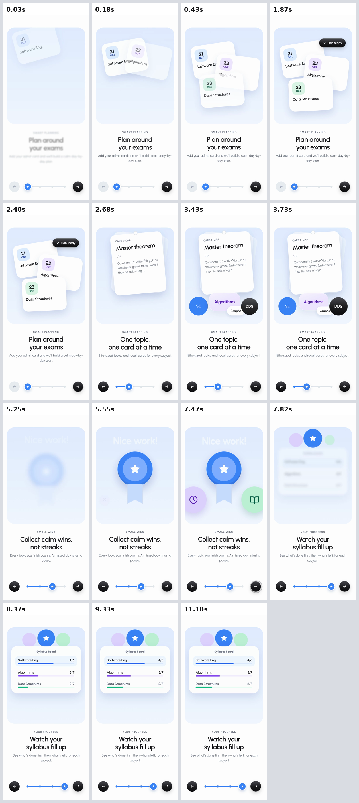

Exact spec from the live design (every animation, timing and easing)

| time | trigger / element | animation | from → to | dur ms | delay ms | easing | loops | React Native |
|---|---|---|---|---|---|---|---|---|
| 0.00s | “21 OCT Software Eng.” | `drop` | opacity:0; transform:translateY(-120px) rotate(-20deg) → opacity:1; transform:translateY(0px) rotate(-9deg) | 720 | 0 | `bezier(0.2, 0.9, 0.25, 1.12)` |  | dropIn() |
| 0.00s | “22 OCT Algorithms” | `drop` | opacity:0; transform:translateY(-120px) rotate(18deg) → opacity:1; transform:translateY(0px) rotate(7deg) | 720 | 140 | `bezier(0.2, 0.9, 0.25, 1.12)` |  | dropIn() |
| 0.00s | “23 OCT Data Structures” | `drop` | opacity:0; transform:translateY(-120px) rotate(-12deg) → opacity:1; transform:translateY(0px) rotate(-3deg) | 720 | 280 | `bezier(0.2, 0.9, 0.25, 1.12)` |  | dropIn() |
| 0.00s | “Plan ready” | `popin` | opacity:0; transform:scale(0.3) → opacity:1; transform:scale(1) | 520 | 620 | `bezier(0.2, 0.9, 0.25, 1.35)` |  | popIn() |
| 0.00s | “SMART PLANNING Plan around your e…” | `txt` | opacity:0; transform:translateY(8px); filter:blur(6px) → opacity:1; transform:none; filter:blur(0px) | 460 | 0 | `bezier(0.2, 0.8, 0.2, 1)` |  | BlurIn soft |
| **2.20s** | 👆 **tap [aria-label="Next"]** | | | | | | | |
| 2.35s | “Next” (button) | `filter` | filter:none → filter:blur(0.6px) | 220 | 0 | `ease` |  | (press blur → haptic in RN) |
| 2.35s | “Next” (button) | `transform` | transform:translateY(-0.97px) → transform:scale(0.96) | 180 | 0 | `bezier(0.2, 0, 0, 1)` |  | PressableScale / withSpring |
| 2.50s | “CARD 1 · DAA Master theorem (n) C…” | `swing` | opacity:0; transform:translate(60px, -140px) rotate(28deg) → opacity:1; transform:rotate(-4deg) | 900 | 0 | `bezier(0.2, 0.9, 0.25, 1.1)` |  | Keyframe swing |
| 2.50s | “SE” | `popin` | opacity:0; transform:scale(0.3) → opacity:1; transform:scale(1) | 520 | 520 | `bezier(0.2, 0.9, 0.25, 1.35)` |  | popIn() |
| 2.50s | “Algorithms” | `popin` | opacity:0; transform:scale(0.3) → opacity:1; transform:scale(1) | 520 | 620 | `bezier(0.2, 0.9, 0.25, 1.35)` |  | popIn() |
| 2.50s | “Graphs” | `popin` | opacity:0; transform:scale(0.3) → opacity:1; transform:scale(1) | 520 | 720 | `bezier(0.2, 0.9, 0.25, 1.35)` |  | popIn() |
| 2.50s | “DDS” | `popin` | opacity:0; transform:scale(0.3) → opacity:1; transform:scale(1) | 520 | 820 | `bezier(0.2, 0.9, 0.25, 1.35)` |  | popIn() |
| 2.50s | “SMART LEARNING One topic, one car…” | `txt` | opacity:0; transform:translateY(8px); filter:blur(6px) → opacity:1; transform:none; filter:blur(0px) | 460 | 0 | `bezier(0.2, 0.8, 0.2, 1)` |  | BlurIn soft |
| **4.77s** | 👆 **tap [aria-label="Next"]** | | | | | | | |
| 4.90s | “Next” (button) | `filter` | filter:none → filter:blur(0.6px) | 220 | 0 | `ease` |  | (press blur → haptic in RN) |
| 4.90s | “Next” (button) | `transform` | transform:translateY(-1px) → transform:scale(0.96) | 180 | 0 | `bezier(0.2, 0, 0, 1)` |  | PressableScale / withSpring |
| 5.05s | “Nice work!” | `ghost` | opacity:0; transform:translateY(-10px) → opacity:0.55; transform:none | 900 | 0 | `ease` |  | FadeIn |
| 5.05s | block 160×238 | `rise` | opacity:0; transform:translateY(12px); filter:blur(10px) → opacity:1; transform:none; filter:blur(0px) | 700 | 200 | `bezier(0.2, 0.9, 0.25, 1.08)` |  | BlurIn index={n} |
| 5.05s | shape 120×120 | `popin` | opacity:0; transform:scale(0.3) → opacity:1; transform:scale(1) | 520 | 520 | `bezier(0.2, 0.9, 0.25, 1.35)` |  | popIn() |
| 5.05s | shape 120×120 | `popin` | opacity:0; transform:scale(0.3) → opacity:1; transform:scale(1) | 520 | 640 | `bezier(0.2, 0.9, 0.25, 1.35)` |  | popIn() |
| 5.05s | “SMALL WINS Collect calm wins, not…” | `txt` | opacity:0; transform:translateY(8px); filter:blur(6px) → opacity:1; transform:none; filter:blur(0px) | 460 | 0 | `bezier(0.2, 0.8, 0.2, 1)` |  | BlurIn soft |
| **7.33s** | 👆 **tap [aria-label="Next"]** | | | | | | | |
| 7.45s | “Next” (button) | `filter` | filter:none → filter:blur(0.6px) | 220 | 0 | `ease` |  | (press blur → haptic in RN) |
| 7.45s | “Next” (button) | `transform` | transform:translateY(-1px) → transform:scale(0.96) | 180 | 0 | `bezier(0.2, 0, 0, 1)` |  | PressableScale / withSpring |
| 7.65s | shape 19×19 | `popin` | opacity:0; transform:scale(0.3) → opacity:1; transform:scale(1) | 520 | 80 | `bezier(0.2, 0.9, 0.25, 1.35)` |  | popIn() |
| 7.65s | shape 24×24 | `popin` | opacity:0; transform:scale(0.3) → opacity:1; transform:scale(1) | 520 | 0 | `bezier(0.2, 0.9, 0.25, 1.35)` |  | popIn() |
| 7.65s | shape 19×19 | `popin` | opacity:0; transform:scale(0.3) → opacity:1; transform:scale(1) | 520 | 160 | `bezier(0.2, 0.9, 0.25, 1.35)` |  | popIn() |
| 7.65s | “Syllabus board Software Eng. 4/6 …” | `rise` | opacity:0; transform:translateY(12px); filter:blur(10px) → opacity:1; transform:none; filter:blur(0px) | 700 | 160 | `bezier(0.2, 0.9, 0.25, 1.08)` |  | BlurIn index={n} |
| 7.65s | shape 0×6 | `grow` | transform:scaleX(0) → transform:scaleX(1) | 800 | 420 | `bezier(0.2, 0.8, 0.2, 1)` |  | scaleX 0→1, transformOrigin left |
| 7.65s | shape 0×6 | `grow` | transform:scaleX(0) → transform:scaleX(1) | 800 | 540 | `bezier(0.2, 0.8, 0.2, 1)` |  | scaleX 0→1, transformOrigin left |
| 7.65s | shape 0×6 | `grow` | transform:scaleX(0) → transform:scaleX(1) | 800 | 660 | `bezier(0.2, 0.8, 0.2, 1)` |  | scaleX 0→1, transformOrigin left |
| 7.65s | “YOUR PROGRESS Watch your syllabus…” | `txt` | opacity:0; transform:translateY(8px); filter:blur(6px) → opacity:1; transform:none; filter:blur(0px) | 460 | 0 | `bezier(0.2, 0.8, 0.2, 1)` |  | BlurIn soft |

---

## M4 · Quick add

The glossy + button blurs the whole screen behind a white veil and the actions fly out of it, last one first.

<video src="M4-quick-add-blur-menu.mp4" poster="posters/M4-quick-add-blur-menu.jpg" controls muted loop playsinline width="300"></video>

▶ **Video:** [`M4-quick-add-blur-menu.mp4`](M4-quick-add-blur-menu.mp4) · **Key frames (for AI):** [`frames/M4-quick-add-blur-menu.png`](frames/M4-quick-add-blur-menu.png) · **Raw timeline:** [`timeline/M4-quick-add-blur-menu.json`](timeline/M4-quick-add-blur-menu.json)

### Step by step

1. **1.20s** — Tap **+**: the screen blurs behind a white veil (200 ms); the + rotates into ×.
2. **1.50s** — Actions fly out from the button: translate (14, 26) → 0, scale .3 → 1, blur 4 → 0 (440 ms), 135 ms between items.
3. **3.37s** — Tap an action: the menu closes and a small toast confirms (2.2 s).
4. **4.93s** — Open again.

### Build it in React Native

- `<QuickAddMenu actions={…}>` as `Screen` overlay (iOS live blur, Android 82% white veil).

### Key frames

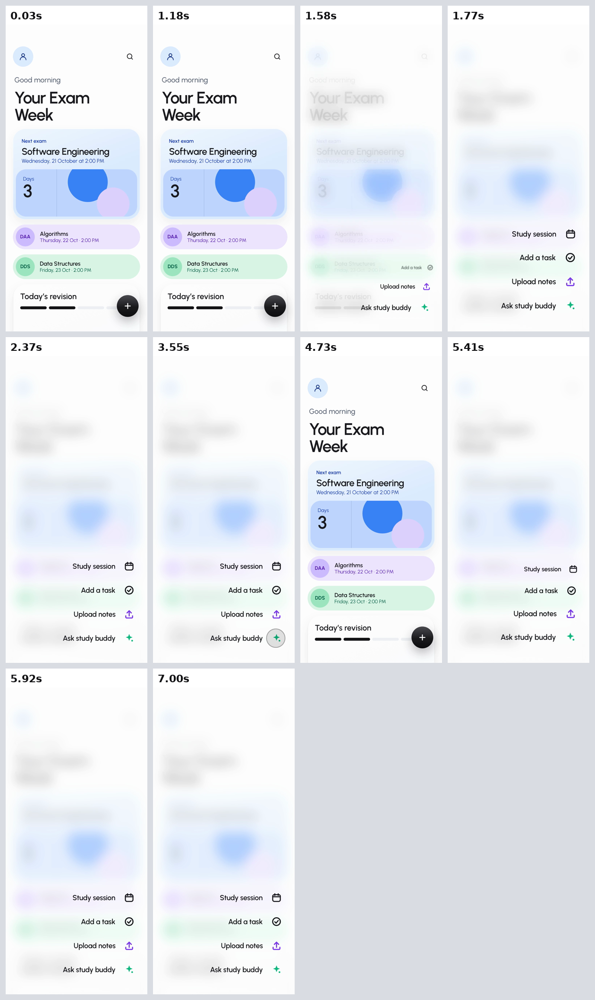

Exact spec from the live design (every animation, timing and easing)

| time | trigger / element | animation | from → to | dur ms | delay ms | easing | loops | React Native |
|---|---|---|---|---|---|---|---|---|
| **1.20s** | 👆 **tap [aria-label="Quick add"] >> nth=-1** | | | | | | | |
| 1.50s | block 390×844 | `veil` | opacity:0 → opacity:1 | 200 | 0 | `ease-out` |  | QuickAddMenu veil |
| 1.50s | “Study session” | `itemin` | opacity:0; transform:translate(14px, 26px) scale(0.3); filter:blur(4px… → opacity:1; transform:none; filter:none | 440 | 135 | `bezier(0.2, 0.9, 0.25, 1.25)` |  | quickAddItemIn(i) |
| 1.50s | “Add a task” | `itemin` | opacity:0; transform:translate(14px, 26px) scale(0.3); filter:blur(4px… → opacity:1; transform:none; filter:none | 440 | 90 | `bezier(0.2, 0.9, 0.25, 1.25)` |  | quickAddItemIn(i) |
| 1.50s | “Upload notes” | `itemin` | opacity:0; transform:translate(14px, 26px) scale(0.3); filter:blur(4px… → opacity:1; transform:none; filter:none | 440 | 45 | `bezier(0.2, 0.9, 0.25, 1.25)` |  | quickAddItemIn(i) |
| 1.50s | “Ask study buddy” | `itemin` | opacity:0; transform:translate(14px, 26px) scale(0.3); filter:blur(4px… → opacity:1; transform:none; filter:none | 440 | 0 | `bezier(0.2, 0.9, 0.25, 1.25)` |  | quickAddItemIn(i) |
| **3.37s** | 👆 **tap [aria-label="Quick add"] >> nth=-1** | | | | | | | |
| 3.65s | “Opening study buddy” | `toast` | opacity:0; transform:translateY(-14px) scale(0.96) → opacity:0; transform:translateY(-8px) | 2200 | 0 | `bezier(0.2, 0.8, 0.2, 1)` |  | Keyframe toast |
| **4.93s** | 👆 **tap [aria-label="Quick add"] >> nth=-1** | | | | | | | |
| 5.25s | “Study session” | `itemin` | opacity:0; transform:translate(14px, 26px) scale(0.3); filter:blur(4px… → opacity:1; transform:none; filter:none | 440 | 135 | `bezier(0.2, 0.9, 0.25, 1.25)` |  | quickAddItemIn(i) |
| 5.25s | “Add a task” | `itemin` | opacity:0; transform:translate(14px, 26px) scale(0.3); filter:blur(4px… → opacity:1; transform:none; filter:none | 440 | 90 | `bezier(0.2, 0.9, 0.25, 1.25)` |  | quickAddItemIn(i) |
| 5.25s | “Upload notes” | `itemin` | opacity:0; transform:translate(14px, 26px) scale(0.3); filter:blur(4px… → opacity:1; transform:none; filter:none | 440 | 45 | `bezier(0.2, 0.9, 0.25, 1.25)` |  | quickAddItemIn(i) |
| 5.25s | “Ask study buddy” | `itemin` | opacity:0; transform:translate(14px, 26px) scale(0.3); filter:blur(4px… → opacity:1; transform:none; filter:none | 440 | 0 | `bezier(0.2, 0.9, 0.25, 1.25)` |  | quickAddItemIn(i) |

---

## M5 · PDF tools

A reading dock with four tools. The + button morphs the dock into a grid of study tools.

<video src="M5-pdf-tools.mp4" poster="posters/M5-pdf-tools.jpg" controls muted loop playsinline width="300"></video>

▶ **Video:** [`M5-pdf-tools.mp4`](M5-pdf-tools.mp4) · **Key frames (for AI):** [`frames/M5-pdf-tools.png`](frames/M5-pdf-tools.png) · **Raw timeline:** [`timeline/M5-pdf-tools.json`](timeline/M5-pdf-tools.json)

### Step by step

1. **1.00s** — Tap highlight: the tool sits in the pressed-in groove.
2. **2.27s** — Tap +: the dock grows into a panel and the tools blur/scale in (35 ms apart).
3. **4.53s** — Tap ×: the panel shrinks back to the dock.

### Build it in React Native

- `<ToolDock primary={…} more={…}>` — layout spring 400/34, `toolIn(i)`.

### Key frames

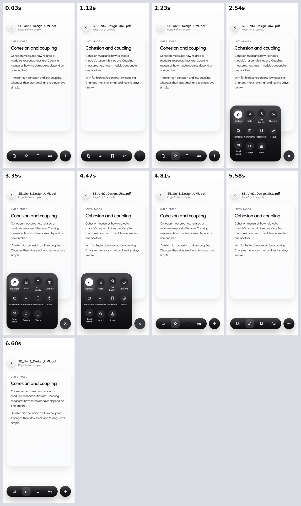

Exact spec from the live design (every animation, timing and easing)

| time | trigger / element | animation | from → to | dur ms | delay ms | easing | loops | React Native |
|---|---|---|---|---|---|---|---|---|
| **1.00s** | 👆 **tap [aria-label="Highlight"]** | | | | | | | |
| 1.15s | “Highlight” (button) | `transform` | transform:none → transform:scale(0.92) | 140 | 0 | `bezier(0.2, 0, 0, 1)` |  | PressableScale / withSpring |
| **2.27s** | 👆 **tap [aria-label="Open study tools"]** | | | | | | | |
| 2.40s | “Open study tools” (button) | `transform` | transform:none → transform:scale(0.88) | 360 | 0 | `bezier(0.3, 1.4, 0.45, 1)` |  | PressableScale / withSpring |
| **4.53s** | 👆 **tap [aria-label="Close tools"]** | | | | | | | |
| 4.65s | “Close tools” (button) | `transform` | transform:none → transform:scale(0.88) | 360 | 0 | `bezier(0.3, 1.4, 0.45, 1)` |  | PressableScale / withSpring |

---

## M6 · Split tab bar

Alternative tab bar: the active tab breaks away into its own black pill and the rest regroup; each screen blurs in.

<video src="M6-split-tab-bar.mp4" poster="posters/M6-split-tab-bar.jpg" controls muted loop playsinline width="300"></video>

▶ **Video:** [`M6-split-tab-bar.mp4`](M6-split-tab-bar.mp4) · **Key frames (for AI):** [`frames/M6-split-tab-bar.png`](frames/M6-split-tab-bar.png) · **Raw timeline:** [`timeline/M6-split-tab-bar.json`](timeline/M6-split-tab-bar.json)

### Step by step

1. **0.90s** — Tap **Calendar**: pill moves (460 ms, slight overshoot); screen blurs in (blur 4 → 0, 380 ms).
2. **2.37s** — Tap **Subjects**.
3. **3.83s** — Tap **Questions**.
4. **5.30s** — Back to **Today**.

### Build it in React Native

- Optional. The default is `<TabBar>` (groove). If you want this one: measured pill + `withSpring` and a separate group for the other tabs.

### Key frames

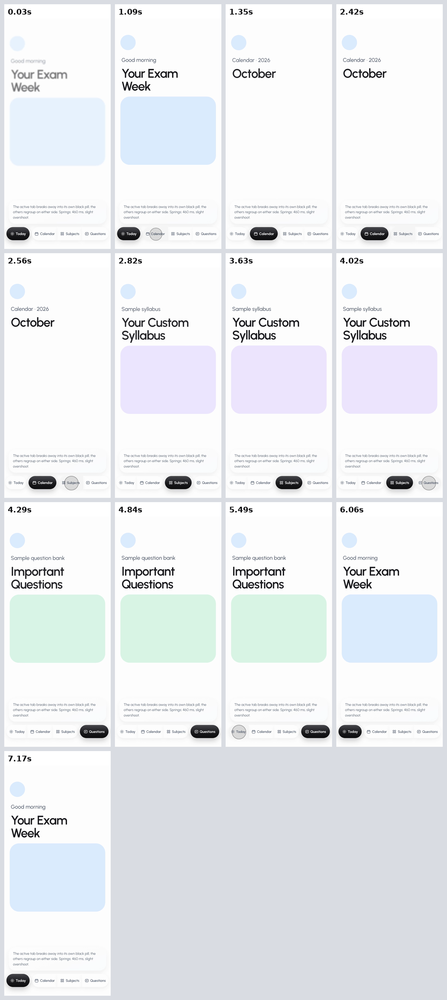

Exact spec from the live design (every animation, timing and easing)

| time | trigger / element | animation | from → to | dur ms | delay ms | easing | loops | React Native |
|---|---|---|---|---|---|---|---|---|
| 0.00s | “Good morning Your Exam Week” | `screen` | opacity:0; transform:translateY(10px); filter:blur(4px) → opacity:1; transform:none; filter:blur(0px) | 380 | 0 | `bezier(0.2, 0.8, 0.2, 1)` |  | BlurIn (screen) |
| **0.90s** | 👆 **tap [aria-label="Main"] button >> nth=1** | | | | | | | |
| 1.05s | “Calendar” | `transform` | transform:none → transform:scale(0.95) | 140 | 0 | `bezier(0.2, 0, 0, 1)` |  | PressableScale / withSpring |
| 1.20s | “Calendar · 2026 October” | `screen` | opacity:0; transform:translateY(10px); filter:blur(4px) → opacity:1; transform:none; filter:blur(0px) | 380 | 0 | `bezier(0.2, 0.8, 0.2, 1)` |  | BlurIn (screen) |
| **2.37s** | 👆 **tap [aria-label="Main"] button >> nth=2** | | | | | | | |
| 2.50s | “Subjects” | `transform` | transform:none → transform:scale(0.95) | 140 | 0 | `bezier(0.2, 0, 0, 1)` |  | PressableScale / withSpring |
| 2.65s | “Sample syllabus Your Custom Sylla…” | `screen` | opacity:0; transform:translateY(10px); filter:blur(4px) → opacity:1; transform:none; filter:blur(0px) | 380 | 0 | `bezier(0.2, 0.8, 0.2, 1)` |  | BlurIn (screen) |
| **3.83s** | 👆 **tap [aria-label="Main"] button >> nth=3** | | | | | | | |
| 3.95s | “Questions” | `transform` | transform:none → transform:scale(0.95) | 140 | 0 | `bezier(0.2, 0, 0, 1)` |  | PressableScale / withSpring |
| 4.15s | “Sample question bank Important Qu…” | `screen` | opacity:0; transform:translateY(10px); filter:blur(4px) → opacity:1; transform:none; filter:blur(0px) | 380 | 0 | `bezier(0.2, 0.8, 0.2, 1)` |  | BlurIn (screen) |
| **5.30s** | 👆 **tap [aria-label="Main"] button >> nth=0** | | | | | | | |
| 5.45s | “Today” | `transform` | transform:none → transform:scale(0.95) | 140 | 0 | `bezier(0.2, 0, 0, 1)` |  | PressableScale / withSpring |

---

## M7 · Live subject icons

Three ambient icons for subject chips and empty states. They loop quietly.

<video src="M7-live-subject-icons.mp4" poster="posters/M7-live-subject-icons.jpg" controls muted loop playsinline width="520"></video>

▶ **Video:** [`M7-live-subject-icons.mp4`](M7-live-subject-icons.mp4) · **Key frames (for AI):** [`frames/M7-live-subject-icons.png`](frames/M7-live-subject-icons.png) · **Raw timeline:** [`timeline/M7-live-subject-icons.json`](timeline/M7-live-subject-icons.json)

### Step by step

1. **0.00s** — SE: gears twist back and forth (2.4 s, three phases twistA/B/C); a key presses down (2.4 s).
2. **0.00s** — DAA: radar sweep rotates (2.6 s) with blips (from 400 ms).
3. **0.90s** — DDS: blocks warm in waves (heat 2.2 s); LEDs blink.

### Build it in React Native

- `withRepeat` rotate / opacity loops in `react-native-svg`; pause off-screen and with Reduce Motion.

### Key frames

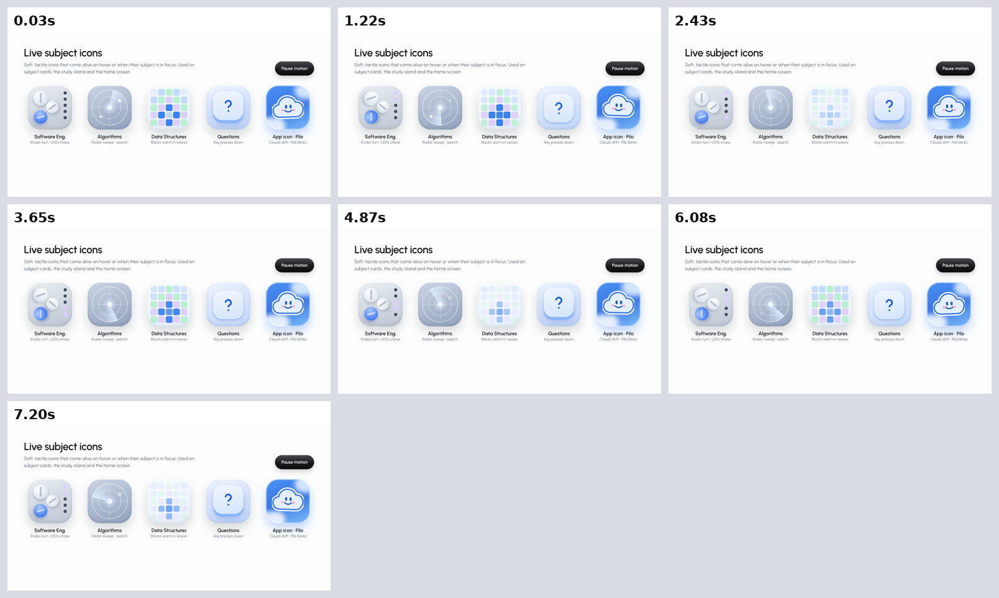

Exact spec from the live design (every animation, timing and easing)

| time | trigger / element | animation | from → to | dur ms | delay ms | easing | loops | React Native |
|---|---|---|---|---|---|---|---|---|
| 0.00s | shape 50×50 | `twistA` | transform:rotate(0deg) → transform:rotate(0deg) | 2400 | 0 | `bezier(0.5, 0, 0.3, 1.4)` | ∞ | withRepeat rotate |
| 0.00s | shape 58×58 | `twistB` | transform:rotate(-35deg) → transform:rotate(-35deg) | 2400 | 0 | `bezier(0.5, 0, 0.3, 1.4)` | ∞ | withRepeat rotate |
| 0.00s | shape 59×59 | `twistC` | transform:rotate(20deg) → transform:rotate(20deg) | 2400 | 0 | `bezier(0.5, 0, 0.3, 1.4)` | ∞ | withRepeat rotate |
| 0.00s | shape 11×11 | `led` | backgroundPositionX:0%; backgroundPositionY:0%; backgroundRepeat:repea… → backgroundPositionX:0%; backgroundPositionY:0%; backgroundRepeat:repea… | 1500 | 0 | `steps(1)` | ∞ | withRepeat backgroundColor |
| 0.00s | shape 11×11 | `led` | backgroundPositionX:0%; backgroundPositionY:0%; backgroundRepeat:repea… → backgroundPositionX:0%; backgroundPositionY:0%; backgroundRepeat:repea… | 1500 | 300 | `steps(1)` | ∞ | withRepeat backgroundColor |
| 0.00s | shape 11×11 | `led` | backgroundPositionX:0%; backgroundPositionY:0%; backgroundRepeat:repea… → backgroundPositionX:0%; backgroundPositionY:0%; backgroundRepeat:repea… | 1500 | 600 | `steps(1)` | ∞ | withRepeat backgroundColor |
| 0.00s | shape 11×11 | `led` | backgroundPositionX:0%; backgroundPositionY:0%; backgroundRepeat:repea… → backgroundPositionX:0%; backgroundPositionY:0%; backgroundRepeat:repea… | 1500 | 900 | `steps(1)` | ∞ | withRepeat backgroundColor |
| 0.00s | shape 11×11 | `led` | backgroundPositionX:0%; backgroundPositionY:0%; backgroundRepeat:repea… → backgroundPositionX:0%; backgroundPositionY:0%; backgroundRepeat:repea… | 1500 | 1200 | `steps(1)` | ∞ | withRepeat backgroundColor |
| 0.00s | shape 122×122 | `sweep` | transform:none → transform:rotate(360deg) | 2600 | 0 | `linear` | ∞ | withRepeat rotate |
| 0.00s | shape 10×10 | `blip` | opacity:0; transform:scale(0.4) → opacity:0; transform:scale(1.6) | 2600 | 400 | `ease-out` | ∞ | Keyframe scale+fade |
| 0.00s | shape 8×8 | `blip` | opacity:0; transform:scale(0.4) → opacity:0; transform:scale(1.6) | 2600 | 1600 | `ease-out` | ∞ | Keyframe scale+fade |
| 0.00s | 2× shape 23×23 | `heat` | opacity:0.25; transform:scale(0.86) → opacity:0.25; transform:scale(0.86) | 2200 | 900 | `ease-in-out` | ∞ | withRepeat opacity+scale |
| 0.00s | 4× shape 23×23 | `heat` | opacity:0.25; transform:scale(0.86) → opacity:0.25; transform:scale(0.86) | 2200 | 720 | `ease-in-out` | ∞ | withRepeat opacity+scale |
| 0.00s | 7× shape 23×23 | `heat` | opacity:0.25; transform:scale(0.86) → opacity:0.25; transform:scale(0.86) | 2200 | 540 | `ease-in-out` | ∞ | withRepeat opacity+scale |
| 0.00s | 7× shape 23×23 | `heat` | opacity:0.25; transform:scale(0.86) → opacity:0.25; transform:scale(0.86) | 2200 | 360 | `ease-in-out` | ∞ | withRepeat opacity+scale |
| 0.00s | 4× shape 23×23 | `heat` | opacity:0.25; transform:scale(0.86) → opacity:0.25; transform:scale(0.86) | 2200 | 180 | `ease-in-out` | ∞ | withRepeat opacity+scale |
| 0.00s | shape 20×20 | `heat` | opacity:0.25; transform:scale(0.86) → opacity:0.25; transform:scale(0.86) | 2200 | 0 | `ease-in-out` | ∞ | withRepeat opacity+scale |
| 0.00s | “?” | `keypress` | transform:translateY(0px); boxShadow:rgb(139, 181, 255) 0px 10px 0px 0… → transform:translateY(0px); boxShadow:rgb(139, 181, 255) 0px 10px 0px 0… | 2400 | 0 | `bezier(0.3, 1.4, 0.45, 1)` | ∞ | withRepeat translateY + shadow |
| 0.00s | shape 90×54 | `drift` | transform:translateX(0px) → transform:translateX(0px) | 7000 | 0 | `ease-in-out` | ∞ | withRepeat translateX |
| 0.00s | shape 86×56 | `drift` | transform:translateX(0px) → transform:translateX(0px) | 7000 | -3000 | `ease-in-out` | ∞ | withRepeat translateX |
| 0.00s | shape 111×94 | `bob` | transform:translateY(0px) rotate(-2deg) → transform:translateY(0px) rotate(-2deg) | 3000 | 0 | `ease-in-out` | ∞ | withRepeat translateY ± |
| 0.00s | g 23×13 | `blink` | transform:scaleY(1) → transform:scaleY(1) | 3400 | 0 | `ease-in-out` | ∞ | withRepeat scaleY |

---

## M8 · Study block picker

Pick a study block: presets fill a range band across the calendar; start / end values blur in when they change.

<video src="M8-study-block-picker.mp4" poster="posters/M8-study-block-picker.jpg" controls muted loop playsinline width="520"></video>

▶ **Video:** [`M8-study-block-picker.mp4`](M8-study-block-picker.mp4) · **Key frames (for AI):** [`frames/M8-study-block-picker.png`](frames/M8-study-block-picker.png) · **Raw timeline:** [`timeline/M8-study-block-picker.json`](timeline/M8-study-block-picker.json)

### Step by step

1. **1.00s** — Tap **Weekend**: the range band and end caps move; START / END values blur in (val: blur 3 → 0, rise 6, 280 ms).
2. **2.67s** — **1 week**: band stretches.
3. **4.33s** — **3 days**.
4. **6.00s** — **Until exam**: band reaches the exam day.

### Build it in React Native

- Band: absolute view with `withSpring` left/width; values `<BlurIn key={value} soft rise={6}>`; drag handles with `Gesture.Pan()`.

### Key frames

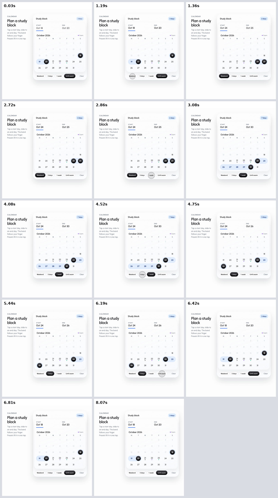

Exact spec from the live design (every animation, timing and easing)

| time | trigger / element | animation | from → to | dur ms | delay ms | easing | loops | React Native |
|---|---|---|---|---|---|---|---|---|
| 0.00s | “3 days” | `badge` | opacity:0; transform:scale(0.7) → opacity:1; transform:none | 300 | 0 | `bezier(0.2, 0.9, 0.25, 1.3)` |  | popIn() |
| 0.00s | “Oct 18” | `val` | opacity:0; transform:translateY(6px); filter:blur(3px) → opacity:1; transform:none; filter:blur(0px) | 280 | 0 | `bezier(0.2, 0.8, 0.2, 1)` |  | BlurIn soft keyed by value |
| 0.00s | “Oct 20” | `val` | opacity:0; transform:translateY(6px); filter:blur(3px) → opacity:1; transform:none; filter:blur(0px) | 280 | 0 | `bezier(0.2, 0.8, 0.2, 1)` |  | BlurIn soft keyed by value |
| **1.00s** | 👆 **tap button:has-text("Weekend")** | | | | | | | |
| 1.15s | “Weekend” | `transform` | transform:none → transform:scale(0.95) | 140 | 0 | `ease` |  | PressableScale / withSpring |
| 1.30s | “2 days” | `badge` | opacity:0; transform:scale(0.7) → opacity:1; transform:none | 300 | 0 | `bezier(0.2, 0.9, 0.25, 1.3)` |  | popIn() |
| 1.30s | “Oct 24” | `val` | opacity:0; transform:translateY(6px); filter:blur(3px) → opacity:1; transform:none; filter:blur(0px) | 280 | 0 | `bezier(0.2, 0.8, 0.2, 1)` |  | BlurIn soft keyed by value |
| 1.30s | “Oct 25” | `val` | opacity:0; transform:translateY(6px); filter:blur(3px) → opacity:1; transform:none; filter:blur(0px) | 280 | 0 | `bezier(0.2, 0.8, 0.2, 1)` |  | BlurIn soft keyed by value |
| **2.67s** | 👆 **tap button:has-text("1 week")** | | | | | | | |
| 2.80s | “1 week” | `transform` | transform:none → transform:scale(0.95) | 140 | 0 | `ease` |  | PressableScale / withSpring |
| 2.95s | “7 days” | `badge` | opacity:0; transform:scale(0.7) → opacity:1; transform:none | 300 | 0 | `bezier(0.2, 0.9, 0.25, 1.3)` |  | popIn() |
| 2.95s | “Oct 30” | `val` | opacity:0; transform:translateY(6px); filter:blur(3px) → opacity:1; transform:none; filter:blur(0px) | 280 | 0 | `bezier(0.2, 0.8, 0.2, 1)` |  | BlurIn soft keyed by value |
| **4.33s** | 👆 **tap button:has-text("3 days")** | | | | | | | |
| 4.45s | “3 days” | `transform` | transform:none → transform:scale(0.95) | 140 | 0 | `ease` |  | PressableScale / withSpring |
| 4.65s | “Oct 26” | `val` | opacity:0; transform:translateY(6px); filter:blur(3px) → opacity:1; transform:none; filter:blur(0px) | 280 | 0 | `bezier(0.2, 0.8, 0.2, 1)` |  | BlurIn soft keyed by value |
| **6.00s** | 👆 **tap button:has-text("Until exam")** | | | | | | | |
| 6.15s | “Until exam” | `transform` | transform:none → transform:scale(0.95) | 140 | 0 | `ease` |  | PressableScale / withSpring |
| 6.30s | “3 days” | `badge` | opacity:0; transform:scale(0.7) → opacity:1; transform:none | 300 | 0 | `bezier(0.2, 0.9, 0.25, 1.3)` |  | popIn() |

---

## M9 · Blur reader

Your reference clip, rebuilt: lines drift up every 2.6 s; the focused line is bold black, neighbours grey and blurred; the edges fade through a progressive blur.

<video src="M9-blur-reader.mp4" poster="posters/M9-blur-reader.jpg" controls muted loop playsinline width="300"></video>

▶ **Video:** [`M9-blur-reader.mp4`](M9-blur-reader.mp4) · **Key frames (for AI):** [`frames/M9-blur-reader.png`](frames/M9-blur-reader.png) · **Raw timeline:** [`timeline/M9-blur-reader.json`](timeline/M9-blur-reader.json)

### Step by step

1. **0.00s** — Lines drift up one step every **2.6 s** (track 900 ms `bezier(.65,0,.25,1)`); focus line #111113 700, next #6E6E74 blur 0.4, far #A6A6AC blur 1.6 (700 ms).
2. **6.50s** — Tap mode 2: the groove slides (spring); text blurs out and back in (blur 14 → 0, scale .98 → 1, 520 ms).
3. **10.37s** — Mode 3: same swap.
4. **13.53s** — Pen: rotates −18°, scale 1.1, and the highlighter wipes in under the focus line (700 ms).

### Build it in React Native

- `<BlurReader modes={…}>` — same timings (`READER_STEP_MS`, `readerLine`).

### Key frames

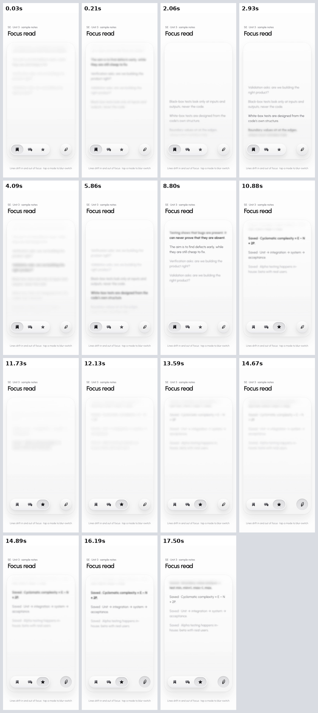

Exact spec from the live design (every animation, timing and easing)

| time | trigger / element | animation | from → to | dur ms | delay ms | easing | loops | React Native |
|---|---|---|---|---|---|---|---|---|
| 0.00s | “Testing shows that bugs are prese…” | `transform` | transform:none → transform:translateY(214px) | 900 | 0 | `bezier(0.65, 0, 0.25, 1)` |  | PressableScale / withSpring |
| 0.00s | “Testing shows that bugs are prese…” | `modeA` | opacity:0; transform:scale(0.98); filter:blur(14px) → opacity:1; transform:none; filter:blur(0px) | 520 | 0 | `bezier(0.2, 0.8, 0.2, 1)` |  | BlurIn amount=blur.swap |
| 0.15s | “Testing shows that bugs are prese…” | `transform` | transform:none → transform:translateY(154px) | 900 | 0 | `bezier(0.65, 0, 0.25, 1)` |  | PressableScale / withSpring |
| 0.15s | “Testing shows that bugs are prese…” | `modeA` | opacity:0; transform:scale(0.98); filter:blur(14px) → opacity:1; transform:none; filter:blur(0px) | 520 | 0 | `bezier(0.2, 0.8, 0.2, 1)` |  | BlurIn amount=blur.swap |
| 0.25s | “Testing shows that bugs are prese…” | `transform` | transform:none → transform:translateY(81px) | 900 | 0 | `bezier(0.65, 0, 0.25, 1)` |  | PressableScale / withSpring |
| 0.25s | “Testing shows that bugs are prese…” | `modeA` | opacity:0; transform:scale(0.98); filter:blur(14px) → opacity:1; transform:none; filter:blur(0px) | 520 | 0 | `bezier(0.2, 0.8, 0.2, 1)` |  | BlurIn amount=blur.swap |
| 0.50s | “Testing shows that bugs are prese…” | `transform` | transform:none → transform:translateY(8px) | 900 | 0 | `bezier(0.65, 0, 0.25, 1)` |  | PressableScale / withSpring |
| 0.50s | “Testing shows that bugs are prese…” | `modeA` | opacity:0; transform:scale(0.98); filter:blur(14px) → opacity:1; transform:none; filter:blur(0px) | 520 | 0 | `bezier(0.2, 0.8, 0.2, 1)` |  | BlurIn amount=blur.swap |
| 1.70s | “Testing shows that bugs are prese…” | `transform` | transform:none → transform:translateY(227px) | 900 | 0 | `bezier(0.65, 0, 0.25, 1)` |  | PressableScale / withSpring |
| 1.75s | 2× “Testing shows that bugs are prese…” | `transform` | transform:none → transform:translateY(154px) | 900 | 0 | `bezier(0.65, 0, 0.25, 1)` |  | PressableScale / withSpring |
| 2.25s | “Testing shows that bugs are prese…” | `transform` | transform:none → transform:translateY(154px) | 900 | 0 | `bezier(0.65, 0, 0.25, 1)` |  | PressableScale / withSpring |
| 2.40s | “Testing shows that bugs are prese…” | `transform` | transform:none → transform:translateY(81px) | 900 | 0 | `bezier(0.65, 0, 0.25, 1)` |  | PressableScale / withSpring |
| 2.65s | “Testing shows that bugs are prese…” | `transform` | transform:none → transform:translateY(8px) | 900 | 0 | `bezier(0.65, 0, 0.25, 1)` |  | PressableScale / withSpring |
| 3.50s | “Testing shows that bugs are prese…” | `transform` | transform:none → transform:translateY(227px) | 900 | 0 | `bezier(0.65, 0, 0.25, 1)` |  | PressableScale / withSpring |
| 3.75s | “Testing shows that bugs are prese…” | `transform` | transform:none → transform:translateY(154px) | 900 | 0 | `bezier(0.65, 0, 0.25, 1)` |  | PressableScale / withSpring |
| 3.85s | “Testing shows that bugs are prese…” | `transform` | transform:none → transform:translateY(81px) | 900 | 0 | `bezier(0.65, 0, 0.25, 1)` |  | PressableScale / withSpring |
| 4.05s | “Testing shows that bugs are prese…” | `transform` | transform:none → transform:translateY(8px) | 900 | 0 | `bezier(0.65, 0, 0.25, 1)` |  | PressableScale / withSpring |
| 5.00s | “Testing shows that bugs are prese…” | `transform` | transform:none → transform:translateY(227px) | 900 | 0 | `bezier(0.65, 0, 0.25, 1)` |  | PressableScale / withSpring |
| 5.15s | “Testing shows that bugs are prese…” | `transform` | transform:none → transform:translateY(154px) | 900 | 0 | `bezier(0.65, 0, 0.25, 1)` |  | PressableScale / withSpring |
| 5.25s | “Testing shows that bugs are prese…” | `transform` | transform:none → transform:translateY(81px) | 900 | 0 | `bezier(0.65, 0, 0.25, 1)` |  | PressableScale / withSpring |
| 5.50s | “Testing shows that bugs are prese…” | `transform` | transform:none → transform:translateY(8px) | 900 | 0 | `bezier(0.65, 0, 0.25, 1)` |  | PressableScale / withSpring |
| **6.50s** | 👆 **tap [aria-label="Reader mode"] button >> nth=1** | | | | | | | |
| 6.50s | “Testing shows that bugs are prese…” | `transform` | transform:none → transform:translateY(227px) | 900 | 0 | `bezier(0.65, 0, 0.25, 1)` |  | PressableScale / withSpring |
| 6.65s | “Ask Pilo” (button) | `filter` | filter:none → filter:blur(0.6px) | 220 | 0 | `ease` |  | (press blur → haptic in RN) |
| 6.65s | “Ask Pilo” (button) | `transform` | transform:translateY(-0.97px) → transform:scale(0.92) | 180 | 0 | `bezier(0.2, 0, 0, 1)` |  | PressableScale / withSpring |
| 6.70s | “Testing shows that bugs are prese…” | `transform` | transform:none → transform:translateY(154px) | 900 | 0 | `bezier(0.65, 0, 0.25, 1)` |  | PressableScale / withSpring |
| 6.85s | “Testing shows that bugs are prese…” | `transform` | transform:none → transform:translateY(81px) | 900 | 0 | `bezier(0.65, 0, 0.25, 1)` |  | PressableScale / withSpring |
| 7.15s | “Testing shows that bugs are prese…” | `transform` | transform:none → transform:translateY(8px) | 900 | 0 | `bezier(0.65, 0, 0.25, 1)` |  | PressableScale / withSpring |
| 8.50s | “Testing shows that bugs are prese…” | `transform` | transform:none → transform:translateY(227px) | 900 | 0 | `bezier(0.65, 0, 0.25, 1)` |  | PressableScale / withSpring |
| 8.90s | “Testing shows that bugs are prese…” | `transform` | transform:none → transform:translateY(154px) | 900 | 0 | `bezier(0.65, 0, 0.25, 1)` |  | PressableScale / withSpring |
| 9.25s | “Testing shows that bugs are prese…” | `transform` | transform:none → transform:translateY(8px) | 900 | 0 | `bezier(0.65, 0, 0.25, 1)` |  | PressableScale / withSpring |
| **10.37s** | 👆 **tap [aria-label="Reader mode"] button >> nth=2** | | | | | | | |
| 10.50s | “Saved” (button) | `filter` | filter:none → filter:blur(0.6px) | 220 | 0 | `ease` |  | (press blur → haptic in RN) |
| 10.50s | “Saved” (button) | `transform` | transform:translateY(-0.97px) → transform:scale(0.92) | 180 | 0 | `bezier(0.2, 0, 0, 1)` |  | PressableScale / withSpring |
| 10.65s | “Saved · Boundary value analysis —…” | `transform` | transform:none → transform:translateY(227px) | 900 | 0 | `bezier(0.65, 0, 0.25, 1)` |  | PressableScale / withSpring |
| 10.65s | “Saved · Boundary value analysis —…” | `modeB` | opacity:0; transform:scale(0.98); filter:blur(14px) → opacity:1; transform:none; filter:blur(0px) | 520 | 0 | `bezier(0.2, 0.8, 0.2, 1)` |  | BlurIn amount=blur.swap |
| 10.75s | “Saved · Boundary value analysis —…” | `transform` | transform:none → transform:translateY(154px) | 900 | 0 | `bezier(0.65, 0, 0.25, 1)` |  | PressableScale / withSpring |
| 11.25s | “Saved · Boundary value analysis —…” | `transform` | transform:none → transform:translateY(81px) | 900 | 0 | `bezier(0.65, 0, 0.25, 1)` |  | PressableScale / withSpring |
| 11.75s | “Saved · Boundary value analysis —…” | `transform` | transform:none → transform:translateY(8px) | 900 | 0 | `bezier(0.65, 0, 0.25, 1)` |  | PressableScale / withSpring |
| 12.10s | “Saved · Boundary value analysis —…” | `transform` | transform:none → transform:translateY(227px) | 900 | 0 | `bezier(0.65, 0, 0.25, 1)` |  | PressableScale / withSpring |
| 12.45s | “Saved · Boundary value analysis —…” | `transform` | transform:none → transform:translateY(154px) | 900 | 0 | `bezier(0.65, 0, 0.25, 1)` |  | PressableScale / withSpring |
| 12.90s | “Saved · Boundary value analysis —…” | `transform` | transform:none → transform:translateY(81px) | 900 | 0 | `bezier(0.65, 0, 0.25, 1)` |  | PressableScale / withSpring |
| 13.25s | “Saved · Boundary value analysis —…” | `transform` | transform:none → transform:translateY(8px) | 900 | 0 | `bezier(0.65, 0, 0.25, 1)` |  | PressableScale / withSpring |
| **13.53s** | 👆 **tap [aria-label="Highlight focus line"] >> visible=true** | | | | | | | |
| 13.55s | “Saved · Boundary value analysis —…” | `transform` | transform:none → transform:translateY(227px) | 900 | 0 | `bezier(0.65, 0, 0.25, 1)` |  | PressableScale / withSpring |
| 13.65s | “Highlight focus line” (button) | `transform` | transform:none → transform:scale(0.92) | 180 | 0 | `bezier(0.2, 0, 0, 1)` |  | PressableScale / withSpring |
| 13.85s | 2× “Saved · Boundary value analysis —…” | `transform` | transform:none → transform:translateY(227px) | 900 | 0 | `bezier(0.65, 0, 0.25, 1)` |  | PressableScale / withSpring |
| 14.25s | “Saved · Boundary value analysis —…” | `transform` | transform:none → transform:translateY(81px) | 900 | 0 | `bezier(0.65, 0, 0.25, 1)` |  | PressableScale / withSpring |
| 14.25s | “Saved · Boundary value analysis —…” | `modeB` | opacity:0; transform:scale(0.98); filter:blur(14px) → opacity:1; transform:none; filter:blur(0px) | 520 | 0 | `bezier(0.2, 0.8, 0.2, 1)` |  | BlurIn amount=blur.swap |
| 14.55s | “Saved · Boundary value analysis —…” | `transform` | transform:none → transform:translateY(8px) | 900 | 0 | `bezier(0.65, 0, 0.25, 1)` |  | PressableScale / withSpring |
| 14.65s | “Saved · Boundary value analysis —…” | `transform` | transform:none → transform:translateY(227px) | 900 | 0 | `bezier(0.65, 0, 0.25, 1)` |  | PressableScale / withSpring |
| 14.80s | “Saved · Boundary value analysis —…” | `transform` | transform:none → transform:translateY(154px) | 900 | 0 | `bezier(0.65, 0, 0.25, 1)` |  | PressableScale / withSpring |
| 15.15s | “Saved · Boundary value analysis —…” | `transform` | transform:none → transform:translateY(81px) | 900 | 0 | `bezier(0.65, 0, 0.25, 1)` |  | PressableScale / withSpring |
| 15.55s | “Saved · Boundary value analysis —…” | `transform` | transform:none → transform:translateY(8px) | 900 | 0 | `bezier(0.65, 0, 0.25, 1)` |  | PressableScale / withSpring |
| 15.85s | “Saved · Boundary value analysis —…” | `transform` | transform:none → transform:translateY(227px) | 900 | 0 | `bezier(0.65, 0, 0.25, 1)` |  | PressableScale / withSpring |
| 16.05s | “Saved · Boundary value analysis —…” | `transform` | transform:none → transform:translateY(154px) | 900 | 0 | `bezier(0.65, 0, 0.25, 1)` |  | PressableScale / withSpring |
| 16.45s | “Saved · Boundary value analysis —…” | `transform` | transform:none → transform:translateY(81px) | 900 | 0 | `bezier(0.65, 0, 0.25, 1)` |  | PressableScale / withSpring |
| 16.85s | “Saved · Boundary value analysis —…” | `transform` | transform:none → transform:translateY(8px) | 900 | 0 | `bezier(0.65, 0, 0.25, 1)` |  | PressableScale / withSpring |
| 17.25s | “Saved · Boundary value analysis —…” | `transform` | transform:none → transform:translateY(227px) | 900 | 0 | `bezier(0.65, 0, 0.25, 1)` |  | PressableScale / withSpring |
| 17.55s | “Saved · Boundary value analysis —…” | `transform` | transform:none → transform:translateY(154px) | 900 | 0 | `bezier(0.65, 0, 0.25, 1)` |  | PressableScale / withSpring |

---
