# ExamPilot — Design Specification

A calm, friendly exam-prep companion for Indian B.Tech students. This file is the single source of truth for **what to build and how it should look, move and read**. Every screen below has a screenshot, its layout, its states, what each control does, its animation and its acceptance criteria.

> **Design principle:** calm without being bland. Big friendly type, soft pastel subject cards, one confident black for actions, plenty of space, no red alerts, no ticking clocks, no streaks to lose.

---

## 0. How to read this folder

| Folder | What's inside | Use it for |
|---|---|---|
| `DESIGN.md` (this file) | Full spec for all 12 screens | Building each screen |
| `CLAUDE.md` | Rules for Claude Code | Copy into your repo root |
| `screenshots/` | PNG of every screen and state (2× retina, full scroll height) | Visual target, pixel reference |
| `reference/rendered-html/` | Static HTML snapshot of each screen | Exact spacing, sizes, colours, markup |
| `reference/prototypes/` | Original interactive design files (`.dc.html`) incl. logic | How each interaction behaves |
| `design-tokens/` | `tokens.json`, `tokens.css`, `tailwind.config.js` | Colours, type, radius, shadows, motion |
| `animations/` | `keyframes.css`, `motion-variants.ts`, `examples/*.tsx` | Every animation, ready to drop in |
| `assets/icons/` | 38 SVG icons + `sprite.svg` | All icons used |
| `assets/illustrations/` | 11 SVG illustrations (logo, app icon, splash art, hero art…) | Decorative art |
| `sample-data/` | JSON for exams, subjects, tasks, sessions, questions, materials, microcopy, AI shapes | Seeding the app |
| `docs/` | Motion, data model, backend & AI, build plan with prompts | Deeper detail per topic |
| `research/` | Design research + AI/backend research report and notes | Why decisions were made |

**Screenshot naming:** `NN-screen.png` is the default state; `NNb-…`, `NNc-…` are other states of the same screen.

---

## 1. Product overview

### 1.1 Real data that must be preloaded
| Exam | Date | Time |
|---|---|---|
| Software Engineering (SE) | Wed 21 October 2026 | 2:00 PM |
| Design and Analysis of Algorithm (DAA) | Thu 22 October 2026 | 2:00 PM |
| Design of Data Structures (DDS) | Fri 23 October 2026 | 2:00 PM |

Everything else in the screenshots (topics, tasks, sessions, questions, PDFs, notes) is **sample content** and must be labelled "Sample" in the UI until the student edits it. "Today" in the design is **Sunday 18 October 2026**.

### 1.2 Flow

```
1 Splash ─► 2 Login ─► 3 Your details ─► 4 Admit card ─► 5 Plan ready ─► 6 Today
                                                                       │
            ┌──────────────── bottom nav (4 tabs) ─────────────────────┤
            6 Today   7 Calendar   8 Subjects   9 Questions
                                      │
                                      └─► 10 Study materials ─► 12 PDF reader ─► 11 Study assistant
            5 Plan ready ─► "Adjust with study assistant" ─► 11
            Today hero ↗ ─► 8 Subjects        DAA/DDS rows ─► 7 Calendar
```

- **First launch:** 1 → 2 → 3 → 4 → 5 → 6. Steps 3–5 show a 3-step progress bar.
- **Repeat launch:** skip the animated splash; open on Today (keep the native splash only until data is ready).
- **Main app:** exactly **four tabs** — Today, Calendar, Subjects, Questions. Study materials, PDF reader and the assistant are reached from inside those screens (not new tabs).
- **Where the assistant lives (decide):** reachable from Plan ready, the PDF reader ("Ask about this page"), and a sparkle button you may add to the Today header. Keep the bottom nav at four.

### 1.3 Must-haves
- Responsive; mobile first (390 × 844 design frame). On ≥ 768px, centre a 480px column or move the nav to a left rail.
- Checklists, filters, calendar navigation, accordion, topic ticks all work.
- Progress saved (localStorage in v1, Firestore after login is built — see `docs/data-model.md`).
- `prefers-reduced-motion` respected everywhere.
- Friendly copy only — see `sample-data/microcopy.json`.

---

## 2. Design system — "Lavender Calm"

Full values: `design-tokens/tokens.json`. Board image: `screenshots/design-system-board.png`.

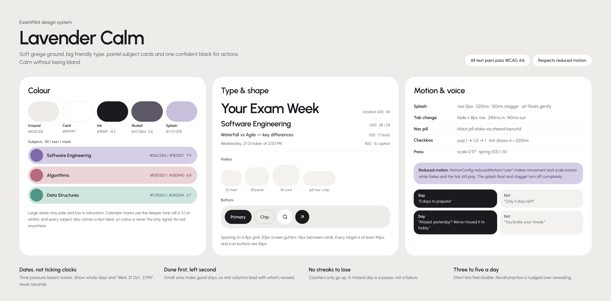

### 2.1 Colour
| Role | Hex | Notes |
|---|---|---|
| Ground (page) | `#EDECE8` | warm greige |
| Surface (cards, icon buttons) | `#FFFFFF` | |
| Surface muted / input | `#F4F2EE` / `#F7F6F3` | inactive nav buttons, inputs, note boxes |
| Ink (text, primary actions) | `#1B1B1F` | 14.5:1 on ground |
| Ink muted | `#5C5866` | 5.8:1 on ground |
| Ink subtle | `#77727F` | 4.7:1 on white — captions only |
| Splash | `#C9C0DB` | splash backgrounds |
| Border / strong | `#E4E1DA` / `#CFCAC1` | chips use strong |

**Subjects** (fill / text on fill / chart mark):
| Subject | Fill | Text | Mark | Contrast |
|---|---|---|---|---|
| SE — lavender | `#D6CDE6` (deep `#C5BADB`) | `#3E3557` (muted `#4A4260`) | `#7D6BAA` | 7.4 |
| DAA — pink | `#EBD3D7` (deep `#DDB5BD`) | `#6B3440` | `#B86A7A` | 6.8 |
| DDS — mint | `#CFE6E0` (deep `#A9D3C8`) | `#24524A` | `#4F9686` | 6.7 |

Decorative art: plum `#8C7BB5`, pink `#E9C4CC`, mint `#BFE0D8`. Highlighter `#E9DFF7`.

**Status:** info `#E3EEF8/#2C5577`, success = DDS mint, heads-up `#FEF3DC/#7A5300`, error `#FDE7E4/#9A3B33` (**real errors only** — never for exams or deadlines). Subjects always carry a text label (SE / DAA / DDS) so colour is never the only signal.

### 2.2 Typography — Urbanist (Google Fonts, 400/500/600/700)
| Style | Size / line-height | Weight | Tracking | Used for |
|---|---|---|---|---|
| Splash display | 60 / 1.0 | 600 | −0.04em | "ExamPilot" |
| Display | 46 / 1.02 | 600 | −0.03em | "Your Exam Week", screen titles (2 lines) |
| Onboard title | 40 / 1.05 | 600 | −0.03em | login/onboarding headings |
| Stat number | 54 / 1.0 | 600 | −0.03em | "3" days |
| Card title | 28 / 1.1 | 600 | −0.02em | hero card subject |
| Section | 24 / 1.2 | 600 | −0.02em | "Today's revision" |
| Eyebrow | 20 / 1.3 | 500 | — | "Good morning", muted |
| Body large | 17 / 1.5 | 500 | — | task titles |
| Body | 16 / 1.55 | 400–600 | — | rows, answers |
| Caption | 14–15 | 400 | — | meta lines |
| Micro | 13 | 600 | — | chips, tags |

### 2.3 Shape, size, spacing
- **Radius:** input 22 · inset 22 · panel 28 · card 34 · sheet 36 (top corners) · everything else pill (`9999px`). List rows that represent exams/sessions are **pills** (`border-radius: 999px`) with a 52px circle on the left.
- **Sizes:** icon buttons 56 (white circles), small 44–48; primary button 62–64 high, black pill with a 46–48 white circle containing an arrow on the right; chips 52 high; touch targets ≥ 44.
- **Spacing:** 4px grid. Screen gutters 20 (tabs) / 24 (onboarding). Top padding 60. Card gap 14. Card padding 18–22. Bottom padding 128 so content clears the floating nav.
- **Shadows:** cards are mostly flat (white on greige). Nav `0 12px 32px rgba(40,30,60,.14)`; sheet/hero art `0 16px 40px rgba(40,30,60,.10)`.
- **No gradients** on backgrounds or cards (one exception: the chat input area fades from transparent to ground so messages scroll under it).

### 2.4 Iconography
Stroke icons, 24 viewBox, 2px stroke, round caps/joins, `currentColor`. 22px in nav and icon buttons, 20px in pills. Files in `assets/icons/`. Never use emoji.

### 2.5 Voice
Warm, plain English. Lead with what's done. Dates not countdown clocks. System takes the blame ("We've moved it to today"). Full set: `sample-data/microcopy.json`.
- Say "3 days to prepare" — not "Only 3 days left!"
- Say "Missed yesterday? No problem. We've moved it to today." — not "You broke your streak."

---

## 3. Shared components

Build these once and reuse. Reference look in the screenshots; behaviour in `docs/motion.md`.

| Component | Spec |
|---|---|
| **TopBar** | Left: 56px lavender circle avatar (user icon) or white back button. Right: 56px white circles — Search, More (⋯). Gap 8. |
| **ScreenHeader** | Eyebrow (20/500 muted) + Display title (46/600, may break onto 2 lines). Padding 14 top, 4 sides. |
| **FloatingTabBar** | Fixed, 20px from sides, 24px from bottom (+ safe-area). White 78% capsule, 8px padding, white 1px border, nav shadow. Active tab = black pill that flexes to fill with icon + label; inactive = 56px circles `#F4F2EE` with `#E4E1DA` border. Example: `animations/examples/TabBar.tsx`. |
| **PrimaryButton** | Black pill, 62–64px, label 18/600 white, left padding 28, right a 46–48px white circle with arrow-right icon. Hover lifts 1px; press scales 0.97. |
| **SecondaryButton** | White pill 56px, or outline pill (`1.5px #CFCAC1`), or dashed outline for "Add …". |
| **IconButton** | 56px white circle (52 on onboarding), 22px icon. |
| **Chip / FilterChip** | 52px pill. Active: black fill, white 600 text. Inactive: transparent with `1.5px #CFCAC1`. Leading 52px white circle with filter icon (decorative). |
| **SubjectTag** | Small pill: subject fill + text, 13/600, padding 2×9. |
| **SubjectRow** | Pill in subject fill; 52px circle (deep fill) with code; title 16/600 (ellipsis); meta 14 in subject text colour. |
| **HeroCard** (SubjectHero) | 34-radius card in subject fill, 8px padding. Header: eyebrow, title 28/600, description, 48px outline ⋯ button. Inner 28-radius panel (deep fill, 170–176 high) split into stat columns with 1px dividers (e.g. Days 3 / Topics 4/6) + an abstract circle composition + a 52px black ↗ button bottom-right. See `screenshots/component-subject-hero.png`, `assets/illustrations/hero-card-art-*.svg`. |
| **SegmentedProgress** | One segment per item, 6–8px tall pills, gap 4–6. Done = ink, todo = `#ECEAE5` (or white 75% on tinted cards). Segments fill one by one. |
| **Checkbox** | 28–30px circle. Unchecked: 2px `#BDB8AE` ring. Checked: ink fill, white tick that draws in, title turns muted with a strike-through. Example: `animations/examples/AnimatedCheckbox.tsx`. |
| **Card** | White, 34 radius, padding 20–22. |
| **InfoCard** | Gentle notice (info/mint/lavender fill), 20–24 radius, icon + text. Never red. |
| **BottomSheet** | White, 36 top radius, handle 44×5, scrim `rgba(27,27,31,.32)`. Slides up. |
| **StepHeader** (onboarding) | Back circle + 3 segment progress + "n of 3". |
| **Field** | `#F7F6F3` box, 22 radius, label 13/600 muted above input 17px. Focus: 2px ink ring, white background. |

---

## 4. Screens

Each screen: screenshot · purpose · layout (top → bottom) · interactions · states · animation · acceptance criteria. Pixel values are for the 390-wide frame.

---

### 01 · Animated splash (first launch only)

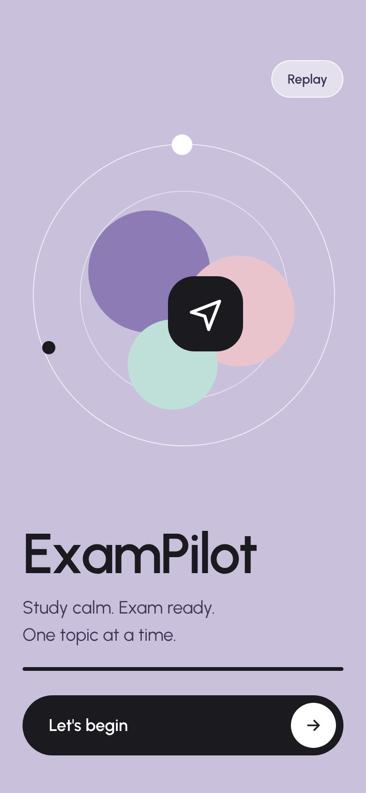

**Purpose:** a warm, ~1.9 s welcome that sets the calm tone.
**Layout:** full-bleed `#C9C0DB`. Top-right "Replay" pill (design-only; drop in production). Centre: two white rings (320/220), three overlapping circles (plum 130, pink 118, mint 96), a black 80px rounded-square logo badge with the paper-plane mark, two orbiting dots. Bottom: "ExamPilot" 60/600, tagline "Study calm. Exam ready. / One topic at a time." 19px in `#3E3557`, a 4px load bar, black "Let's begin" button.
**Interactions:** "Let's begin" → Login (first launch) or Today (signed in).
**Animation (in order):** rings + circles bloom from 0.6 scale (0 / 140 / 280 ms, overshoot ease) → logo badge pops (300 ms) → logo path draws (500–1200 ms) → letters rise one by one (700 ms + 45 ms each) → load bar fills (400–1900 ms) → tagline fades (1200 ms) → CTA fades (1700 ms). Dots orbit slowly (14 s loop). Code: `animations/examples/SplashIntro.tsx`, timeline in `motion-variants.ts → splashTimeline`.
**Reduced motion:** show the final frame immediately; no orbit.
**Done when:** plays once on first launch, under 2 s, never blocks a returning user; static final frame with reduced motion.
Assets: `assets/illustrations/splash-composition.svg`, `logo-mark.svg`, `app-icon-1024.svg`.

---

### 02 · Login

| Sign in | Create account |
|---|---|
| 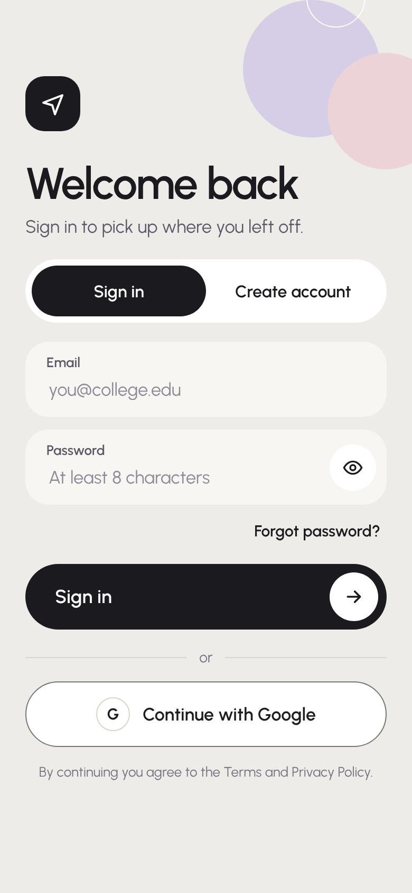 | 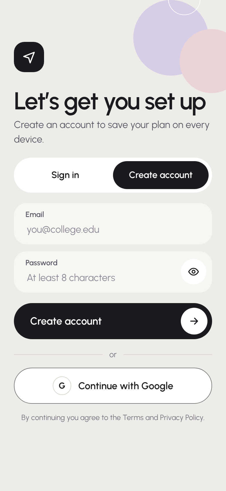 |

**Purpose:** email + password or Google sign-in.
**Layout:** decorative circles top-right (`login-corner-art.svg`); 52px black logo tile; title 42/600 ("Welcome back" / "Let's get you set up") + subtitle; segmented control (white pill, black sliding indicator) Sign in | Create account; Email field; Password field with 44px show/hide eye button; "Forgot password?" (sign-in only); black primary button ("Sign in" / "Create account"); "or" divider; **Continue with Google** button; terms line.
**Interactions:** segment switch swaps title, subtitle, CTA label, hides "Forgot password?"; eye toggles password visibility (aria-label "Show/Hide password"); submit → validate → Your details (new user) or Today (returning).
**Google button:** in production use **Google's official button** (Google Identity Services / Firebase UI). Allowed text: "Continue with Google". Light theme: white fill, `#747775` 1px border, the official full-colour G logo, Google Sans-style 14/20 label, at least as prominent as other options. The mockup uses a plain "G" placeholder — replace it.
**Animation:** fields rise in with 60 ms stagger; segment indicator slides (360 ms overshoot); focused field gets a 2px ink ring.
**Errors:** inline under the field in `#9A3B33` on `#FDE7E4` only for real errors (wrong password); never block typing.
**Done when:** both modes work with Firebase Auth (email/password + Google), keyboard and screen-reader accessible, password managers autofill (`autocomplete` set).

---

### 03 · Your details (step 1 of 3)

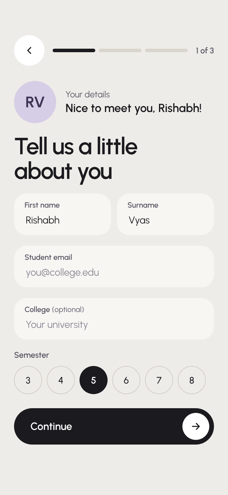

**Purpose:** student first name, surname, student email, college (optional), semester.
**Layout:** StepHeader (1 of 3); avatar circle (72px lavender) showing **live initials** ("Hi" when empty) + "Nice to meet you, {first}!"; title "Tell us a little about you"; First name + Surname side by side; Student email (prefilled from login); College (optional); Semester chips 3–8 (48px circles, selected = black); Continue.
**Interactions:** typing updates initials and greeting live; semester single-select; Continue → Admit card. Validate first name + email.
**Animation:** progress segment grows (600 ms); avatar pops on change; fields rise with stagger.
**Done when:** values persist to the profile; back returns to Login without losing input.

---

### 04 · Admit card upload (step 2 of 3)

| Idle | Scanning | Results |
|---|---|---|
| 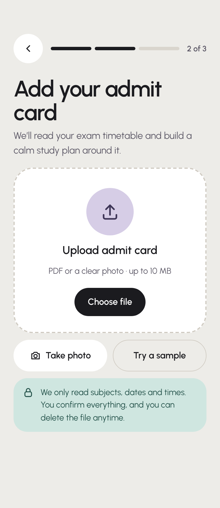 | 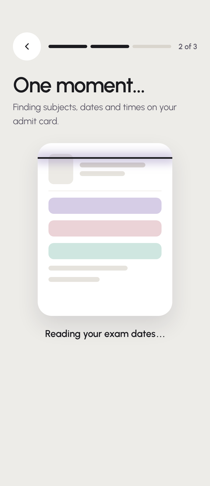 | 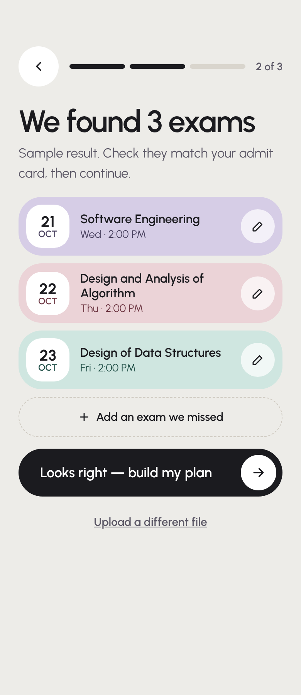 |

**Purpose:** read the hall ticket (PDF or photo) and pull out exams → build the calendar.
**Idle:** title "Add your admit card"; big dashed drop zone (white, 34 radius) with bobbing lavender upload badge, "Upload admit card", "PDF or a clear photo · up to 10 MB", black "Choose file"; row: "Take photo" (camera capture) + "Try a sample"; mint privacy note with lock icon.
**Scanning:** title "One moment…"; admit-card skeleton (`admit-card-skeleton.svg`) with pulsing rows and a glowing scan line sweeping up and down; "Reading your exam dates…" with blinking dots (`role="status"`).
**Results:** title "We found 3 exams"; one pill row per exam in its subject colour: white date tile (21 OCT), subject name, weekday + time, edit (pencil) button; dashed "Add an exam we missed"; primary "Looks right — build my plan"; text button "Upload a different file".
**Real pipeline (see `docs/backend-and-ai.md`):** 1) consent + age notice → 2) on-device `pdf.js` text extraction for text PDFs → 3) otherwise send image to the server proxy → Gemini Flash-Lite (paid key) with a JSON schema that **excludes name, photo, roll number** → 4) code validates DD/MM dates against printed weekday, time ranges, duplicates → 5) student reviews/edits (flag uncertain rows in heads-up amber, not red) → 6) save rows, **delete the file**. Output shape: `sample-data/admit-card-extraction-example.json`.
**Animation:** state changes fade up; result rows stagger 120 ms; upload badge bobs (2.4 s loop).
**Done when:** student can always edit/add/remove rows before saving; nothing is saved until confirm; failure shows a friendly retry ("We couldn't read that one. Try a clearer photo or add exams by hand.").

---

### 05 · Plan ready (step 3 of 3)

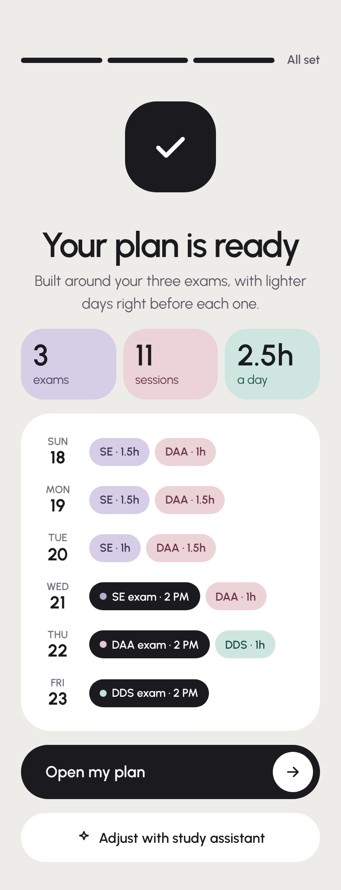

**Purpose:** celebrate and show the generated week.
**Layout:** completed 3-step bar + "All set"; burst of 14 coloured dots around a 104px black badge with a drawing tick (`success-badge.svg`); "Your plan is ready" + "Built around your three exams, with lighter days right before each one."; 3 stat tiles (3 exams / 11 sessions / 2.5h a day) in SE/DAA/DDS fills; white card listing Sun 18 → Fri 23 with chips per day — study chips in subject fill ("SE · 1.5h"), exam chips black with a coloured dot ("SE exam · 2 PM"); primary "Open my plan" → Today; white "Adjust with study assistant" → Assistant.
**Plan logic:** generated by the AI (`sample-data/ai-plan-example.json` shape) or a local heuristic: spread remaining topics across days, lighter load the evening before each exam, no new topics on exam day, regular bedtime.
**Animation:** burst (1.1 s) + badge pop + tick draw; header, tiles and day rows fade up in sequence (300 → 900 ms). Use `celebrate()` from `animations/examples/celebrate.ts`.
**Done when:** sessions written to the calendar; counts reflect real data.

---

### 06 · Today (tab 1)

| Default | All done |
|---|---|
| 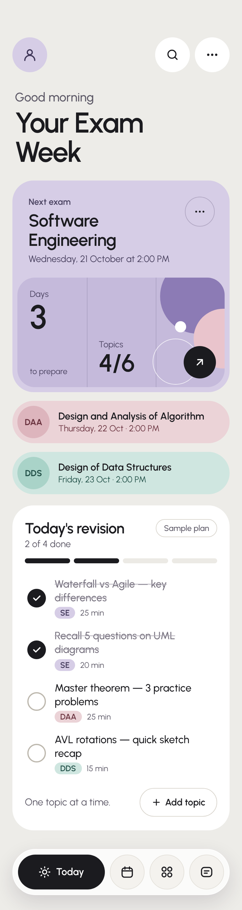 | 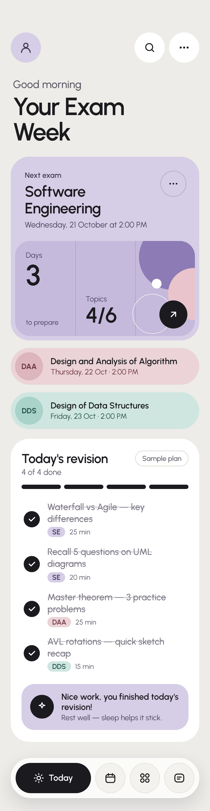 |

**Purpose:** next exam at a glance + a short daily checklist.
**Layout:** TopBar (avatar · search · more); eyebrow "Good morning" (time-based greeting) + "Your Exam Week"; **HeroCard** (lavender) — "Next exam", "Software Engineering", "Wednesday, 21 October at 2:00 PM", ⋯; panel stats **Days 3 · to prepare** | **Topics 4/6** + art + black ↗ (→ Subjects); **DAA** pink pill row and **DDS** mint pill row (→ Calendar); **Today's revision** card: title, "2 of 4 done", "Sample plan" outline chip, 4 segment progress, 3–5 tasks (checkbox + title + subject tag + minutes), footer "One topic at a time." + dashed "Add topic"; when all done the footer becomes a lavender card "Nice work, you finished today's revision! / Rest well — sleep helps it stick." with a sparkle badge.
**Countdown rules:** whole days only; ≥2 days → "{n} days to prepare"; 1 → "Tomorrow, 2:00 PM"; 0 → "Today, 2:00 PM — you've prepared for this." After an exam, the hero moves to the next exam.
**Interactions:** tap anywhere on a task row toggles it (aria-pressed); progress + count update; "Add topic" opens a quick-add sheet.
**Animation:** screen rises in; segments fill one by one; checkbox pop + tick draw + strike-through; completion card fades up + gentle confetti once.
**Done when:** ticks persist per day; header greeting follows local time; hero always shows the next upcoming exam.

---

### 07 · Calendar (tab 2)

| Today selected | Exam day selected |
|---|---|
| 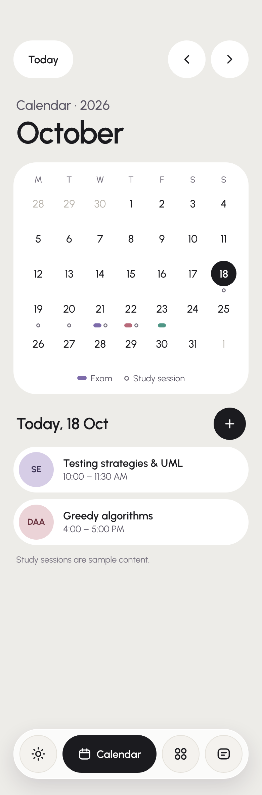 | 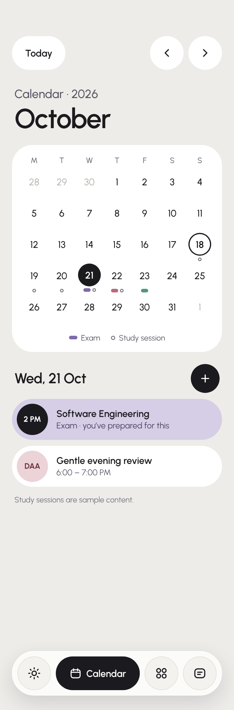 |

**Purpose:** exams and study sessions by day.
**Layout:** top row: white "Today" pill (left) + previous / next month circles (right); eyebrow "Calendar · 2026" + month name 46/600 (`aria-live`); white month card: M T W T F S S header, 7-col grid of 50px cells (number in 38px circle; selected = black fill white text; today = 2px ink ring; other-month days `#B5B0A8`), markers under each day (exam = 12×6 pill in subject mark colour; study = 6px hollow ring), legend "Exam / Study session"; selected-day section: "Today, 18 Oct" / "Wed, 21 Oct" + black ⊕ add-session button; event rows (exam = subject-fill pill with black 52px "2 PM" circle; study = white pill with subject circle); empty state dashed "Nothing planned. A free day is fine too."; note "Study sessions are sample content."
**Interactions:** prev/next month; tap a day to select (moves month if needed); Today resets; ⊕ opens add-session sheet (subject, date, start, end).
**Accessibility:** each day button has a full label ("Wednesday 21 October, exam"); arrow-key grid navigation recommended (WAI-ARIA grid pattern).
**Animation:** selected-day list fades up on change; press feedback on cells.

---

### 08 · Subjects (tab 3)

| SE selected | DAA selected |
|---|---|
| 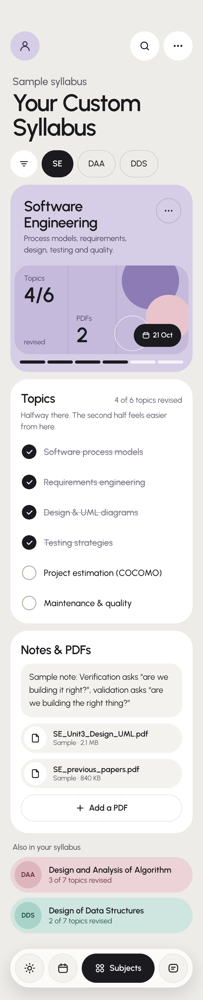 | 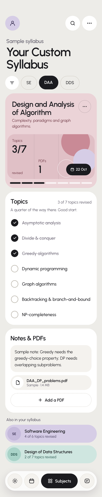 |

**Purpose:** syllabus progress, notes and PDFs per subject.
**Layout:** TopBar; eyebrow "Sample syllabus" + "Your Custom Syllabus"; filter circle + subject chips SE / DAA / DDS (active black); **HeroCard** in the subject's colour (title, description, panel stats Topics 3/7 · PDFs 1 · exam date pill "22 Oct", segmented topic progress); **Topics** card (count, milestone line, checkbox list); **Notes & PDFs** card (note box, PDF pill rows, dashed "Add a PDF"); "Also in your syllabus" — the other two subjects as pill rows (tap to switch).
**Milestones:** <25% "One topic at a time." · 25 "A quarter of the way there. Good start." · 50 "Halfway there…" · 75 "Three-quarters done…" · 100 "Everything revised. Now rest and let it settle."
**Interactions:** chip / row switches subject; topic tick updates hero segments, counts and milestone; PDF row → PDF reader; "Add a PDF" → file picker (stored on device in v1). Link from here to **Study materials** (e.g. "See all materials" on the Notes & PDFs card).
**Animation:** section fades up on subject change; checkbox pop/draw.

---

### 09 · Questions (tab 4)

| All | Filtered: DDS |
|---|---|
| 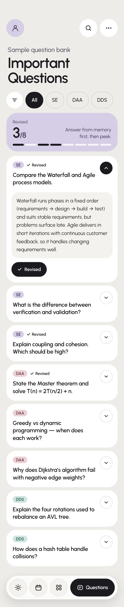 | 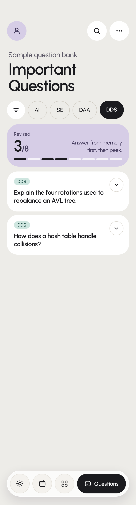 |

**Purpose:** important questions by subject with expandable answers.
**Layout:** TopBar; eyebrow "Sample question bank" + "Important Questions"; filter circle + chips All / SE / DAA / DDS (toggle buttons, `aria-pressed`); lavender progress card "Revised 4/8" + message + 8 segments; question cards (white, 30 radius): subject tag + "✓ Revised" marker, question 18/600, 40px chevron circle (black when open); open state shows answer in `#F4F2EE` box + "Mark as revised" outline pill / black "✓ Revised" pill.
**Accessibility:** each question is an `h2 > button[aria-expanded]` controlling its answer region (WAI-ARIA accordion).
**Animation:** answer height-auto 250 ms + fade; revised marker pops; segments fill.
**Done when:** filter + open + revised persist; messages: <4 "Answer from memory first, then peek." · ≥4 "Halfway! Each one makes the next easier." · 8 "All revised…"

---

### 10 · Study materials (from Subjects)

| List | Add sheet |
|---|---|
| 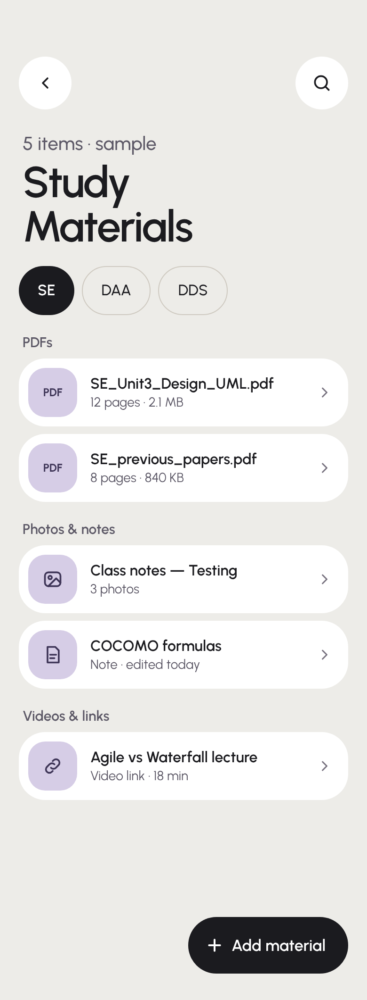 | 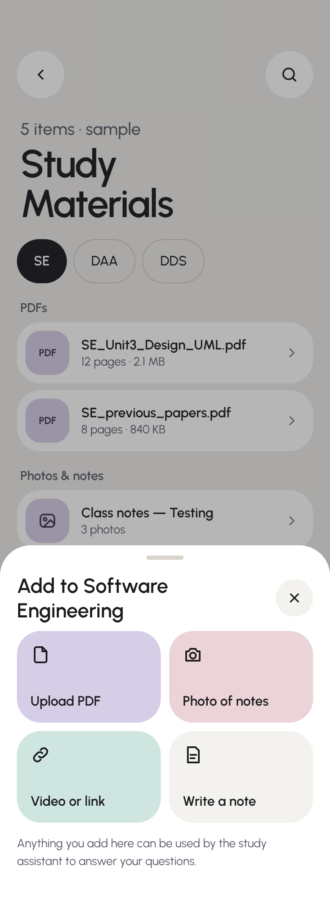 |

**Purpose:** everything a student collects per subject.
**Layout:** back + search circles; "{n} items · sample" + "Study Materials"; subject chips; groups **PDFs**, **Photos & notes**, **Videos & links** — white 28-radius rows with a 52px subject-tinted tile (PDF / image / link / note icon), name (ellipsis), meta, chevron; floating black "Add material" button (breathing shadow); bottom sheet "Add to {subject}" with 4 tiles: Upload PDF (lavender), Photo of notes (pink), Video or link (mint), Write a note (muted) + note "Anything you add here can be used by the study assistant…".
**Storage:** PDFs/images on device (IndexedDB web / file system Expo) in v1; never in localStorage. Metadata in the database.
**Animation:** groups stagger in; rows lift on hover; sheet springs up with scrim fade; tiles stagger 60 ms.

---

### 11 · Study assistant

| Plan + chart | Reply with source |
|---|---|
| 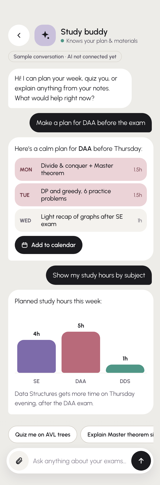 | 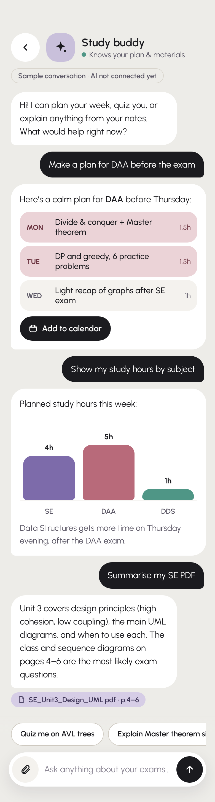 |

**Purpose:** AI study buddy that plans, explains, quizzes and charts, grounded in the student's plan and materials.
**Layout:** back + lavender sparkle avatar (gently rotating) + "Study buddy" + green dot "Knows your plan & materials"; outline note "Sample conversation · AI not connected yet" (remove when live); scrolling message list — assistant bubbles white (26/26/26/8 radius), user bubbles black (26/26/8/26); **plan card** (rows per day in subject fill with hours + "Add to calendar" → turns mint "Added to calendar"); **chart card** (bar chart hours per subject in mark colours, value labels, x labels, caption); **source chip** under answers that used a PDF ("SE_Unit3_Design_UML.pdf · p.4–6" → opens PDF reader at that page); suggestion chips row; input bar (attach · text · black send circle).
**AI contract:** the server returns either text or a structured block; render blocks by `type` — `study_plan`, `chart` (`sample-data/ai-plan-example.json`). Charts render with Recharts from the JSON.
**Animation:** messages slide/scale in (360 ms); typing indicator = 3 bouncing dots; chart bars grow with 120 ms stagger; list auto-scrolls smoothly to newest.
**Done when:** streaming text replies; plan/chart blocks validated server-side; per-student daily cap with a friendly message when reached; no API keys in the client.

---

### 12 · PDF reader

| Reading | Finished |
|---|---|
| 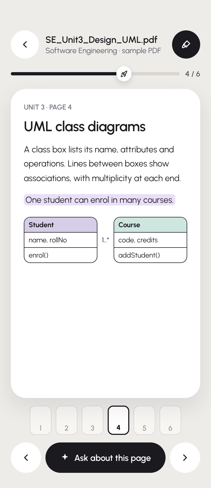 | 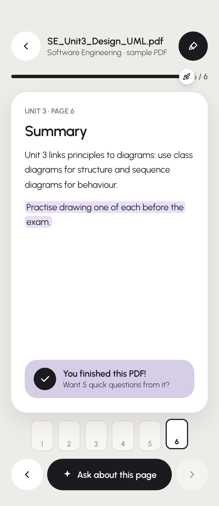 |

**Purpose:** read notes comfortably and make it a little fun.
**Layout:** back circle, file name + "Software Engineering · sample PDF", highlighter toggle (black when on); reading progress track with a white **rocket** knob that travels as you read + "4 / 6"; the page as a white 28-radius sheet with soft shadow (real PDF page via react-pdf); page thumbnails strip (current = 2px ink border); bottom bar: previous circle, black "✦ Ask about this page" (→ Assistant with page context), next circle.
**Finish state:** on the last page a lavender "You finished this PDF! / Want 5 quick questions from it?" card pops in with a small burst.
**Animation:** page turn slides 40px + 2° rotate in the reading direction (420 ms); rocket and fill glide (500 ms); highlight colour fades in; thumbnails lift on hover.
**Known fix:** at 100% the rocket overlaps the "6 / 6" label — clamp the knob inside the track (`left: min(pct, calc(100% - 14px))`).
**Done when:** large PDFs render lazily (only visible pages), highlights persist per page, progress is saved per file.

---

## 5. Motion summary

Full detail and code: `docs/motion.md`, `animations/`.

| Moment | Spec |
|---|---|
| Screen enter | fade + 10px rise, 360 ms `cubic-bezier(.2,.8,.2,1)`; exit 140 ms |
| Tab change | black pill slides between tabs (shared `layoutId`, spring 400/34); label slides in 120 ms later |
| Button | hover −1px; press scale 0.97 (spring 500/30) |
| Checkbox | pop 0.9→1.12→1 (260 ms) + tick draws (220 ms) + strike line grows |
| Progress | segments/bars fill with spring 300/30 or 600 ms smooth |
| Lists | children rise with 60 ms stagger |
| Sheet | spring up (380/36) + scrim fade 260 ms |
| Chat | bubbles 360 ms overshoot; typing dots |
| Celebration | one confetti burst (canvas-confetti, `disableForReducedMotion: true`) — checklist done, plan ready, PDF finished |
| Splash | ~1.9 s timeline (see screen 01) |

**Reduced motion:** wrap the app in `<MotionConfig reducedMotion="user">`; gate infinite loops (orbit, bob, scan, glow, breathing FAB), count-ups and confetti with `useReducedMotion()`.

---

## 6. Accessibility checklist
- Text contrast ≥ 4.5:1 (all token pairs verified; see `tokens.json → contrast`).
- Every icon-only button has `aria-label`; decorative SVGs `aria-hidden`.
- Toggles use `aria-pressed`; accordions `aria-expanded`; current tab `aria-current="page"`; live regions for "Reading your exam dates…" and month changes.
- Focus ring: 3px ink, 2px offset, never removed.
- Touch targets ≥ 44px; whole task rows are buttons.
- Colour never the only signal (subject codes, legend shapes, icons).
- Respect reduced motion (above).

---

## 7. Recommended stack (from research)
React + Vite + Tailwind v3 + Motion (`motion/react`) · Firebase Auth (email/password + Google) + Firestore (Spark plan) · PDFs on device first (IndexedDB) · react-pdf for the reader · Recharts for AI charts · canvas-confetti · AI via a Cloudflare Worker proxy → Gemini (paid tier with a low cap; Flash-Lite for chat, Flash for plans) with Groq as fallback. Details and risks: `docs/backend-and-ai.md`, `research/ai-and-backend-report.md`.

Build order with copy-paste prompts for Claude Code: `docs/build-plan.md`.
